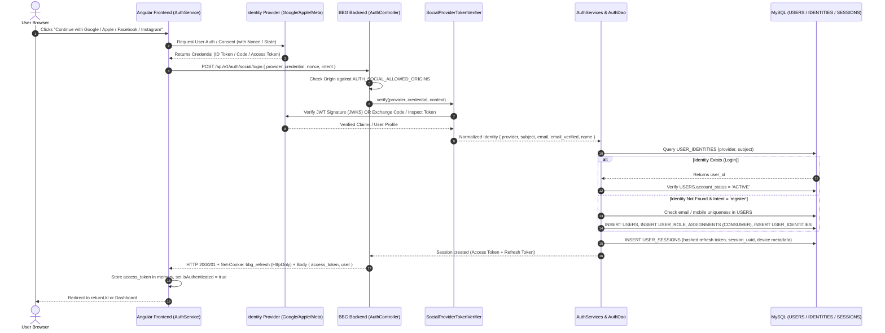

# BBG — OAuth 2.0 & Social Login Integration: Complete Technical Audit and Analysis

**Audit Report Identifier:** `BBG-AUDIT-AUTH-001`  
**Application:** BBG — Business Management & Marketplace Platform  
**Target Repository:** `dark-store`  
**Git Branch:** `feature/business-onboarding-from-workspace-base`  
**Working Tree Status:** Clean  
**Date of Audit:** 24 November 2026  
**Auditor:** Senior Solution Architect, OAuth 2.0 / OIDC Security Specialist, Angular Architect & Yii 3 Backend Architect  
**Classification:** Confidential / Technical Architecture Report  

---

## 1. Executive Summary

### 1.1 Scope & Context
This report provides an exhaustive, source-code-verified technical audit of the **OAuth 2.0 and Social Login** architecture across the BBG web frontend (Angular 22, TypeScript) and backend API (Yii 3, PHP 8.4, MySQL 8.4).

### 1.2 Overall Status
> **Overall Assessment: READY WITH IMPROVEMENTS (Configuration, UI Gaps & Test Coverage Blockers)**
> 
> The core backend identity mapping, cryptographic token verification, and session creation logic are architecturally mature, well-isolated, and secure. However, social login is currently inactive in runtime due to missing developer console credentials, lacks an account-linking settings interface in the personal dashboard, and has zero automated test coverage.

### 1.3 Key Findings Overview

1. **Provider Support:**
   - Four providers are implemented across frontend and backend: **Google**, **Facebook**, **Apple**, and **Instagram** (Professional/Creator accounts only).
   - **Microsoft**, **LinkedIn**, and **GitHub** are not implemented. (LinkedIn is mentioned only as a schema-compatible enum in architecture documentation).
2. **Current Operational State:**
   - Social login buttons on `/login` and `/register` are currently rendered in the UI but **disabled** (`[disabled]="true"`) because all provider client IDs and secrets in `.env` are empty strings.
   - The UI correctly displays: *"Social sign-in is not configured yet. You can continue with email or phone."*
3. **Backend Cryptographic & Server-Side Verification:**
   - The backend **never trusts client assertions**. Every provider credential is independently verified server-side via [`App\Utils\SocialProviderTokenVerifier`](file:///Users/apple/Documents/Development/dark-store/backend/src/Utils/SocialProviderTokenVerifier.php#L16).
   - **Google & Apple:** Validated via OpenID Connect (OIDC) JSON Web Tokens (JWT) fetched from official JWKS endpoints (`https://www.googleapis.com/oauth2/v3/certs` and `https://appleid.apple.com/auth/keys`), verifying `iss`, `aud`, `exp`, `iat`, `azp`, and cryptographic `nonce`.
   - **Facebook:** Validated via Meta Graph API `debug_token` inspection using server app credentials (`app_id|app_secret`), verifying application binding and expiration before querying `/me`.
   - **Instagram:** Server-to-server OAuth 2.0 Authorization Code exchange via `https://api.instagram.com/oauth/access_token` followed by identity confirmation on `graph.instagram.com/me`.
4. **Token & Credential Hygiene:**
   - **Zero provider tokens are stored:** Neither provider access tokens nor ID tokens are ever written to the database.
   - BBG stores only an immutable provider subject (`provider_subject`), provider code (`provider`), and optional email in `USER_IDENTITIES`.
   - Downstream session management reuses BBG's standard session engine: a random 64-character refresh token is generated, hashed with SHA-256 for storage in `USER_SESSIONS`, and delivered via a hardened `HttpOnly`, `SameSite=Lax` cookie. Access tokens are issued as short-lived (15-minute) HS256 JWTs kept in Angular memory.
5. **Account Linking & Account Takeover Prevention:**
   - **Strict isolation:** An incoming social identity whose email matches an existing BBG account **is never automatically linked**. Silent auto-linking is strictly prohibited, eliminating a common account-takeover vector. The user is required to sign in with their existing BBG password and link the provider explicitly via `POST /api/v1/auth/social/link`.
6. **Critical Gaps & Missing Capabilities:**
   - **No Account Linking / Unlinking UI:** While `POST /api/v1/auth/social/link` exists in the backend and `linkSocialProvider()` exists in `AuthService`, there is **no UI component** in the personal account dashboard allowing users to view, link, or unlink social providers.
   - **No Unlink Functionality:** Neither the backend nor the database supports unlinking a social provider (`USER_IDENTITIES` status transition to `'Z'` or record deletion).
   - **Zero Automated Tests:** There are no unit or integration tests for `SocialProviderTokenVerifier`, `manageSocialLogin`, `manageSocialLink`, or the Angular `SocialAuthCallback` component.
   - **External Dependencies:** Production activation requires registration and approval in Google Cloud Console, Meta for Developers (including Instagram Business Login and App Review), and Apple Developer Program (Services ID + private `.p8` key).

### 1.4 Top Recommended Next Actions
1. **Author Automated Unit/Integration Tests:** Create backend mocks for JWKS endpoints, Meta debug endpoints, and Instagram token exchanges to achieve automated CI coverage.
2. **Build Account Management UI:** Implement a *"Connected Accounts"* card within `PersonalAccountModule` allowing authenticated users to link and unlink their social providers.
3. **Implement Unlink Endpoint:** Add `POST /api/v1/auth/social/unlink` ensuring a user cannot unlink their sole authentication method if they have no password set.
4. **Configure External Developer Consoles:** Provision developer applications and populate `.env` credentials in staging/production environments.

---

## 2. Audit Scope & Methodology

### 2.1 Audit Scope
The audit covered all files and database structures related to authentication, OAuth 2.0, OpenID Connect, and social identity federation:
- **Backend Yii 3 API:**
  - Routes: [`backend/config/common/routes.php`](file:///Users/apple/Documents/Development/dark-store/backend/config/common/routes.php#L41-L43)
  - Controller: [`backend/src/Modules/Api/V1/Controllers/AuthController.php`](file:///Users/apple/Documents/Development/dark-store/backend/src/Modules/Api/V1/Controllers/AuthController.php)
  - Versioned Service: [`backend/src/Modules/Api/V1/Services/Implementations/AuthServicesV1.php`](file:///Users/apple/Documents/Development/dark-store/backend/src/Modules/Api/V1/Services/Implementations/AuthServicesV1.php)
  - Core Service: [`backend/src/Services/Implementations/AuthServices.php`](file:///Users/apple/Documents/Development/dark-store/backend/src/Services/Implementations/AuthServices.php)
  - Data Access Object: [`backend/src/Dao/AuthDao.php`](file:///Users/apple/Documents/Development/dark-store/backend/src/Dao/AuthDao.php)
  - Security Verifier: [`backend/src/Utils/SocialProviderTokenVerifier.php`](file:///Users/apple/Documents/Development/dark-store/backend/src/Utils/SocialProviderTokenVerifier.php)
  - Token Service: [`backend/src/Utils/AuthTokenService.php`](file:///Users/apple/Documents/Development/dark-store/backend/src/Utils/AuthTokenService.php)
  - Migrations: [`backend/database/migrations/20261113_002_social_identity_mapping.sql`](file:///Users/apple/Documents/Development/dark-store/backend/database/migrations/20261113_002_social_identity_mapping.sql)
- **Frontend Angular 22:**
  - Core Service: [`frontend/src/app/core/auth/auth.service.ts`](file:///Users/apple/Documents/Development/dark-store/frontend/src/app/core/auth/auth.service.ts)
  - Data Models: [`frontend/src/app/core/auth/auth.models.ts`](file:///Users/apple/Documents/Development/dark-store/frontend/src/app/core/auth/auth.models.ts)
  - Shared Auth Component: [`frontend/src/app/shared/auth-experience/auth-experience.ts`](file:///Users/apple/Documents/Development/dark-store/frontend/src/app/shared/auth-experience/auth-experience.ts)
  - Login Page: [`frontend/src/app/features/auth/pages/login/login.ts`](file:///Users/apple/Documents/Development/dark-store/frontend/src/app/features/auth/pages/login/login.ts)
  - Registration Page: [`frontend/src/app/features/auth/pages/register/register.ts`](file:///Users/apple/Documents/Development/dark-store/frontend/src/app/features/auth/pages/register/register.ts)
  - Callback Page: [`frontend/src/app/features/auth/pages/social-callback/social-callback.ts`](file:///Users/apple/Documents/Development/dark-store/frontend/src/app/features/auth/pages/social-callback/social-callback.ts)
  - App Routing: [`frontend/src/app/app.routes.ts`](file:///Users/apple/Documents/Development/dark-store/frontend/src/app/app.routes.ts#L43)
- **Database Schema & SQL Migrations:**
  - `USERS`, `USER_IDENTITIES`, `USER_SESSIONS`, `USER_ROLE_ASSIGNMENTS`, `ROLES` definitions in `bbg_schema.sql`.

### 2.2 Methodology
- **Static Code Analysis:** Line-by-line inspection of token verification algorithms, signature validation, claim parsing, error handling paths, and session state establishment.
- **Protocol Conformance Review:** Verification against RFC 6749 (OAuth 2.0), OpenID Connect Core 1.0, RFC 7519 (JWT), and OWASP Application Security Verification Standard (ASVS v4.0).
- **Execution & Test Verification:** Execution of existing backend Unit test suites (`codecept run Unit`) and frontend Vitest suites (`ng test`).

---

## 3. Provider Discovery & Comparison

### 3.1 Discovered Providers

| Provider Code | Marketing Name | Protocol Used | Frontend SDK / Flow | Backend Verifier Method | DB Mapping | Implementation Status |
|---|---|---|---|---|---|---|
| `GOOGLE` | Google Sign-In | OpenID Connect (ID Token) | Google Identity Services (`gsi/client`) | `verifyGoogle()` via Google JWKS | `USER_IDENTITIES` | **Code Complete / Unconfigured** |
| `FACEBOOK` | Facebook Login | OAuth 2.0 (User Access Token) | Meta JS SDK (`sdk.js` v27.0) | `verifyFacebook()` via Meta Graph `/debug_token` | `USER_IDENTITIES` | **Code Complete / Unconfigured** |
| `INSTAGRAM` | Instagram Login (Business/Creator) | OAuth 2.0 (Authorization Code Grant) | Full-page redirect to `instagram.com/oauth/authorize` | `verifyInstagram()` via code exchange on `api.instagram.com` | `USER_IDENTITIES` | **Code Complete / Unconfigured** |
| `APPLE` | Sign in with Apple | Hybrid (Auth Code + OIDC ID Token) | AppleID JS (`appleid.auth.js`) | `verifyApple()` via ES256 JWT Client Secret + Apple JWKS | `USER_IDENTITIES` | **Code Complete / Unconfigured** |
| `LINKEDIN` | LinkedIn | N/A | None | None | Mentioned in amendment doc only | **Not Implemented** |
| `MICROSOFT` | Microsoft Account | N/A | None | None | None | **Not Implemented** |
| `GITHUB` | GitHub | N/A | None | None | None | **Not Implemented** |

---

## 4. BBG Authentication Architecture Overview

BBG uses a hybrid authentication model:
1. **Public Identity Configuration:** Frontend queries `GET /api/v1/auth/social/config` to discover which third-party providers are active.
2. **Third-Party Authentication:** The user authenticates with the chosen provider (via client popup, prompt, or full-page redirect).
3. **Provider Proof Submission:** The frontend sends the resulting credential (JWT ID token, User Access Token, or Authorization Code) along with cryptographic parameters (`nonce`, `redirect_uri`, `intent`) to the BBG backend endpoint `POST /api/v1/auth/social/login`.
4. **Server-Side Cryptographic Verification:** The backend verifies the credential directly with the provider (using JWKS public keys or server-to-server Graph API calls).
5. **BBG Identity Resolution:**
   - If `(provider, provider_subject)` exists in `USER_IDENTITIES`, loads existing active user.
   - If not found and `intent === 'register'`, creates an active row in `USERS`, assigns platform `CONSUMER` role, and links identity in `USER_IDENTITIES` atomically.
   - If not found and `intent === 'login'`, fails with clear error asking user to register.
   - If email matches an existing account during registration, refuses creation to prevent duplicates and prevent silent account takeover.
6. **BBG Session Issuance:**
   - Generates a UUID session and UUID token family.
   - Generates random refresh token, stores SHA-256 hash in `USER_SESSIONS`.
   - Generates signed HS256 JWT access token (15-min TTL) with claims `sub` (user_id) and `sid` (session_uuid).
   - Sets `bbg_refresh` cookie (`HttpOnly`, `Path=/api/v1/auth`, `SameSite=Lax`).
   - Returns access token and user payload in JSON response body.



---

## 5. OAuth 2.0 vs. OpenID Connect in BBG

BBG's implementation intentionally differentiates between authentication protocols based on provider capabilities:

### 5.1 OpenID Connect (OIDC) — Google & Apple
- **Protocol Purpose:** Authentication (verifying *who* the user is).
- **Artifact:** Cryptographically signed Identity Token (`id_token` JWT).
- **Verification:** BBG decodes the token header, fetches the provider's JSON Web Key Set (JWKS), verifies RSA/ECDSA signatures, verifies the token was issued to BBG (`aud` = client_id), checks expiration, and validates that `nonce` matches the client-initiated request.
- **Evidence:** [`backend/src/Utils/SocialProviderTokenVerifier.php:43-56`](file:///Users/apple/Documents/Development/dark-store/backend/src/Utils/SocialProviderTokenVerifier.php#L43-L56) and [`lines 94-100`](file:///Users/apple/Documents/Development/dark-store/backend/src/Utils/SocialProviderTokenVerifier.php#L94-L100).

### 5.2 OAuth 2.0 Bearer Token with Introspection — Facebook
- **Protocol Purpose:** Delegated authorization used for identity assertion.
- **Artifact:** User Access Token (short-lived opaque/signed string).
- **Verification:** Because access tokens cannot be verified offline, BBG calls the Meta Graph API `/debug_token` endpoint using its server `app_id|app_secret`. It validates that `is_valid === true`, `app_id === AUTH_FACEBOOK_APP_ID`, and expiration is valid before querying `/me`.
- **Evidence:** [`backend/src/Utils/SocialProviderTokenVerifier.php:205-222`](file:///Users/apple/Documents/Development/dark-store/backend/src/Utils/SocialProviderTokenVerifier.php#L205-L222).

### 5.3 OAuth 2.0 Authorization Code Grant — Instagram & Apple
- **Protocol Purpose:** Delegated authorization with server-side secret exchange.
- **Artifact:** Short-lived single-use authorization code (`code`).
- **Verification:** The client passes `code` to BBG backend. The backend executes a direct server-to-server POST request to the provider token endpoint (`api.instagram.com/oauth/access_token` or `appleid.apple.com/auth/token`) using confidential client secrets that are never exposed to browser clients.
- **Evidence:** [`backend/src/Utils/SocialProviderTokenVerifier.php:176-186`](file:///Users/apple/Documents/Development/dark-store/backend/src/Utils/SocialProviderTokenVerifier.php#L176-L186).

---

## 6. Provider-by-Provider Technical Analysis

### 6.1 Google Sign-In (`GOOGLE`)
- **Frontend Method:** [`AuthService.authenticateGoogle()`](file:///Users/apple/Documents/Development/dark-store/frontend/src/app/core/auth/auth.service.ts#L338-L382). Dynamically injects `https://accounts.google.com/gsi/client`. Uses `window.google.accounts.id.initialize({ client_id, nonce, callback })` and `google.accounts.id.prompt()`.
- **Backend Method:** [`SocialProviderTokenVerifier.verifyGoogle()`](file:///Users/apple/Documents/Development/dark-store/backend/src/Utils/SocialProviderTokenVerifier.php#L37-L66).
- **Cryptographic Validation:**
  - Decodes token with JWKS from `https://www.googleapis.com/oauth2/v3/certs`.
  - Checks issuer: `https://accounts.google.com` or `accounts.google.com`.
  - Checks audience: matches `AUTH_GOOGLE_CLIENT_ID`.
  - Checks nonce: `hash_equals($nonce, $claims->nonce)`.
  - Email authoritativeness check:
    ```php
    $googleIsAuthoritative = str_ends_with($email, '@gmail.com') || trim((string) ($claims->hd ?? '')) !== '';
    $emailVerified = $providerVerified && $googleIsAuthoritative;
    ```
    *Architectural Significance:* Only `@gmail.com` addresses or Google Workspace domains (attested by the `hd` hosted-domain claim) are marked `email_verified = true`. If a Google account is registered with an external unverified third-party email, BBG does not treat it as verified.

### 6.2 Sign in with Apple (`APPLE`)
- **Frontend Method:** [`AuthService.authenticateApple()`](file:///Users/apple/Documents/Development/dark-store/frontend/src/app/core/auth/auth.service.ts#L413-L447). Loads `https://appleid.cdn-apple.com/appleauth/static/jsapi/appleid/1/en_US/appleid.auth.js`. Calls `AppleID.auth.init({ clientId, scope: 'name email', redirectURI, nonce, usePopup: true })` and `AppleID.auth.signIn()`.
- **Backend Method:** [`SocialProviderTokenVerifier.verifyApple()`](file:///Users/apple/Documents/Development/dark-store/backend/src/Utils/SocialProviderTokenVerifier.php#L68-L131).
- **Client Secret Generation:** Generates dynamic ES256 JWT client secret on the fly:
  - Header: `alg=ES256`, `kid=AUTH_APPLE_KEY_ID`
  - Claims: `iss=AUTH_APPLE_TEAM_ID`, `sub=AUTH_APPLE_CLIENT_ID`, `aud=https://appleid.apple.com`, `exp=time() + 300`
  - Signed with private `.p8` key (`AUTH_APPLE_PRIVATE_KEY`).
- **Cryptographic Validation:**
  - POSTs authorization code to `https://appleid.apple.com/auth/token`.
  - Validates returned `id_token` against `https://appleid.apple.com/auth/keys`.
  - Validates nonce: accepts either raw nonce or `hash('sha256', $nonce)`.

### 6.3 Facebook Login (`FACEBOOK`)
- **Frontend Method:** [`AuthService.authenticateFacebook()`](file:///Users/apple/Documents/Development/dark-store/frontend/src/app/core/auth/auth.service.ts#L384-L411). Loads `https://connect.facebook.net/en_US/sdk.js`. Calls `window.FB.init({ appId, version: 'v27.0' })` and `FB.login(callback, { scope: 'email,public_profile' })`.
- **Backend Method:** [`SocialProviderTokenVerifier.verifyFacebook()`](file:///Users/apple/Documents/Development/dark-store/backend/src/Utils/SocialProviderTokenVerifier.php#L133-L163).
- **Token Inspection:**
  - Calls `graph.facebook.com/v27.0/debug_token?input_token={token}&access_token={app_id}|{app_secret}`.
  - Verifies `app_id` matches and token is not expired.
  - Calls `graph.facebook.com/v27.0/me?fields=id,name,email,picture.type(large)`.
  - Always marks `email_verified = false` because Facebook does not guarantee real-time email verification.

### 6.4 Instagram Login (`INSTAGRAM`)
- **Frontend Method:** [`AuthService.startInstagramLogin()`](file:///Users/apple/Documents/Development/dark-store/frontend/src/app/core/auth/auth.service.ts#L449-L470).
  - Creates 32-byte hex nonce stored in `sessionStorage.bbg_instagram_state`.
  - Stores registration context (`intent`, `full_name`, `email`, `mobile`) in `sessionStorage`.
  - Redirects browser to `https://www.instagram.com/oauth/authorize?client_id={appId}&redirect_uri={origin}/auth/social/callback&scope=instagram_business_basic&response_type=code&state={state}`.
- **Frontend Callback:** [`SocialAuthCallback`](file:///Users/apple/Documents/Development/dark-store/frontend/src/app/features/auth/pages/social-callback/social-callback.ts) route `/auth/social/callback`.
  - Reads `code`, `state`, and error params from URL.
  - Compares `state` against `sessionStorage.bbg_instagram_state`.
  - Invokes `completeInstagramLogin(code, state)`.
- **Backend Method:** [`SocialProviderTokenVerifier.verifyInstagram()`](file:///Users/apple/Documents/Development/dark-store/backend/src/Utils/SocialProviderTokenVerifier.php#L165-L203).
  - POSTs authorization code to `https://api.instagram.com/oauth/access_token` with `client_id`, `client_secret`, and `redirect_uri`.
  - Calls `https://graph.instagram.com/me?fields=user_id,username&access_token={token}`.
  - *Business Constraint:* Supports Instagram Business and Creator accounts only. Instagram Basic Display does not provide user email; first-time registration requires the user to input contact details on the form.

---

## 7. Frontend Angular Architecture Analysis

### 7.1 Source File Inventory & Responsibilities

| File Path | Architecture Role | Key Responsibilities | Audit Findings & Quality Observations |
|---|---|---|---|
| [`frontend/src/app/core/auth/auth.service.ts`](file:///Users/apple/Documents/Development/dark-store/frontend/src/app/core/auth/auth.service.ts) | Core Authentication Service | Provider initialization, SDK script injection, credential normalization, API communication, token storage | Well-structured Angular signal-based service. Dynamically injects provider SDKs with script deduplication. Stores access token in memory (`accessTokenState`). Sets `withCredentials: true` for refresh cookies. |
| [`frontend/src/app/core/auth/auth.models.ts`](file:///Users/apple/Documents/Development/dark-store/frontend/src/app/core/auth/auth.models.ts) | Data Models & Contracts | Types `SocialProvider`, `SocialAuthConfig`, `SocialAuthIntent`, `AuthUser` | Clean TypeScript definitions strictly matching backend `$resArr['data']` payload contracts. |
| [`frontend/src/app/shared/auth-experience/auth-experience.ts`](file:///Users/apple/Documents/Development/dark-store/frontend/src/app/shared/auth-experience/auth-experience.ts) | Base Auth Controller Component | Manages login/register form states, social button clicks, validation, returnUrl routing | Provides reusable base class for `Login` and `Register`. Automatically loads social configuration on init. Disables buttons if provider is not enabled. |
| [`frontend/src/app/features/auth/pages/login/login.ts`](file:///Users/apple/Documents/Development/dark-store/frontend/src/app/features/auth/pages/login/login.ts) | Login Route Page | Extends `AuthExperienceComponent`, binds template | Clean subclass. Sets mode to `'login'`. |
| [`frontend/src/app/features/auth/pages/register/register.ts`](file:///Users/apple/Documents/Development/dark-store/frontend/src/app/features/auth/pages/register/register.ts) | Registration Route Page | Extends `AuthExperienceComponent`, binds template | Sets mode to `'register'`. Enforces email/mobile contact requirement for Instagram registration. |
| [`frontend/src/app/features/auth/pages/social-callback/social-callback.ts`](file:///Users/apple/Documents/Development/dark-store/frontend/src/app/features/auth/pages/social-callback/social-callback.ts) | Social Callback Route Page | Handles redirect landings on `/auth/social/callback` | Validates `state` parameter against `sessionStorage`. Currently implemented **strictly for Instagram**. If Apple were to redirect here, it would be rejected as invalid state. |
| [`frontend/src/app/app.routes.ts`](file:///Users/apple/Documents/Development/dark-store/frontend/src/app/app.routes.ts#L43) | Application Routing | Declares public auth routes | Routes `/login`, `/register`, and `/auth/social/callback` registered as public lazy-loaded components. |

### 7.2 Frontend Evaluation Against Requirements
1. **Dynamic Provider Configuration:** Correctly environment-driven via `/api/v1/auth/social/config`. No hardcoded client IDs in frontend code.
2. **Duplicate Request Prevention:** Buttons check `[disabled]="busy() || !providerEnabled(...)"`. Multiple rapid clicks are prevented.
3. **Return URL Validation:**
   ```ts
   const returnUrl = this.route.snapshot.queryParamMap.get('returnUrl');
   await this.router.navigateByUrl(
     returnUrl && returnUrl.startsWith('/') && !returnUrl.startsWith('//') ? returnUrl : '/',
   );
   ```
   *Security Note:* Prevents basic protocol-relative open redirects (`//evil.com`), but does not canonicalize backslash variations (`/\evil.com`) or percent-encoded sequences.

---

## 8. Backend Yii 3 Seven-Layer Architecture Analysis

The backend social authentication strictly adheres to the established BBG seven-layer architectural pattern:

```
[Layer 1: InDto]          AuthInDto ($authParam)
      ↓
[Layer 2: Controller]     AuthController (actionManageAuth, actionSocialConfig, Origin check, CSRF check)
      ↓
[Layer 3: Versioned Svc]  AuthServicesV1 (Input mapping & delegation)
      ↓
[Layer 4: Core Services]  AuthServices (manageSocialLogin, manageSocialLink, createSession)
      ↓
[Layer 5: DAO]            AuthDao (getUserIdentity, insertSocialUser, insertUserIdentity, assignConsumerRole)
      ↓
[Layer 6: Model / DB]     USERS, USER_IDENTITIES, USER_SESSIONS, USER_ROLE_ASSIGNMENTS, ROLES
      ↓
[Layer 7: Utils]          SocialProviderTokenVerifier, AuthTokenService
```

### 8.1 Seven-Layer Verification & Evidence

1. **Layer 1 — InDto:**  
   `App\Modules\Api\V1\Dto\In\AuthInDto` captures `public array $authParam = []`. Validated via `InDtoObjectFactory`.
2. **Layer 2 — Controller:**  
   [`AuthController.php`](file:///Users/apple/Documents/Development/dark-store/backend/src/Modules/Api/V1/Controllers/AuthController.php#L54-L78):
   - Enforces origin allowlist:
     ```php
     $origin = $request->getHeaderLine('Origin');
     $allowedOrigins = array_values(array_filter(array_map('trim', explode(',', (string) getenv('AUTH_SOCIAL_ALLOWED_ORIGINS')))));
     if ($origin === '' || !in_array($origin, $allowedOrigins, true)) {
         return $this->respond(['status' => 'FAILED', 'msgArr' => ['Social authentication origin is not allowed.']]);
     }
     ```
   - For `socialLink`, enforces `X-BBG-CSRF: 1` header.
   - Extracts IP address (`REMOTE_ADDR`) and `User-Agent`.
3. **Layer 3 — Versioned Services:**  
   [`AuthServicesV1.php`](file:///Users/apple/Documents/Development/dark-store/backend/src/Modules/Api/V1/Services/Implementations/AuthServicesV1.php#L30-L41) wraps `AuthInDto` and calls Core Services `manageAuth()`.
4. **Layer 4 — Core Services:**  
   [`AuthServices.php`](file:///Users/apple/Documents/Development/dark-store/backend/src/Services/Implementations/AuthServices.php#L224-L410):
   - Executes `manageSocialLogin()` and `manageSocialLink()`.
   - Coordinates cryptographic validation via `SocialProviderTokenVerifier`.
   - Manages DB transaction spanning user creation, role assignment, and identity linking.
   - Reuses `createSession()` to guarantee identical session and refresh token behavior.
5. **Layer 5 — DAO:**  
   [`AuthDao.php`](file:///Users/apple/Documents/Development/dark-store/backend/src/Dao/AuthDao.php#L480-L567):
   - Uses strict parameterized SQL.
   - `getUserIdentity()` queries by `(provider, provider_subject)`.
   - `insertSocialUser()` sets `account_status = 'ACTIVE'` and conditional `email_verified_on`.
   - `insertUserIdentity()` inserts provider subject mapping.
   - `assignConsumerRole()` ensures the platform `CONSUMER` role is assigned.
6. **Layer 6 — Model / DB:**  
   Physical MySQL tables: `USERS`, `USER_IDENTITIES`, `USER_SESSIONS`, `USER_ROLE_ASSIGNMENTS`.
7. **Layer 7 — Utils:**  
   `SocialProviderTokenVerifier` (cURL, JWKS parsing, Firebase JWT) and `AuthTokenService` (HS256 access tokens, SHA-256 refresh hashing).

---

## 9. Database Integration & Schema Analysis

### 9.1 Table Mapping Matrix

| Table Name | Purpose in Social Auth | Relevant Columns | Key Constraints & Indexes | Evidence |
|---|---|---|---|---|
| `USER_IDENTITIES` | Maps BBG user to external provider subject | `id`, `user_id`, `provider`, `provider_subject`, `provider_email`, `linked_on`, `status` | `PRIMARY KEY (id)`, `UNIQUE KEY (provider, provider_subject)`, `KEY (user_id)`, `KEY (status)` | [`bbg_schema.sql:2152-2172`](file:///Users/apple/Documents/Development/dark-store/bbg_schema.sql#L2152-L2172) |
| `USERS` | Primary BBG account record | `id`, `full_name`, `email`, `mobile`, `password_hash`, `profile_image`, `email_verified_on`, `account_status`, `status` | `PRIMARY KEY (id)`, Foreign keys to self (`created_by`, `updated_by`) | [`bbg_schema.sql:2126-2147`](file:///Users/apple/Documents/Development/dark-store/bbg_schema.sql#L2126-L2147) |
| `USER_SESSIONS` | Active session and refresh token family | `id`, `user_id`, `session_uuid`, `refresh_token_hash`, `token_family_id`, `device_name`, `ip_address`, `user_agent`, `issued_on`, `expires_on`, `revoked_on`, `replaced_by_session_id`, `status` | `PRIMARY KEY (id)`, `KEY (token_family_id)`, `KEY (user_id)` | [`bbg_schema.sql:2208-2235`](file:///Users/apple/Documents/Development/dark-store/bbg_schema.sql#L2208-L2235) |
| `USER_ROLE_ASSIGNMENTS` | Grants initial platform authorization | `id`, `user_id`, `role_id`, `tenant_id`, `assigned_on`, `status` | `PRIMARY KEY (id)`, `KEY (user_id)`, `KEY (role_id)` | [`bbg_schema.sql:2177-2203`](file:///Users/apple/Documents/Development/dark-store/bbg_schema.sql#L2177-L2203) |
| `ROLES` | Role definitions | `id`, `role_code`, `scope_type`, `status` | `role_code = 'CONSUMER'`, `scope_type = 'PLATFORM'` | [`AuthDao.php:240-244`](file:///Users/apple/Documents/Development/dark-store/backend/src/Dao/AuthDao.php#L240-L244) |

### 9.2 Key Schema Observations
1. **Immutable External Key:** `provider_subject` is stored as `VARCHAR(190)` with `utf8mb4_bin` collation, ensuring case-sensitive binary matching of provider IDs (crucial for Google numerical IDs, Facebook scoped IDs, and Apple alphanumeric sub claims).
2. **Nullable Password:** `password_hash` in `USERS` is explicitly `DEFAULT NULL`. Social-only registered users do not have a dummy password set; they authenticate solely via social login or can subsequently set a password via `/api/v1/auth/password/update`.
3. **No Provider Secrets/Tokens in DB:** There are zero columns for provider access tokens, provider refresh tokens, or provider ID tokens. BBG stores no third-party credential data.

---

## 10. Security Audit & Controls Evaluation

### 10.1 OAuth Protocol Security

| Security Control | Implementation Mechanism | Assessment | Finding / Evidence |
|---|---|---|---|
| **CSRF Protection (Callbacks)** | Client generates random 32-byte hex nonce stored in `sessionStorage`; checked on callback return. | **PASS** | [`auth.service.ts:454-468`](file:///Users/apple/Documents/Development/dark-store/frontend/src/app/core/auth/auth.service.ts#L454-L468) and [`social-callback.ts:27-38`](file:///Users/apple/Documents/Development/dark-store/frontend/src/app/features/auth/pages/social-callback/social-callback.ts#L27-L38). |
| **Origin Allowlist Check** | Backend inspects `Origin` header against `AUTH_SOCIAL_ALLOWED_ORIGINS`. | **PASS** | [`AuthController.php:54-68`](file:///Users/apple/Documents/Development/dark-store/backend/src/Modules/Api/V1/Controllers/AuthController.php#L54-L68). Fails closed if header is missing or disallowed. |
| **Same-Origin CSRF Header** | `X-BBG-CSRF: 1` required for `socialLink`. | **PASS** | [`AuthController.php:69-77`](file:///Users/apple/Documents/Development/dark-store/backend/src/Modules/Api/V1/Controllers/AuthController.php#L69-L77). |
| **PKCE (RFC 7636)** | Proof Key for Code Exchange. | **NOT IMPLEMENTED** | Instagram and Apple code flows do not use PKCE `code_challenge` / `code_verifier`. Instead, they rely on confidential client secret exchange on the backend. |
| **Open Redirect Prevention** | Verifies `returnUrl.startsWith('/') && !returnUrl.startsWith('//')`. | **PARTIAL** | Basic protection against `//evil.com`, but lacks complete path sanitization against malformed relative paths. |

### 10.2 OpenID Connect (OIDC) Security

| Security Control | Implementation Mechanism | Assessment | Finding / Evidence |
|---|---|---|---|
| **JWKS Signature Validation** | `Firebase\JWT\JWT::decode($token, JWK::parseKeySet($jwks))` | **PASS** | Verifies RSA/ECDSA signatures against live provider keys. |
| **Issuer (`iss`) Validation** | Google: `['https://accounts.google.com', 'accounts.google.com']`. Apple: `['https://appleid.apple.com']`. | **PASS** | [`SocialProviderTokenVerifier.php:44, 95`](file:///Users/apple/Documents/Development/dark-store/backend/src/Utils/SocialProviderTokenVerifier.php#L44). |
| **Audience (`aud`) Validation** | Strictly compared against `AUTH_GOOGLE_CLIENT_ID` / `AUTH_APPLE_CLIENT_ID`. | **PASS** | [`SocialProviderTokenVerifier.php:240`](file:///Users/apple/Documents/Development/dark-store/backend/src/Utils/SocialProviderTokenVerifier.php#L240). Rejects tokens intended for other apps. |
| **Authorized Party (`azp`)** | If multiple audiences exist, asserts `azp === client_id`. | **PASS** | [`SocialProviderTokenVerifier.php:241`](file:///Users/apple/Documents/Development/dark-store/backend/src/Utils/SocialProviderTokenVerifier.php#L241). |
| **Expiration & Clock Skew** | Asserts `exp > time()` and `iat <= time() + 60` (allowing 60s clock skew). | **PASS** | [`SocialProviderTokenVerifier.php:242-243`](file:///Users/apple/Documents/Development/dark-store/backend/src/Utils/SocialProviderTokenVerifier.php#L242-L243). |
| **Nonce Validation** | Strict cryptographic string equality via `hash_equals()`. | **PASS** | Google matches raw nonce; Apple matches raw or sha256 nonce. |

### 10.3 Account Security & Takeover Prevention

| Scenario | Handled? | Mechanism | Impact / Analysis |
|---|---|---|---|
| **Email Collision on Social Register** | **YES** | If provider returns an email already registered in BBG, registration is rejected: *"A BBG account already uses this email or mobile. Sign in to that existing BBG account instead of creating a duplicate."* | **Critical Security Feature:** Completely prevents pre-account takeover attacks where an attacker registers a social account with a victim's email to hijack an existing account. |
| **Silent Auto-Linking** | **NO (Prevented)** | External identities are **never** auto-linked by email. | User must sign in to the existing BBG account using password or existing provider and explicitly execute `socialLink`. |
| **Unverified Email Handling** | **YES** | Only authoritative emails (Google `@gmail.com` or Workspace domain) set `email_verified_on`. Facebook, Instagram, and unverified Apple emails leave `email_verified_on = NULL`. | Prevents unverified email spoofing. |
| **Cross-Account Identity Stealing** | **YES** | `socialLink` checks `getUserIdentity()`. If the provider subject is already linked to another `user_id`, request is rejected with HTTP 400. | An external account cannot be attached to multiple BBG accounts. |

---

## 11. Authentication Consistency: Social vs. Password Login

BBG enforces identical authentication, authorization, and session policies regardless of whether the user signs in with a password or a social identity:

| Feature / Behavior | Password Authentication | Social Authentication | Consistent? | Evidence |
|---|---|---|---|---|
| **User Status Check** | Requires `account_status = 'ACTIVE'` and `status = 'A'` | Requires `account_status = 'ACTIVE'` and `status = 'A'` | **YES** | [`AuthServices.php:262`](file:///Users/apple/Documents/Development/dark-store/backend/src/Services/Implementations/AuthServices.php#L262) |
| **Role Assignment** | Assigns `CONSUMER` role | Assigns `CONSUMER` role | **YES** | [`AuthServices.php:308`](file:///Users/apple/Documents/Development/dark-store/backend/src/Services/Implementations/AuthServices.php#L308) |
| **Session Generation** | `createSession()` | `createSession()` | **YES** | [`AuthServices.php:339`](file:///Users/apple/Documents/Development/dark-store/backend/src/Services/Implementations/AuthServices.php#L339) |
| **Access Token Issuance** | HS256 JWT, 15m TTL | HS256 JWT, 15m TTL | **YES** | Identical payload (`sub`, `sid`, `exp`, `iat`) |
| **Refresh Token Rotation** | SHA-256 hashed, HttpOnly cookie | SHA-256 hashed, HttpOnly cookie | **YES** | Token family tracking identical |
| **Remote Session Revocation** | Supported (BBG-REQ-002) | Supported (BBG-REQ-002) | **YES** | Appears in active sessions list |
| **Logout & Invalidation** | Revokes session family & clears cookie | Revokes session family & clears cookie | **YES** | Identical logout flow |
| **Workspace Resolution** | Evaluates tenants & roles | Evaluates tenants & roles | **YES** | Context switcher behaves identically |

---

## 12. Error Handling & Edge Cases Matrix

| Edge Case Scenario | Status | Code Evidence | Behavior / User Experience |
|---|---|---|---|
| User cancels provider popup/prompt | **Handled** | `auth.service.ts:377, 399` | Promise rejects with user-friendly error; UI displays notice without crashing. |
| Provider unconfigured in environment | **Handled** | `auth-experience.ts:58-62` | Social buttons are disabled (`[disabled]="true"`); notice displayed. |
| Invalid / Expired provider ID token | **Handled** | `SocialProviderTokenVerifier.php:242` | Returns HTTP 400 with *"The provider identity token is expired or intended for another application."* |
| Provider network timeout / failure | **Handled** | `SocialProviderTokenVerifier.php:267` | cURL timeout set to 10s (connect timeout 4s). Throws `RuntimeException` caught by `manageSocialLogin`. |
| Provider email matches existing BBG user | **Handled** | `AuthServices.php:283` | Returns HTTP 400: *"A BBG account already uses this email or mobile. Sign in to that existing BBG account instead of creating a duplicate."* |
| Provider subject already linked to another account | **Handled** | `AuthServices.php:379` | Returns HTTP 400: *"This provider account is already linked to another BBG account."* |
| Missing email from provider (Instagram) | **Handled** | `auth-experience.ts:108-118` | Intercepted in Angular: requires user to input email/mobile on registration form before proceeding. |
| Nonce mismatch / CSRF tampering | **Handled** | `SocialProviderTokenVerifier.php:45, 98` | Throws `RuntimeException`; rejects login. |
| User refreshes `/auth/social/callback` | **Handled** | `social-callback.ts:34-37` | `sessionStorage` state is removed on first read; second read detects empty state and shows *"The Instagram sign-in response is incomplete. Please try again."* |
| Provider unlinking | **Not Handled** | None | No endpoint or method exists to unlink a provider. |
| User tries to unlink sole auth method | **Not Handled** | None | Feature does not exist. |

---

## 13. Testing and Verification Results

### 13.1 Test Execution Audit

| Test Suite / Area | Existing Test File | Execution Result | Coverage Gap / Findings |
|---|---|---|---|
| **Access Token & Refresh Hashing** | `backend/tests/Unit/Services/AuthTokenServiceTest.php` | **PASSED (3/3 tests)** | Tests JWT issuance, tampering rejection, and SHA-256 hash length. |
| **Active Sessions (REQ-BBG-002)** | `backend/tests/Unit/Services/ActiveSessionsTest.php` | **PASSED (4/4 tests)** | Tests device/browser user-agent detection. |
| **Social Token Verifier** | None | **NO TESTS** | `SocialProviderTokenVerifier.php` has zero unit tests. No mocks for Google JWKS, Apple JWT, or Meta Graph API. |
| **Social Login Core Services** | None | **NO TESTS** | `manageSocialLogin()` and `manageSocialLink()` have zero automated tests. |
| **Static API Contract Check** | `backend/tests/static_api_contract_check.php` | **PARTIAL** | Confirms route and method strings exist in PHP files; does not execute requests. |
| **Frontend Auth Components** | None for social auth | **NO TESTS** | Existing frontend tests cover `PersonalAccountModule` and `BusinessWorkspace`, but no tests cover `AuthExperienceComponent` social flows or `SocialAuthCallback`. |

---

## 14. Implementation Maturity Matrix

| Capability Area | Maturity Classification | Analysis / Evidence |
|---|---|---|
| 1. Provider Configuration Architecture | **Fully Implemented** | Driven by environment variables and exposed via public config endpoint. |
| 2. Authorization Initiation | **Fully Implemented** | Clean dynamic SDK loading for Google, Facebook, Apple; redirect for Instagram. |
| 3. Callback Handling | **Partially Implemented** | Handled for Instagram; Apple/Google handle credentials in client promises. |
| 4. Authorization Code Exchange | **Fully Implemented** | Server-side code exchange implemented for Apple and Instagram. |
| 5. Provider Token Validation | **Fully Implemented** | Cryptographic verification via JWKS (Google/Apple) and Graph API (Facebook/Instagram). |
| 6. OpenID Connect Compliance | **Fully Implemented** | Full validation of `iss`, `aud`, `exp`, `iat`, `azp`, and `nonce`. |
| 7. User Identification & Lookup | **Fully Implemented** | Efficient binary search on `(provider, provider_subject)` in `USER_IDENTITIES`. |
| 8. Social Account Registration | **Fully Implemented** | Atomic user creation, role assignment, and identity linking. |
| 9. Social Account Linking | **Backend Only (Incomplete UI)** | Backend endpoint `socialLink` complete; frontend UI in personal settings is missing. |
| 10. Social Account Unlinking | **Not Implemented** | No backend endpoint, DAO method, or UI exists. |
| 11. BBG Access Token Issuance | **Fully Implemented** | Standardized HS256 JWT matching password login. |
| 12. Refresh Token & Session Creation | **Fully Implemented** | Reuses `createSession()` with token family rotation and HttpOnly cookie. |
| 13. Logout & Session Revocation | **Fully Implemented** | Seamlessly invalidates sessions and clears cookies. |
| 14. Security Controls & Takeover Guard | **Fully Implemented** | Auto-linking disabled; origin checks; CSRF nonce validation. |
| 15. Automated Test Coverage | **Missing** | Zero automated tests for social authentication. |
| 16. Production Readiness | **Not Ready** | Blocked by missing console credentials, missing linking UI, and missing tests. |

---

## 15. Prioritized Findings & Risks

| ID | Severity | Area | Finding Summary | Impact | Corrective Recommendation |
|---|---|---|---|---|---|
| **SEC-01** | **Medium** | Security / Redirect | Open redirect check on `returnUrl` uses basic string prefix check. | While blocking `//evil.com`, malformed URL patterns might bypass naive prefix matching. | Implement strict URL parsing: validate that `returnUrl` parses to an internal pathname with no scheme or host. |
| **GAP-01** | **High** | UI / Account Management | Missing Account Linking & Unlinking UI in Personal Account settings. | Users who signed up via password cannot link social accounts; users who signed up via social login cannot see their linked providers. | Build a *"Connected Accounts"* section in `PersonalAccountModule` using `linkSocialProvider()`. |
| **GAP-02** | **High** | Functionality | Missing Social Provider Unlink API and logic. | Users cannot disconnect a social provider once linked. | Create `POST /api/v1/auth/social/unlink` with safety check preventing unlinking if no password exists. |
| **TST-01** | **High** | Quality Assurance | Zero automated unit or integration tests for social auth. | Regressions in JWT decoding, JWKS fetching, or identity linking cannot be detected in CI. | Add unit tests for `SocialProviderTokenVerifier` with mocked HTTP responses and synthetic JWKS keys. |
| **OPS-01** | **High** | Operations / Config | Inactive environment configuration in `.env`. | Social login buttons remain disabled in all environments until external developer apps are provisioned. | Provision Google, Meta, and Apple developer consoles; inject credentials into deployment pipelines. |
| **DOC-01** | **Low** | Architecture | LinkedIn provider mentioned in DB amendment but not implemented. | Architectural confusion regarding LinkedIn support. | Clarify in documentation that LinkedIn is deferred to future milestones. |

---

## 16. Production Readiness Assessment

### 16.1 Checklist

- [x] Backend 7-layer architecture compliance
- [x] Server-side cryptographic token verification
- [x] Protection against pre-account takeover (no silent auto-linking)
- [x] Zero provider token persistence
- [x] Consistent session and cookie lifecycle
- [x] CSRF protection and origin allowlist enforcement
- [ ] Staging / Production developer console credentials configured
- [ ] Account-linking & unlinking UI in Personal Account
- [ ] Backend unlinking endpoint (`socialUnlink`)
- [ ] Automated unit test coverage for token verifier and social services
- [ ] Production Meta App Review and business verification (Instagram Business Login)

### 16.2 Verdict
**NOT PRODUCTION READY.**  
The backend implementation is technically robust and secure, but the feature cannot be considered production-ready until developer console credentials are configured, automated test coverage is added, and the user-facing account-linking UI is built.

---

## 17. Conclusion

The BBG OAuth 2.0 and Social Login subsystem demonstrates excellent engineering rigor in its core security design:
- It eliminates the primary vulnerability of social authentication (silent auto-linking on matching email).
- It never stores third-party credentials.
- It strictly validates OIDC tokens against official cryptographic JWKS key sets.
- It unifies downstream token issuance, session tracking, and remote revocation with BBG's core authentication engine.

To transition this subsystem from *"code complete"* to *"production ready"*, the team should execute the three prioritized tasks: authoring automated tests with synthetic JWKS fixtures, building the *"Connected Accounts"* management UI in the Personal Account module, and completing external developer console provisioning.
