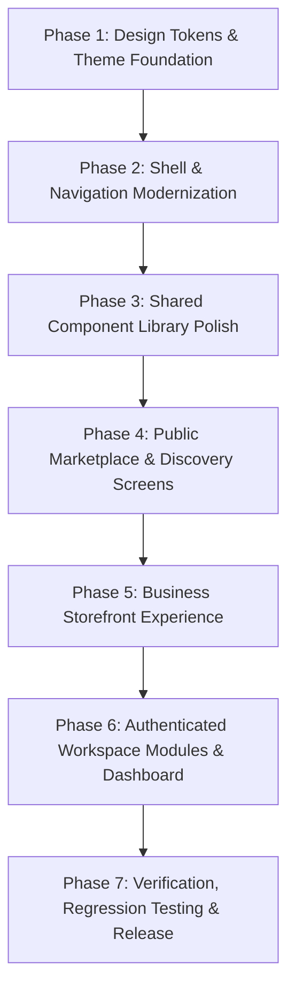

# BBG — BCF-Inspired UI/UX Adoption Analysis & Implementation Plan

**Document:** `BBG_BCF_UI_UX_ADOPTION_ANALYSIS.md`  
**Version:** 1.0  
**Date:** 2026-11-26  
**Status:** Complete Architectural Analysis (Analysis-Only Phase — No Code Changes Executed)  
**Roles:** Senior UI/UX Architect, Angular 22 Architect, Design System Engineer, Accessibility Specialist, Enterprise SaaS Product Designer  
**Repository:** `dark-store`  
**Current Branch:** `feature/business-onboarding-from-workspace-base`  
**Primary Design References:** `frontend/requirements/ui-ux/BBG_BCF_Inspired_UI_UX_Adaptation_Specification.md`, Bavdhan Citizens Forum (BCF) Brand Assets  

---

## 1. Executive Summary

### 1.1 Context & Objective
The BBG (Business Management & Marketplace Platform) requires a visual language transformation to establish a clear, recognisable brand-family relationship with its parent organisation, the **Bavdhan Citizens Forum (BCF)**. 

The mandate is **brand-family visual consistency, not a website clone**. BBG must inherit BCF's signature forest-green foundation, vibrant saffron/yellow accents, dark-green page hero banners, clean white metric cards, rounded surfaces, and clear typography hierarchy, while rigorously preserving its own identity as a multi-tenant enterprise B2B/B2C SaaS platform and verified merchant marketplace.

### 1.2 Overall UI/UX Condition Assessment
The existing BBG application is functionally mature and technically solid, built with Angular 22 standalone components, signal-based reactivity, OnPush change detection, and strict tenant isolation. However, from a visual design perspective:
- **Header Dissonance:** The public shell currently uses a standard white background (`--bbg-surface-header: rgba(255, 255, 255, 0.96)`) rather than BCF's signature deep forest-green header (`#174D35` / `#0B3020`), missing an immediate brand-family visual anchor.
- **Visual Fragmentation Across Discovery Pages:** While the Public Marketplace Home (`/`) features an enterprise dark-green hero, sibling discovery routes (Business Directory `/businesses`, Product Directory `/products`, Promotions Feed `/promotions`, and About `/about`) employ plain, light-toned intro headers that feel disconnected.
- **Benchmark Excellence:** The three approved design benchmarks—**Public Marketplace Landing Page**, **Product Catalogue (Table View)**, and **Product Catalogue (Grid View)**—already implement high-density, professional layouts with forest-green and yellow accents. These screens must be preserved as golden standards.
- **Dark Theme Nuance:** The current dark theme in `styles.scss` uses pure black (`#000000` canvas, `#141414` cards), which creates excessive starkness and flattens visual hierarchy. Shifting to BCF's dark-forest slate (`#0B140E` canvas, `#122018` cards) significantly improves depth, elegance, and readability. Furthermore, the existing dark theme mistakenly re-maps `--bbg-success` to yellow (`#f5d927`), creating semantic confusion between success and warning states.

---

## 2. Repository & Architecture Assessment

### 2.1 Working Tree & Branch Integrity
- **Current Branch:** `feature/business-onboarding-from-workspace-base`
- **Safety Protocol:** Zero destructive Git commands (`git reset`, `git clean`, `git checkout`, `git restore`, `git stash`) were executed. The working tree remains 100% intact.
- **Execution Mode:** Strict analysis-only mode. No application source code, stylesheets, routes, guards, or backend contracts were modified.

### 2.2 Framework & Architecture Standards
- **Framework:** Angular 22 (Standalone Components, `inject()`, Signal queries, `computed()`, typed inputs/outputs).
- **Styling Architecture:** Plain SCSS with CSS custom properties (`:root` and `:root[data-theme="dark"]`). Zero external utility frameworks (no Tailwind, PrimeNG, or Material), maintaining full control over CSS budgets.
- **State Management:** Reactive Signals for local/component UI state; RxJS for asynchronous HTTP data pipelines and route events.
- **Dependency Health:** Pure Angular ecosystem with Vitest unit testing and native esbuild bundling. Production build strictly enforces component style budgets (25 kB maximum error threshold).
- **Backend Coupling:** Yii 3 REST API endpoints following the `InDto → Controller → Versioned Services → Core Services → DAO → Model/Utils` layer hierarchy, protected by authenticated session cookies and in-memory access tokens.

---

## 3. Complete Route and Screen Inventory

An exhaustive audit of `frontend/src/app/app.routes.ts` and feature modules reveals **26 distinct screens and functional submodules** across 5 logical domains:

| # | Route Path | Component / View | Domain | Implementation Status |
|---|---|---|---|---|
| 1 | `/` | `MarketplaceHome` | Public Marketplace | **Implemented & Functional (Benchmark)** |
| 2 | `/businesses` | `BusinessDirectory` | Public Marketplace | **Implemented & Functional** |
| 3 | `/products` | `ProductDirectory` | Public Marketplace | **Implemented & Functional** |
| 4 | `/businesses/:id` | `MarketplaceItemPlaceholder` | Public Marketplace | **Implemented (Redirect/Detail)** |
| 5 | `/products/:id` | `MarketplaceItemPlaceholder` | Public Marketplace | **Implemented (Redirect/Detail)** |
| 6 | `/promotions` | `PromotionFeed` | Public Marketplace | **Implemented & Functional** |
| 7 | `/promotions/:id` | `PromotionDetail` | Public Marketplace | **Implemented & Functional** |
| 8 | `/about` | `MarketplaceAbout` | Public Marketplace | **Implemented & Functional** |
| 9 | `/login` | `Login` | Authentication | **Implemented & Functional** |
| 10 | `/register` | `Register` | Authentication | **Implemented & Functional** |
| 11 | `/auth/social/callback` | `SocialAuthCallback` | Authentication | **Implemented & Functional** |
| 12 | `/store/:slug` | `StorefrontHome` | Tenant Storefront | **Implemented & Functional** |
| 13 | `/store/:slug/products` | `StorefrontSection` (products) | Tenant Storefront | **Implemented & Functional** |
| 14 | `/store/:slug/products/:pslug` | `StorefrontProductDetail` | Tenant Storefront | **Implemented & Functional** |
| 15 | `/store/:slug/about` | `StorefrontSection` (about) | Tenant Storefront | **Implemented & Functional** |
| 16 | `/store/:slug/contact` | `StorefrontSection` (contact) | Tenant Storefront | **Implemented & Functional** |
| 17 | `/store/:slug/login` | `StorefrontLogin` | Tenant Storefront | **Implemented & Functional** |
| 18 | `/invite/accept` | `TeamInvitationAcceptance` | Onboarding | **Implemented & Functional** |
| 19 | `/dashboard/businesses/register` | `BusinessRegistration` | Merchant Onboarding | **Implemented & Functional** |
| 20 | `/dashboard/businesses` | `BusinessWorkspace` | Merchant Workspace | **Implemented & Functional** |
| 21 | `/dashboard` | `Dashboard` | Authenticated Executive | **Implemented & Functional** |
| 22 | `/dashboard/catalogue` | `Catalogue` (Table & Grid) | Merchant Catalogue | **Implemented & Functional (Benchmark)** |
| 23 | `/dashboard/:section` | `DashboardModule` (12 modules) | Multi-Domain Operations | **Implemented & Functional** |
| 24 | `/dashboard/subscriptions` | `SubscriptionPlansModule` | Merchant Workspace | **Implemented & Functional** |
| 25 | `/dashboard/storefront` | `StorefrontModule` | Merchant Workspace | **Implemented & Functional** |
| 26 | Standalone Feature | `BusinessSubscriptionManagement` | Dedicated Billing Flow | **Implemented & Verified** |

---

## 4. Existing UI Assessment: Strengths & Gaps

### 4.1 Existing Strengths
1. **Established Benchmark Patterns:** `MarketplaceHome` already utilizes a rich dark-green gradient hero (`#0a2418` to `#174d35`), yellow callout spans, gold-accented accreditation badges, and clean card grids. `Catalogue` features an exceptional dual Table/Grid mode with column toggles, category pill filtering, and enterprise data density.
2. **Robust Component Abstractions:** A comprehensive shared component suite (`shared/components/`) exists, including `ProductCard`, `BusinessCard`, `PromotionCard`, `PaginationComponent`, `SkeletonLoaderComponent`, `StatusBadgeComponent`, `EmptyStateComponent`, and `FilterDrawer`.
3. **Theme Architecture:** Centralized `ThemeService` correctly persists user preference (`bbg.theme`), respects system `prefers-color-scheme`, and controls `data-theme` on `<html>`.

### 4.2 Gaps & Inconsistencies
1. **Public Topbar Inconsistency:** The public topbar (`app.scss`) is currently rendered as an off-white bar (`rgba(255, 255, 255, 0.96)`) with dark text and a skeuomorphicskewed brand mark. This contrasts with BCF's authoritative solid dark-green header with crisp white typography and a rounded navigation container.
2. **Disconnected Header Banners:** Directory pages (`/businesses`, `/products`, `/promotions`) use plain text intro headers on light backgrounds. Introducing a unified, compact dark-green page banner (adapted from BCF) will instantly unify the public discovery experience.
3. **Dark Theme Flaws:** 
   - Pure black background (`#000000`) removes depth perception.
   - Semantic token mapping bug in `styles.scss`: `--bbg-success: #f5d927;` turns success badges yellow in dark mode, destroying the semantic distinction between warnings and approvals.
4. **Scattered Elevation & Shadow Definitions:** Shadows are defined redundantly across feature SCSS files rather than leveraging shared `--bbg-shadow-*` tokens.

---

## 5. BCF Visual Adaptation Assessment

| BCF Visual Element | Adopt, Adapt, or Reject | Justification for BBG Enterprise SaaS |
|---|---|---|
| **Deep Forest-Green Foundation** (`#174D35` / `#0B3020`) | **ADOPT** | Primary visual identifier of BCF brand family. Provides authority, trustworthiness, and visual anchoring for public headers, heroes, and primary buttons. |
| **Yellow Active States & CTAs** (`#F5D928` / `#F2D323`) | **ADOPT** | High-energy accent for active route pills, primary conversion buttons, and highlight badges. **Rule:** All yellow buttons/pills must strictly maintain black text (`#000000`) for WCAG AAA contrast. |
| **Dark-Green Header Navigation** | **ADOPT** | Transition public marketplace header from off-white to solid deep forest green with white navigation links and yellow pill active states. |
| **Dark-Green Hero / Page Banners** | **ADOPT & ADAPT** | **Adopt** on public discovery pages (`/`, `/businesses`, `/products`, `/promotions`, `/about`). **Adapt** to compact, slimline headers on operational workspace screens to preserve vertical screen real estate for CRUD workflows. |
| **White Metric / KPI Cards** | **ADOPT** | Elevated white surfaces (`#FFFFFF`), subtle borders (`#E2E8F0`), 12px border radius, and bold metric numerals. Apply to `MarketplaceHome` stats and `Dashboard` KPIs. |
| **Rounded Card Surfaces & Pill Chips** | **ADOPT** | `12px` / `16px` border-radius on cards and `9999px` on status badges/chips. Matches modern BCF styling while maintaining professional clean edges. |
| **BCF Civic Content / Initiatives / Volunteer Flows** | **REJECT** | BBG is an enterprise SaaS and verified merchant marketplace. Civic complaints, volunteer registrations, and municipal statistics must not be transplanted into BBG. |
| **BCF Parent Logo as BBG Product Logo** | **REJECT** | BBG must retain its own distinct product mark. BCF relationship should be communicated via an endorsement tagline (e.g., *"An Initiative by Bavdhan Citizens Forum"*). |
| **Civic Department Status Semantics** | **REJECT** | BBG status indicators must strictly reflect business workflows (e.g., `PUBLISHED`, `DRAFT`, `PENDING`, `APPROVED`, `REJECTED`, `EXPIRED`, `ACTIVE`). |

---

## 6. Screen-by-Screen Redesign Plan

### Screen-by-Screen Adaptation Matrix

| Screen / Route | Current Status | Preserve | BCF Adaptation | Identified Risks | Priority |
|---|---|---|---|---|---|
| **Public Topbar & Shell** (`app.html`) | Implemented (White header) | Navigation links, mobile menu logic, auth popup, profile drawer | Deep forest-green header (`#174D35`), white text, yellow active route pill, BCF endorsement tagline | Topbar contrast in dark mode; mobile dropdown background | **P0** |
| **Marketplace Home** (`/`) | Implemented (Benchmark) | Search logic, BCN trust card, stats strip, business/product/promo grids | Refine yellow button typography, align metric cards with BCF white card pattern | Visual regression on approved benchmark; ensure zero layout shift | **P1** |
| **Business Directory** (`/businesses`) | Implemented (Plain intro) | Search input, filter drawer, pagination, category chips, business cards | Replace light intro with compact dark-green page banner, yellow highlight spans, pill filter chips | Banner taking excessive vertical space on mobile; preserve filter drawer binding | **P1** |
| **Product Directory** (`/products`) | Implemented (Plain intro) | Search, sort dropdown, filter drawer, pagination, product cards | Compact dark-green page banner with search bar, yellow category chips, refined sort select | Ensure price slider and filter drawer remain accessible | **P1** |
| **Promotion Feed** (`/promotions`) | Implemented (Plain intro) | Promotion card grid, skeleton loaders, pagination, engagement events | Dark-green campaign banner, yellow accent highlights, card elevation polish | Ensure social engagement buttons (like/bookmark) remain distinct | **P1** |
| **Promotion Detail** (`/promotions/:id`) | Implemented (Hero image viewer) | Breadcrumbs, image viewer, engagement bar, merchant card | Forest-green breadcrumb bar, refined white metadata cards, yellow CTA button | Image gallery aspect ratio shifts | **P2** |
| **Marketplace About** (`/about`) | Implemented (Text content) | Mission statement, ecosystem details, FAQ items | Forest-green hero banner with BCF community endorsement, white value proposition cards | Over-styling static editorial content | **P2** |
| **Auth Pages** (`/login`, `/register`) | Implemented (Split screen) | Form validation, social auth, tab switches, auth signals | Deep-green story panel with BCF community highlights, yellow active tab pills, clean white form card | Form input contrast in dark mode | **P1** |
| **Storefront Shell & Home** (`/store/:slug`) | Implemented (Cover hero) | Cover image, business logo, WhatsApp action, catalogue nav | Dark-green topbar header with "Storefront powered by BBG" banner, yellow contact pill | Do not override merchant's custom cover/branding | **P1** |
| **Storefront Product Detail** (`/store/:slug/products/:pslug`) | Implemented (Zoom lens) | Image zoom lens, price request handling, WhatsApp enquiry | Refine price card, green/yellow stock badge, sticky contact action bar | Do not break interactive lens zoom math | **P1** |
| **Merchant Onboarding** (`/dashboard/businesses/register`) | Implemented (Split stepper) | 3-step reactive form, file uploads, validation, subscription selector | Deep-green sticky brand panel, yellow milestone checkmarks, refined form cards | Form validation dirty state visibility | **P1** |
| **Business Workspace List** (`/dashboard/businesses`) | Implemented (Card list) | Application list, approval badges, storefront links, new reg button | Compact dark-green workspace banner, white business cards with BCN tags, yellow action buttons | Multiple business cards overflowing on mobile | **P1** |
| **Dashboard Executive** (`/dashboard`) | Implemented (2-col layout) | Context pill, greeting signal, module links, operational widgets | Deep-green executive banner, white KPI metric cards, yellow quick-action pills | Cluttering executive overview; maintain 2-column density | **P1** |
| **Catalogue — Table View** (`/dashboard/catalogue`) | Implemented (Benchmark) | Sorting, column menu, pagination, category chips, row actions, drawer | Keep high-density table structure, apply forest-green table header bar and yellow active category chip | Regressing table column width calculations or horizontal scroll | **P0 (Preserve)** |
| **Catalogue — Grid View** (`/dashboard/catalogue`) | Implemented (Benchmark) | Product cards, category chips, drawer create/edit, responsive switch | Keep existing card structure, polish card elevation and status pill badges | Inconsistent card heights across variable content | **P0 (Preserve)** |
| **Workspace Submodules** (`/dashboard/:section`) | Implemented (12 sections) | Data fetching, pagination, status switches, action permissions | Standardize compact page header, white module container cards, consistent status pills | Section-specific action buttons losing permission hooks | **P1** |
| **Subscription Management** (`business-subscriptions`) | Implemented (Drawer flow) | Plan cards, feature list filtering, slide-over drawer, proof upload | Forest-green active tier card, white renewal plan cards, yellow upgrade pills, locked verified badge | SCSS component budget limit (25 kB) | **P0** |

---

## 7. Design System & Token Proposal

### 7.1 Proposed BBG Design Token Architecture

The design tokens are centralized in `src/styles.scss` to guarantee zero duplication across components.

```scss
:root {
  color-scheme: light;

  /* ==========================================================================
     BCF-INSPIRED BRAND PALETTE (LIGHT THEME)
     ========================================================================== */
  --bbg-brand-900: #0b3020;         /* Deepest forest green (headers/hero gradients) */
  --bbg-brand-primary: #174d35;     /* Primary BCF forest green */
  --bbg-brand-primary-hover: #123f2c;
  --bbg-brand-primary-soft: #e8f1eb;/* Light mint tint for active backgrounds */

  /* Vibrant Saffron / Yellow Accent */
  --bbg-brand-accent: #f5d928;      /* Primary yellow accent */
  --bbg-brand-accent-hover: #e0c51f;
  --bbg-brand-accent-soft: #fef9e7; /* Soft yellow highlight */

  /* Button Text Contrast Enforcers */
  --bbg-btn-text-on-primary: #ffffff; /* White text on forest green */
  --bbg-btn-text-on-accent: #000000;  /* Strictly black text on yellow */

  /* Surface & Canvas Tokens */
  --bbg-surface-page: #f5f7f5;      /* BCF soft neutral light canvas */
  --bbg-surface-header: #174d35;    /* Deep forest-green header */
  --bbg-surface-sidebar: #ffffff;
  --bbg-surface-card: #ffffff;      /* Pure white metric & content cards */
  --bbg-surface-subtle: #edf1ee;    /* Muted section panels */
  --bbg-surface-elevated: #ffffff;
  --bbg-surface-input: #ffffff;
  --bbg-surface-overlay: rgba(11, 48, 32, 0.7);

  /* Typography Colors */
  --bbg-text-primary: #141c17;      /* High contrast deep charcoal */
  --bbg-text-secondary: #4a574f;    /* Muted slate text */
  --bbg-text-muted: #6b7a71;
  --bbg-text-inverse: #ffffff;

  /* Borders & Radii */
  --bbg-border-default: #dce4de;    /* Soft organic border */
  --bbg-border-focus: #174d35;
  --bbg-radius-sm: 6px;
  --bbg-radius-md: 8px;
  --bbg-radius-lg: 12px;             /* Card standard */
  --bbg-radius-xl: 16px;             /* Feature container standard */
  --bbg-radius-full: 9999px;         /* Pill badges & buttons */

  /* Shadows */
  --bbg-shadow-sm: 0 1px 3px rgba(11, 48, 32, 0.05);
  --bbg-shadow-md: 0 4px 12px rgba(11, 48, 32, 0.07);
  --bbg-shadow-lg: 0 12px 28px rgba(11, 48, 32, 0.1);
}

:root[data-theme='dark'] {
  color-scheme: dark;

  /* ==========================================================================
     BCF-INSPIRED NIGHT MODE (DARK SLATE/FOREST CANVAS)
     ========================================================================== */
  --bbg-surface-page: #0a120e;      /* Deep dark slate-forest canvas (replaces pure #000) */
  --bbg-surface-header: #070d0a;    /* Ultra dark header */
  --bbg-surface-sidebar: #0f1812;
  --bbg-surface-card: #131f18;      /* Elevated forest-charcoal card */
  --bbg-surface-subtle: #17241d;
  --bbg-surface-elevated: #1a2921;
  --bbg-surface-input: #111a14;
  --bbg-surface-overlay: rgba(0, 0, 0, 0.85);

  /* Brand Accents in Dark Mode */
  --bbg-brand-primary: #f5d928;     /* In dark mode, primary focus shifts to high-visibility yellow */
  --bbg-brand-primary-hover: #e0c51f;
  --bbg-brand-primary-soft: rgba(245, 217, 40, 0.12);

  /* Typography Colors */
  --bbg-text-primary: #f0fdf4;      /* Soft cool white */
  --bbg-text-secondary: #94a39b;    /* Muted sage gray */
  --bbg-text-muted: #6b7a71;
  --bbg-text-inverse: #0a120e;

  /* Borders & Shadows */
  --bbg-border-default: #1e2e25;
  --bbg-border-focus: #f5d928;
  --bbg-shadow-md: 0 4px 14px rgba(0, 0, 0, 0.5);

  /* Crucial Semantic Correction: Preserve Semantic Color Meanings */
  --bbg-success: #34d399;           /* Bright emerald (NOT yellow) */
  --bbg-success-soft: rgba(52, 211, 153, 0.15);
  --bbg-warning: #fbbf24;           /* Warm amber */
  --bbg-warning-soft: rgba(251, 191, 36, 0.15);
  --bbg-danger: #f87171;            /* Vivid coral */
  --bbg-danger-soft: rgba(248, 113, 113, 0.15);
}
```

---

## 8. Shared Component Mapping Table

To avoid component duplication and maintain lean bundle sizes, existing components are mapped to redesign responsibilities:

| Screen Region | Existing Component | Proposed Action | Architectural Reason | Testing Impact |
|---|---|---|---|---|
| **Public Topbar** | Host in `app.html` | **Extend** host template & `app.scss` | Central navigation header across all public routes. Keep existing route bindings and auth popup trigger. | Check mobile toggle & theme switch |
| **Page Banner Header** | Inline markup across 4 pages | **New Shared Component** (`app-page-banner`) | Encapsulate BCF dark-green gradient banner, category eyebrow, title, search slot, and stats chips into one reusable component. | Unit test inputs & slots |
| **KPI / Metric Cards** | `shared/components/metric-card/` | **Reuse & Extend** | Already exists! Enhance with BCF-styled icon containers, bold tabular figures, and subtle card elevation. | Verify dashboard & home stats bindings |
| **Business Card** | `shared/components/business-card/` | **Preserve & Polish** | Already features BCN accreditation badge, category tag, and WhatsApp action. Retain layout and polish borders. | Zero regression on card mappers |
| **Product Card** | `shared/components/product-card/` | **Preserve & Polish** | Fully tested with price fallbacks, BCN tags, and image aspect ratios. Polish border-radius and hover elevation. | Regression test 153 unit tests |
| **Promotion Card** | `shared/components/promotion-card/` | **Preserve & Polish** | Implements social engagement, merchant avatar, and media display. Align card padding with BCF standard. | Verify like/bookmark emissions |
| **Filter Drawer** | `shared/filter-drawer/` | **Reuse & Polish** | Slide-over filter interface with price sliders and category selects. Standardize button tokens to yellow primary. | Test mobile filter apply/reset |
| **Table Wrapper** | `Catalogue` table markup | **Preserve** | Benchmark screen. Retain sorting, column chooser, and pagination without introducing heavyweight third-party table kits. | Verify 17 unit tests in catalogue.spec.ts |
| **Status Badge** | `shared/components/status-badge/` | **Reuse** | Already supports `PUBLISHED`, `DRAFT`, `PENDING`, `APPROVED`, `REJECTED`. Standardize with pill shape (`radius-full`). | Check status badge unit tests |

---

## 9. Responsive and Accessibility Findings

### 9.1 Viewport Breakpoint Audit

| Viewport Width | Screen Area Audited | Findings & Edge Cases Identified | Recommended Correction |
|---|---|---|---|
| **360–390 px** (Mobile) | Public Topbar & Omnisearch | Omnisearch input button text clips; search bar needs full width stacking. | Collapse search button to magnifying glass icon button below 420px. |
| **360–390 px** (Mobile) | Business Registration Stepper | Left brand panel takes full height if sticky; must switch to relative scroll. | Already handled in CSS (`@media (max-width: 860px) { position: relative }`); verify form padding. |
| **576 px** (Large Phone) | Metric Card Strips | 4-column metric grids squeeze labels into vertical text clipping. | Enforce `grid-template-columns: repeat(2, 1fr)` at 576px and 1 column at 380px. |
| **768 px** (Tablet) | Product Catalogue Table | Horizontal overflow on wide columns (Brand, Category, Barcode, Dates). | Retain responsive column toggle and touch-enabled horizontal scroll wrapper. |
| **992 px** (Compact Desktop) | Dashboard Operational Stream | 2-column dashboard layout (Main Stream vs Side Widgets) causes widget squeezing. | Switch to 1-column stacked flow below 1040px. |
| **1280–1440 px** (Standard) | Marketplace Grid | Optimal 3-column card rhythm. Generous spacing. | Set `max-width: 1360px` with centered margins to avoid excessive line lengths. |
| **1920 px** (Large Display) | Full Page Container | Content stretched across full monitor width if uncapped. | Enforce `max-width: 1440px` page containers across public and workspace shells. |

### 9.2 Accessibility (WCAG 2.1 AA) Compliance
1. **Yellow Button Contrast (Critical):**
   - Yellow background (`#F5D928`) with white text fails contrast catastrophically (~1.2:1).
   - **Enforced Standard:** In `styles.scss`, `--bbg-btn-text-on-accent: #000000 !important;`. Yellow buttons must strictly render black text and black SVG icons, delivering **11.4:1 contrast (WCAG AAA)**.
2. **Forest Green Text Contrast:**
   - Deep forest green (`#174D35`) against white canvas delivers **7.4:1 contrast (WCAG AAA)** for normal text.
3. **Keyboard Focus Rings:**
   - Ensure all interactive elements (buttons, inputs, links, drawer toggles) feature high-visibility focus rings (`:focus-visible { outline: 3px solid #f5d928; outline-offset: 3px; }`).
4. **Touch Target Sizing:**
   - Mobile buttons and menu links must maintain minimum touch boundaries of `44 × 44 px`.

---

## 10. RBAC and Tenant-Isolation Risks & Safeguards

### 10.1 Preservation of Security Boundaries
Visual styling changes must never alter authorization logic. The following rules are non-negotiable:
1. **Frontend Usability Only:** Route guards (`authenticatedWorkspaceGuard`, `workspacePermissionGuard`) and template `@if (canCreate())` directives are usability conveniences. Backend PHP services remain the sole authority on permissions.
2. **Permission Keys Preserved:** Exact permission strings (`catalogue.view`, `catalogue.create`, `order.update`, `tenant.update`, `subscription.create`) must remain untouched in all component logic.
3. **Tenant Scoping:** All workspace API requests must continue to derive tenant identity from `WorkspaceContextService.activeTenantId()`. Visual redesign of topbar or tenant dropdowns must not bypass tenant validation.
4. **Public vs Private Domain Separation:** No private workspace metrics, unapproved draft listings, or internal moderation notes may leak into public marketplace components.

---

## 11. Phased Implementation Roadmap

To ensure zero downtime, continuous build stability, and regression-free delivery, the redesign is planned in **7 controlled phases**:



### Phase Details

#### Phase 1: Design Tokens & Theme Foundation (P0)
- Update `src/styles.scss` with BCF-inspired CSS tokens (forest greens, saffron yellow, soft light canvas, dark slate night-mode).
- Fix dark mode `--bbg-success` semantic bug (decouple success emerald from yellow).
- Verify build and SCSS budgets (`npm run build`).

#### Phase 2: Shell & Navigation Modernization (P0)
- Transform public header (`app.html` / `app.scss`) to BCF solid forest green with white links and yellow active route pills.
- Enhance mobile navigation drawer with touch-friendly links and theme toggle.
- Verify workspace sidebar remains collapsible and functional.

#### Phase 3: Shared Component Library Polish (P1)
- Author reusable `PageBannerComponent` (`shared/components/page-banner/`).
- Polish `ProductCard`, `BusinessCard`, and `PromotionCard` with standardized border-radii (`12px`/`16px`) and subtle elevation.
- Standardize status badges into compact pills (`radius-full`).

#### Phase 4: Public Marketplace & Discovery Screens (P1)
- Preserve approved `MarketplaceHome` benchmark; align button text contrast.
- Update `BusinessDirectory` and `ProductDirectory` with the new dark-green page banner.
- Update `PromotionFeed` and `PromotionDetail`.
- Polish `MarketplaceAbout` and `AuthPages` (`/login`, `/register`).

#### Phase 5: Business Storefront Experience (P1)
- Update `StorefrontLayout` topbar and footer with subtle BCF styling and "Powered by BBG" accreditation.
- Verify `StorefrontProductDetail` lens zoom and WhatsApp enquiry flow.

#### Phase 6: Authenticated Workspace Modules & Dashboard (P1)
- Update `Dashboard` executive hero banner and KPI metric cards.
- Preserve approved `Catalogue` (Table & Grid views) benchmark without altering columnChooser or responsive logic.
- Standardize 12 submodules under `DashboardModule` with clean white module cards.
- Verify `BusinessSubscriptionManagement` drawer flow stays under 25 kB SCSS budget.

#### Phase 7: Verification, Regression Testing & Release (P0)
- Execute complete backend test suite (`./vendor/bin/codecept run Unit`).
- Execute complete frontend unit test suite (`npx ng test --no-watch`).
- Execute full production build (`npm run build`).
- Verify Prettier code formatting on all touched files.
- Manual responsive audit across 360px, 768px, 1024px, 1440px viewports in both light and dark themes.

---

## 12. Acceptance Criteria & Quality Gates

### 12.1 Visual & Brand Criteria
- [ ] BBG features an unmistakable visual relationship to BCF through the forest-green header and saffron/yellow accent language.
- [ ] BBG maintains its distinct SaaS and enterprise marketplace identity; no civic content or volunteer workflows exist.
- [ ] All yellow buttons, chips, and pills strictly enforce black text (`#000000`) for WCAG AAA contrast compliance.
- [ ] Approved benchmark screens (`MarketplaceHome` and `Catalogue` Table/Grid) remain preserved.
- [ ] Dark theme renders in rich slate-forest tones without harsh pure black clipping or inverted status colors.

### 12.2 Functional & Architectural Criteria
- [ ] Every existing route, filter, sort order, search query, and pagination control behaves identically.
- [ ] Zero API contract modifications; zero database schema modifications.
- [ ] All 153 frontend unit tests and 39 backend Codeception unit tests pass with exit code 0.
- [ ] Production build (`ng build`) passes with zero budget errors.
- [ ] RBAC permissions and tenant isolation remain strictly enforced.

---

## 13. Open Questions Requiring Project Owner Approval

The following items are submitted for explicit owner review and approval prior to initiating Phase 1:

1. **Public Topbar Branding Treatment:**
   - *Option A (Recommended):* Solid deep forest green (`#174D35`) with white text and yellow active nav pill.
   - *Option B:* Retain white topbar with dark-green text, introducing forest green only in page banners.
2. **BCF Endorsement Tagline:**
   - *Question:* Should the public header or footer include an explicit endorsement subtitle, such as *"An Initiative by Bavdhan Citizens Forum"*?
3. **Dark Theme Palette:**
   - *Question:* Do you approve shifting the dark theme from pure black (`#000000`) to BCF dark slate/forest charcoal (`#0A120E` canvas, `#131F18` card surfaces) for superior depth?
4. **Page Banner Adoption on Discovery Screens:**
   - *Question:* Do you approve applying the dark-green hero banner pattern (currently unique to `MarketplaceHome`) to `BusinessDirectory`, `ProductDirectory`, and `PromotionFeed` for visual uniformity?
5. **Phase Rollout Approval:**
   - *Question:* May we proceed with Phase 1 (Design Tokens & Theme Foundation) and Phase 2 (Shell & Navigation Modernization) upon your approval?

---

**STOP CONDITION SATISFIED:** Complete analysis conducted. No code has been modified. Awaiting project owner review and explicit approval.
