# BBG Public Marketplace & Business Storefront UI Requirement

Start here: [REQ-UI-001 — UI/UX Redesign Specification](REQ-UI-001-marketplace-storefront-redesign.md).

## Separate page wireframes

### Public Marketplace
| Page | Wireframe |
|---|---|
| Homepage | 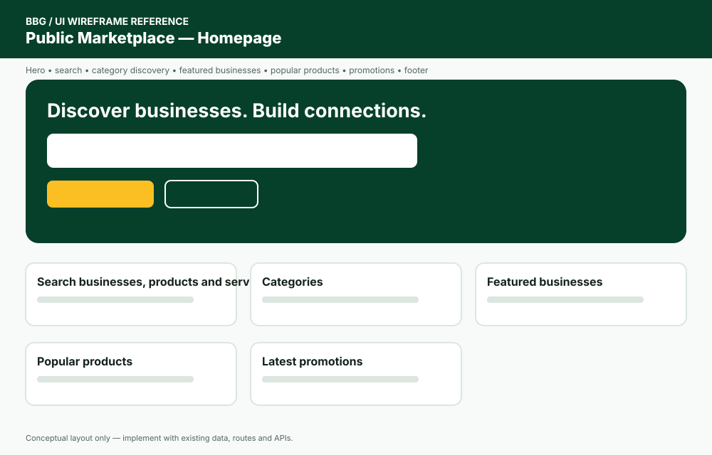 |
| Business Directory | 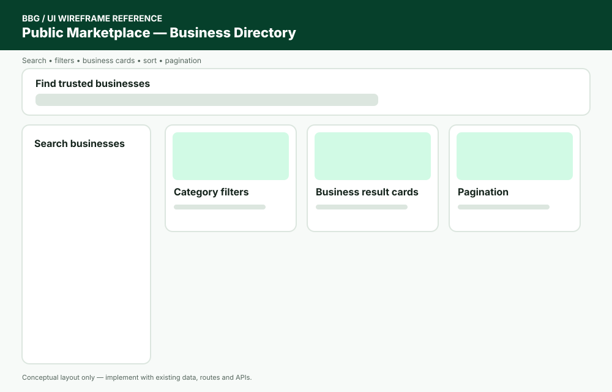 |
| Product Directory | 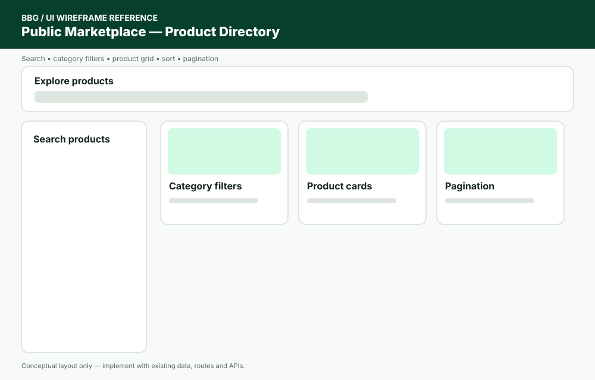 |
| Business Details | 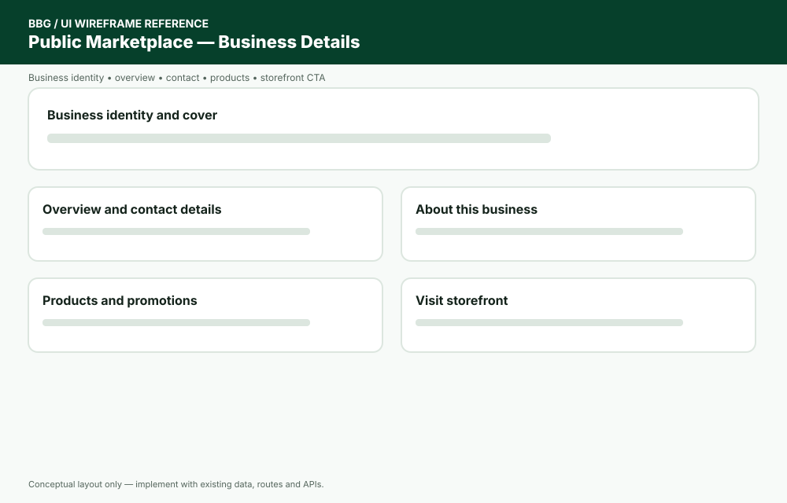 |
| Product Details | [Protected existing page — no redesign](references/marketplace-product-details-protected.svg) |
| Promotions | 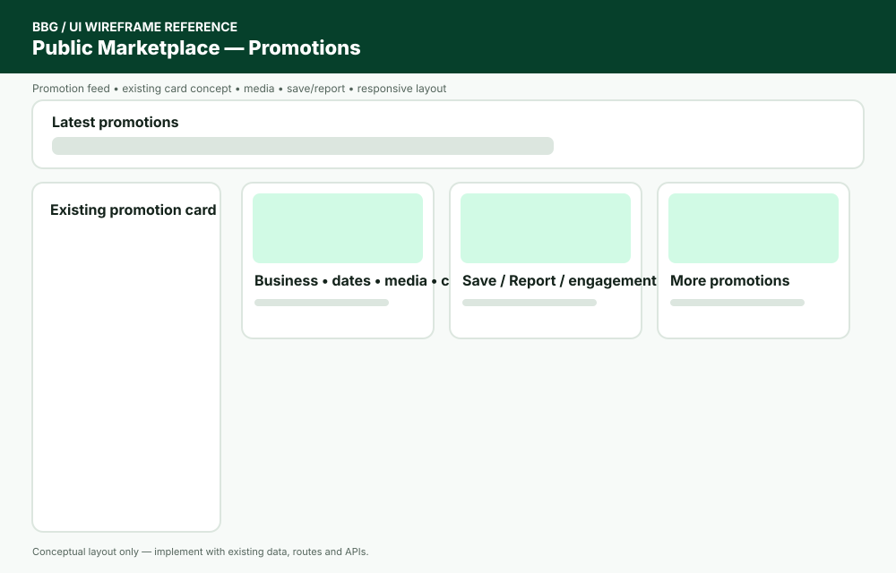 |
| Promotion Details | 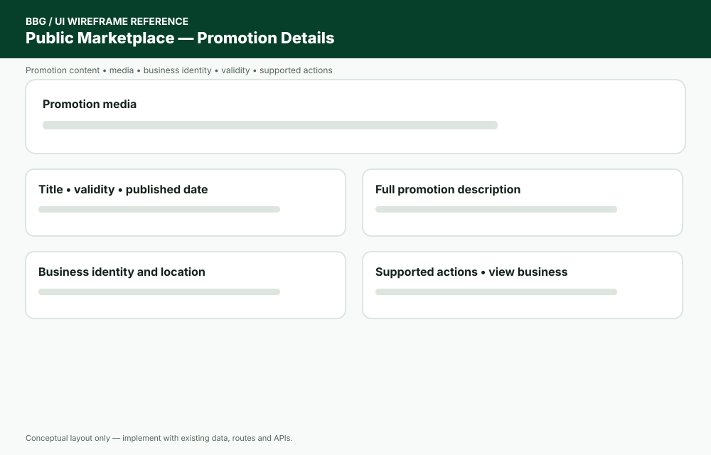 |
| About BBG | 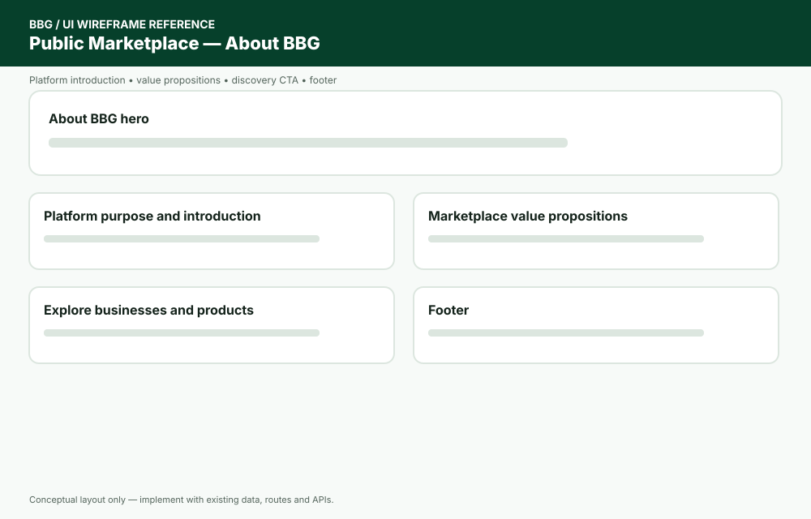 |

### Business Storefront
| Page | Wireframe |
|---|---|
| Storefront Homepage | 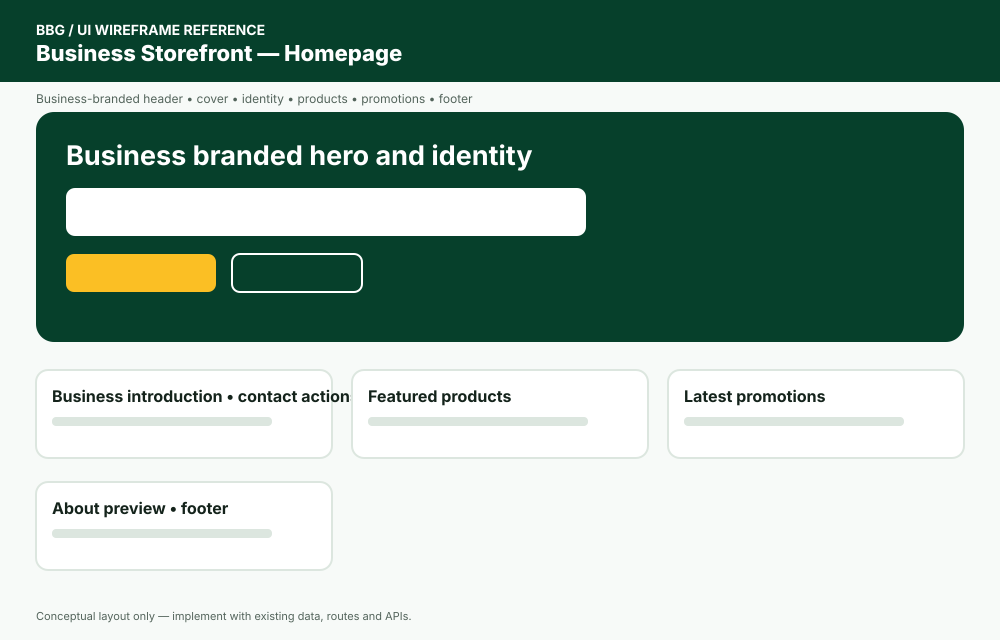 |
| Products | 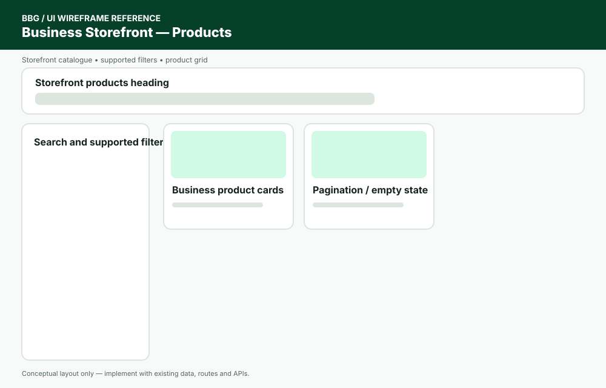 |
| Product Details | [Protected existing page — no redesign](references/storefront-product-details-protected.svg) |
| About | 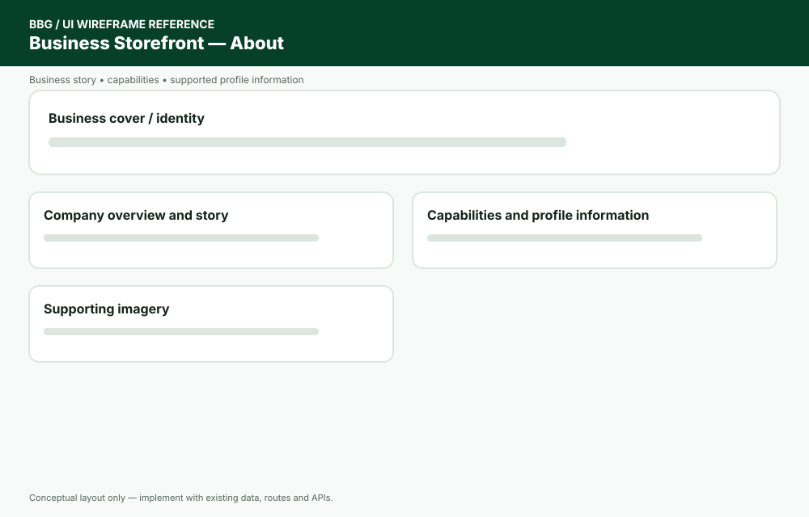 |
| Contact | 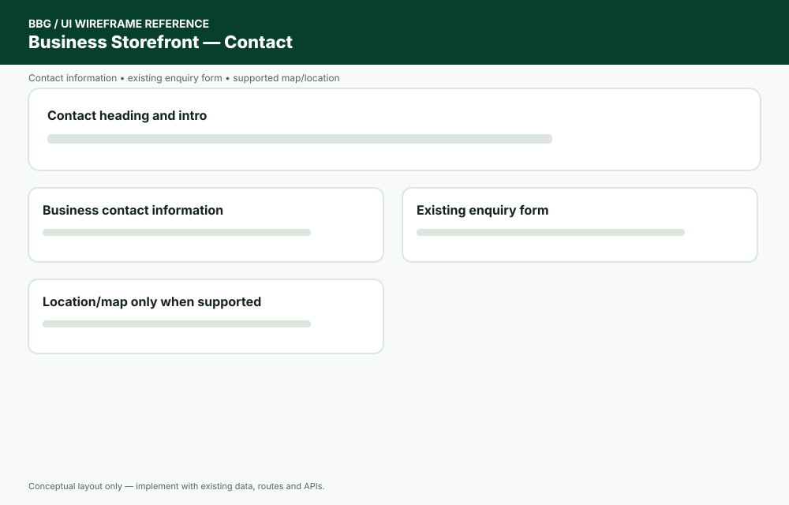 |
| Promotions | 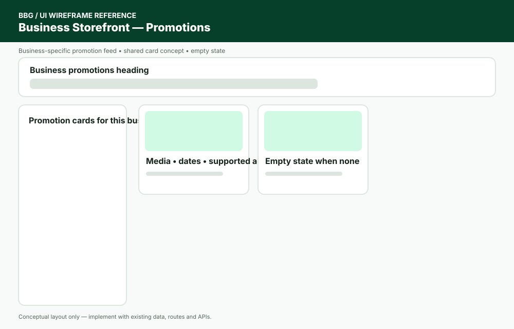 |
| Promotion Details | 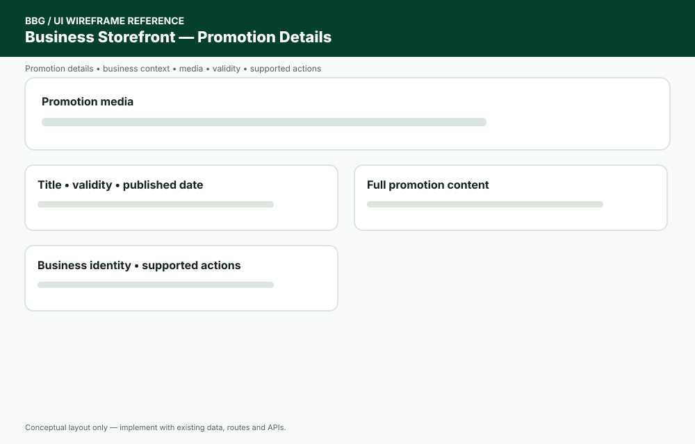 |

Each SVG is a separate page-level wireframe reference. The two product-detail references are protection markers only, not replacement designs.

## Implementation guidance
- [Required BBG skills and workflow](IMPLEMENTATION_SKILLS.md)
- [Full requirement and acceptance criteria](REQ-UI-001-marketplace-storefront-redesign.md)
- References are conceptual layout guides. Existing routes, components, API contracts, models and supported actions remain the source of truth.
