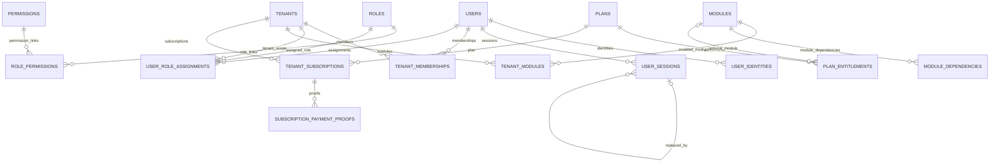
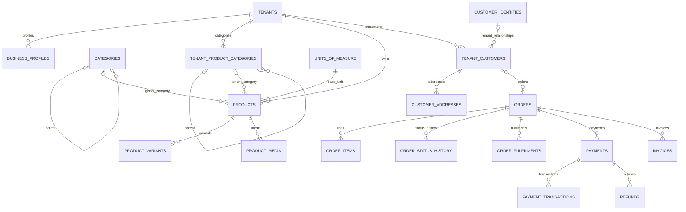
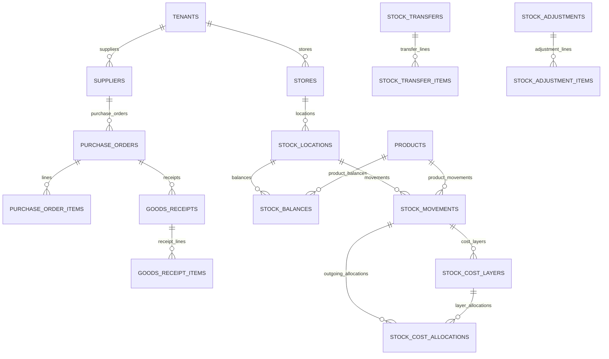

# BBG — Business Management & Marketplace Platform
## Database Design & Data Dictionary — Final v2.0

**Revision date:** 10 November 2026  
**Design baseline:** BBG Database Design v1.2 plus Database Design Requirements Update v1.3  
**Target database requested for v2.0:** `bbg`  
**Target DBMS:** MySQL 8.4 / InnoDB / utf8mb4 (final collation not supplied)  
**Application stack:** Angular 22, Yii 3, PHP 8.4, Nginx + PHP-FPM  
**Architecture:** seven logical `.agents` layers adapted to Yii 3  
**Status:** revised design proposal; not a verified live-schema description and not an executed migration

> **Scope boundary:** This document completes Phase A only. It does not generate migration or fresh-installation SQL. The owner reports that database tables already exist in `bbg`, but the supplied database design sources describe a proposed schema and the development-environment reference reports the active database as `bbc`. The physical schema and actual target database must be established from the previous SQL scripts and, preferably, a live schema-only dump in Phase B.

## 1. Project overview

BBG is a multi-tenant business-management and marketplace platform. The database supports global user identity, tenant workspaces, role/permission assignments, modules and subscriptions, business profiles, product catalogue, customer identities and tenant customer records, orders, payments, invoices, storefront content, enquiries, expenses, cash sessions, notifications and audit logging. Supplier, purchasing and inventory/costing tables are retained as future-scope design.

### 1.1 Design inputs and precedence

| Source | Use in this revision |
|---|---|
| `BBG_Database_Design_v1.2.md` | Primary source for 68 table definitions, column names/types/defaults, business rules, logical relationships and indexes. |
| `BBC_database_design_requirements_update_v1.3.md` | Supersedes v1.2 where it explicitly clarifies the universal A/Z status and four audit columns on every table. |
| Supplied `.agents.zip` | Layer responsibilities, `$resArr` response contract, naming and service/DAO transaction boundaries. Its DB-design skill says no physical FKs; this v2.0 request proposes a deliberate change to that convention. |
| Frontend/backend requirements update v1.2 | Angular 22, Yii 3, PHP 8.4, tenant isolation, soft-delete query rules and database pagination/performance expectations. |
| Development environment reference | macOS Docker Compose setup and current environment notes; reports active database `bbc`, not `bbg`. |
| Marketplace feature list | Functional context only. Its older React/Node stack references are superseded by the newer Angular/Yii requirements and are not used to change the schema. |

### 1.2 Conflicts and explicit resolutions

1. **`deleted_at` conflict:** The v2.0 request text refers to five columns `created_by`, `created_on`, `updated_by`, `updated_on`, `deleted_at`. The actual v1.2 schema and v1.3 update mandate `status` plus those four audit columns; neither defines `deleted_at`. To obey the no-new-column rule and preserve A/Z soft deletion, this document retains exactly `status`, `created_by`, `created_on`, `updated_by`, `updated_on`. `deleted_at` is not introduced. If a timestamped deletion marker is required, obtain explicit approval for a separate schema change.
2. **Physical FK policy:** v1.2, v1.3 and `.agents/skills/db-design/SKILL.md` specify no physical FKs. The owner's new v2.0 instruction asks to introduce them. This document therefore defines a proposed FK layer for direct, unambiguous references, but the change from the established convention must be approved as part of design review before Phase C SQL is produced.
3. **Database name:** This revision uses the owner-requested target name `bbg`. The supplied environment note says the configured database is `bbc` and that `dark_store` is retained. Do not infer that `bbg` is the live database until the actual connection/configuration and schema dump are checked.
4. **Physical schema status:** Older supplied requirement documents say tables had not been created; the current owner says they have since been created. These are time-conflicting statements. This document records the current owner report but does not claim live-schema verification.
5. **Field certainty:** v1.2 repeatedly labels proposed field types/nullability as `TYPE AND NULLABILITY TO BE CONFIRMED`. The inline SQL definitions are reproduced as proposed definitions, not as proof that the live database uses them.
6. **Source formatting defects:** `TENANTS` and `ORDERS` contain an extra malformed `created_by` row carrying index/audit notes. It is not treated as a second column. The universal audit definition and the canonical `created_by` row are retained once.

## 2. Database architecture and conventions

| Concern | Standard |
|---|---|
| Database | `bbg` per current owner instruction; verify against live environment. |
| DBMS / engine | MySQL 8.4, InnoDB. |
| Character set | `utf8mb4`; no final collation is specified in the source materials. |
| Table names | `UPPERCASE_SNAKE_CASE`. |
| Column names | `lowercase_snake_case`. |
| Primary key | `id INT UNSIGNED NOT NULL AUTO_INCREMENT PRIMARY KEY`. |
| Other ID columns | `INT UNSIGNED` unless a source definition explicitly states otherwise. |
| Financial values | Preserve source-selected `DOUBLE(10,2)`; floating-point approximation risk remains. Do not silently convert to DECIMAL. |
| Tenant ownership | Tenant-owned operational tables carry `tenant_id INT UNSIGNED` where specified. |
| Soft deletion | `status VARCHAR(1) NOT NULL DEFAULT 'A'`; `A` active, `Z` soft-deleted. |
| Physical FKs | Proposed for v2.0 direct references in Section 6; pending approval and Phase B validation against actual SQL/schema. |
| Polymorphic references | No physical FK; application validation using the discriminator-to-table mapping. |

### 2.1 Mandatory common columns — all 68 tables

Every table, including junction, history, transaction, audit, event and future-scope tables, has these five common columns. There are no exceptions.

| Column | MySQL definition | Meaning |
|---|---|---|
| `status` | `VARCHAR(1) NOT NULL DEFAULT 'A'` | `A` = active; `Z` = soft-deleted. Business lifecycle states remain in separate columns. |
| `created_by` | `INT UNSIGNED NULL` | User actor that created the record; nullable for approved system/anonymous creation. Proposed FK to `USERS(id)`. |
| `created_on` | `DATETIME NOT NULL DEFAULT CURRENT_TIMESTAMP` | Creation timestamp. |
| `updated_by` | `INT UNSIGNED NULL` | User actor for latest update; may be NULL before an update or for system updates. Proposed FK to `USERS(id)`. |
| `updated_on` | `DATETIME NOT NULL DEFAULT CURRENT_TIMESTAMP ON UPDATE CURRENT_TIMESTAMP` | Last update timestamp. |

`created_by` and `updated_by` definitions and nullability are preserved. The actor FK proposals use `ON DELETE RESTRICT ON UPDATE CASCADE`; a user with historical references cannot be physically deleted, but may be soft-deleted according to policy.

### 2.2 Soft-deletion rules

- Normal deletion is an update from `status='A'` to `status='Z'`, never a physical DELETE through ordinary application workflows.
- Soft-delete and permitted restore operations update `updated_by` and `updated_on`.
- Standard reads, joins, counts, pagination, reports, dashboards and exports filter `status='A'` unless a separately authorized deleted-record operation is requested.
- A parent must not be soft-deleted while active dependent records would be left invalid; the service layer checks dependencies and applies explicit business policy.
- Posted financial records, audit events and immutable stock-ledger entries are protected from ordinary soft deletion; use reversal, compensating or superseding records.
- FK RESTRICT applies to physical parent deletion, not to an A/Z status update. Soft deletion must still be coordinated by the service layer.
- Unique-key reuse after soft deletion remains an explicit per-key business decision; do not weaken unique constraints by adding status to keys without approval.

### 2.3 Foreign-key referential actions

Proposed default for every direct FK in Section 6:
- `ON DELETE RESTRICT` — preserve business and audit records; physical parent deletion is blocked while children reference it.
- `ON UPDATE CASCADE` — propagate a referenced key update, although primary-key updates should be exceptional.

All proposed FK child and parent IDs are `INT UNSIGNED` in the documented schema and target `id INT UNSIGNED` primary keys. Phase B must confirm actual type, signedness, engine, index and collation compatibility from the supplied SQL/live schema. No FK should be added if those checks fail.

## 3. Table catalogue and release classification

| Domain | Tables | Count | Release classification |
|---|---|---:|---|
| Platform identity, tenancy and authorization | USERS through TENANT_SETTINGS | 10 | Current-release candidates |
| Modules, plans and subscription entitlements | MODULES through SUBSCRIPTION_PAYMENT_PROOFS | 7 | Current-release candidates |
| Business profile and product catalogue | BUSINESS_PROFILES through STOREFRONT_SETTINGS | 8 | Current-release candidates |
| Customer identity and tenant relationship | CUSTOMER_IDENTITIES through CUSTOMER_ADDRESSES | 3 | Current-release candidates |
| Sales, orders and fulfilment | ORDERS through ORDER_FULFILMENTS | 4 | Current-release candidates |
| Payments, refunds and invoices | PAYMENTS through INVOICES | 4 | Current-release candidates |
| Suppliers, purchasing and inventory | SUPPLIERS through STOCK_ADJUSTMENT_ITEMS | 16 | Future scope |
| Marketplace engagement and communication | PROMOTIONAL_POSTS through MODERATION_LOGS | 9 | Current-release candidates |
| Expenses, cash, notifications and audit | EXPENSE_CATEGORIES through AUDIT_LOGS | 7 | Current-release candidates |
| **Total** | **68 tables** | **68** | **52 current-release candidates; 16 future-scope** |

**Current-release candidates (52):** USERS, USER_IDENTITIES, USER_SESSIONS, ROLES, PERMISSIONS, ROLE_PERMISSIONS, USER_ROLE_ASSIGNMENTS, TENANTS, TENANT_MEMBERSHIPS, TENANT_SETTINGS, MODULES, MODULE_DEPENDENCIES, TENANT_MODULES, PLANS, PLAN_ENTITLEMENTS, TENANT_SUBSCRIPTIONS, SUBSCRIPTION_PAYMENT_PROOFS, BUSINESS_PROFILES, CATEGORIES, TENANT_PRODUCT_CATEGORIES, UNITS_OF_MEASURE, PRODUCTS, PRODUCT_VARIANTS, PRODUCT_MEDIA, STOREFRONT_SETTINGS, CUSTOMER_IDENTITIES, TENANT_CUSTOMERS, CUSTOMER_ADDRESSES, ORDERS, ORDER_ITEMS, ORDER_STATUS_HISTORY, ORDER_FULFILMENTS, PAYMENTS, PAYMENT_TRANSACTIONS, REFUNDS, INVOICES, PROMOTIONAL_POSTS, POST_MEDIA, CUSTOMER_ENQUIRIES, ENQUIRY_MESSAGES, CONTENT_LIKES, COMMENTS, CONTENT_VIEWS, CONTENT_REPORTS, MODERATION_LOGS, EXPENSE_CATEGORIES, EXPENSES, CASH_SESSIONS, CASH_MOVEMENTS, NOTIFICATION_PREFERENCES, NOTIFICATIONS, AUDIT_LOGS.

**Future-scope tables (16):** SUPPLIERS, PURCHASE_ORDERS, PURCHASE_ORDER_ITEMS, GOODS_RECEIPTS, GOODS_RECEIPT_ITEMS, STORES, STOCK_LOCATIONS, STOCK_BALANCES, STOCK_MOVEMENTS, STOCK_COST_LAYERS, STOCK_COST_ALLOCATIONS, STOCK_RESERVATIONS, STOCK_TRANSFERS, STOCK_TRANSFER_ITEMS, STOCK_ADJUSTMENTS, STOCK_ADJUSTMENT_ITEMS.

Retaining future-scope tables in the schema does not authorize future-scope frontend screens, APIs, services, jobs, activation flows or workflows in the current release.

## 4. Complete table definitions and data dictionary

All definitions below reproduce the v1.2 proposed inline types and nullability. A source note of `TYPE AND NULLABILITY TO BE CONFIRMED` is retained as a design caveat. No undocumented field or column has been added. For common columns, the definitions in Section 2.1 apply exactly.

### 4.1 Platform identity, tenancy and authorization

#### 1. `USERS`

**Release classification:** CURRENT-RELEASE CANDIDATE — scope subset still subject to approval

One global person/account. Do not store a single tenant role here.

| Column | Proposed MySQL definition | Source note / description |
|---|---|---|
| `id` | `INT UNSIGNED NOT NULL AUTO_INCREMENT PRIMARY KEY` | — |
| `full_name` | `VARCHAR(150) NOT NULL` | Source marks exact type/nullability for confirmation. |
| `email` | `VARCHAR(190) NULL` | Source marks exact type/nullability for confirmation. |
| `mobile` | `VARCHAR(25) NULL` | Source marks exact type/nullability for confirmation. |
| `password_hash` | `VARCHAR(255) NULL` | Source marks exact type/nullability for confirmation. |
| `profile_image` | `VARCHAR(500) NULL` | Source marks exact type/nullability for confirmation. |
| `email_verified_on` | `DATETIME NULL` | Source marks exact type/nullability for confirmation. |
| `mobile_verified_on` | `DATETIME NULL` | Source marks exact type/nullability for confirmation. |
| `last_login_on` | `DATETIME NULL` | Source marks exact type/nullability for confirmation. |
| `account_status` | `VARCHAR(20) NOT NULL DEFAULT 'ACTIVE'` | — |
| `status` | `VARCHAR(1) NOT NULL DEFAULT 'A'` | — |
| `created_by` | `INT UNSIGNED NULL` | — |
| `created_on` | `DATETIME NOT NULL DEFAULT CURRENT_TIMESTAMP` | — |
| `updated_by` | `INT UNSIGNED NULL` | — |
| `updated_on` | `DATETIME NOT NULL DEFAULT CURRENT_TIMESTAMP ON UPDATE CURRENT_TIMESTAMP` | — |

**Source indexes / uniqueness:** Indexes: unique normalized email when present; unique normalized mobile

**Proposed direct foreign-key references:** none identified beyond the common audit actor references.

#### 2. `USER_IDENTITIES`

**Release classification:** CURRENT-RELEASE CANDIDATE — scope subset still subject to approval

External login identities; supports multiple social sign-in providers without coupling the `USERS` table to any one provider.

| Column | Proposed MySQL definition | Source note / description |
|---|---|---|
| `id` | `INT UNSIGNED NOT NULL AUTO_INCREMENT PRIMARY KEY` | — |
| `user_id` | `INT UNSIGNED NOT NULL` | Source marks exact type/nullability for confirmation. |
| `provider` | `VARCHAR(50) NOT NULL` | --- requested values: `GOOGLE`, `FACEBOOK`, `LINKEDIN`, `INSTAGRAM |
| `provider_subject` | `VARCHAR(190) NOT NULL` | --- immutable provider-side account identifier; do not use email as the identity key |
| `provider_email` | `VARCHAR(190) NULL` | Source marks exact type/nullability for confirmation. |
| `linked_on` | `DATETIME NOT NULL` | — |
| `status` | `VARCHAR(1) NOT NULL DEFAULT 'A'` | — |
| `created_by` | `INT UNSIGNED NULL` | — |
| `created_on` | `DATETIME NOT NULL DEFAULT CURRENT_TIMESTAMP` | — |
| `updated_by` | `INT UNSIGNED NULL` | — |
| `updated_on` | `DATETIME NOT NULL DEFAULT CURRENT_TIMESTAMP ON UPDATE CURRENT_TIMESTAMP` | — |

**Source indexes / uniqueness:** Unique: (`provider`, `provider_subject`). A user may link more than one provider identity. Never store provider access tokens in plaintext; provider tokens should only be retained when a separate provider API integration genuinely requires them, encrypted and scoped.

**Proposed direct foreign-key references:** `user_id` → `USERS.id` (NOT NULL).

#### 3. `USER_SESSIONS`

**Release classification:** CURRENT-RELEASE CANDIDATE — scope subset still subject to approval

Server-side session and refresh-token-family tracking. Store token hashes, not raw refresh tokens.

| Column | Proposed MySQL definition | Source note / description |
|---|---|---|
| `id` | `INT UNSIGNED NOT NULL AUTO_INCREMENT PRIMARY KEY` | — |
| `user_id` | `INT UNSIGNED NOT NULL` | Source marks exact type/nullability for confirmation. |
| `session_uuid` | `VARCHAR(64) NOT NULL` | Source marks exact type/nullability for confirmation. |
| `refresh_token_hash` | `VARCHAR(255) NOT NULL` | Source marks exact type/nullability for confirmation. |
| `token_family_id` | `VARCHAR(64) NOT NULL` | Source marks exact type/nullability for confirmation. |
| `device_name` | `VARCHAR(150) NULL` | Source marks exact type/nullability for confirmation. |
| `ip_address` | `VARCHAR(45) NULL` | Source marks exact type/nullability for confirmation. |
| `user_agent` | `VARCHAR(500) NULL` | Source marks exact type/nullability for confirmation. |
| `issued_on` | `DATETIME NOT NULL` | Source marks exact type/nullability for confirmation. |
| `expires_on` | `DATETIME NOT NULL` | Source marks exact type/nullability for confirmation. |
| `last_used_on` | `DATETIME NULL` | Source marks exact type/nullability for confirmation. |
| `revoked_on` | `DATETIME NULL` | Source marks exact type/nullability for confirmation. |
| `replaced_by_session_id` | `INT UNSIGNED NULL` | — |
| `status` | `VARCHAR(1) NOT NULL DEFAULT 'A'` | — |
| `created_by` | `INT UNSIGNED NULL` | — |
| `created_on` | `DATETIME NOT NULL DEFAULT CURRENT_TIMESTAMP` | — |
| `updated_by` | `INT UNSIGNED NULL` | — |
| `updated_on` | `DATETIME NOT NULL DEFAULT CURRENT_TIMESTAMP ON UPDATE CURRENT_TIMESTAMP` | — |

**Source indexes / uniqueness:** Indexes: unique `session_uuid`; index (`user_id`, `revoked_on`); index

**Proposed direct foreign-key references:** `user_id` → `USERS.id` (NOT NULL); `replaced_by_session_id` → `USER_SESSIONS.id` (NULL).

#### 4. `ROLES`

**Release classification:** CURRENT-RELEASE CANDIDATE — scope subset still subject to approval

| Column | Proposed MySQL definition | Source note / description |
|---|---|---|
| `id` | `INT UNSIGNED NOT NULL AUTO_INCREMENT PRIMARY KEY` | — |
| `role_code` | `VARCHAR(50) NOT NULL` | Source marks exact type/nullability for confirmation. |
| `role_name` | `VARCHAR(100) NOT NULL` | Source marks exact type/nullability for confirmation. |
| `scope_type` | `VARCHAR(20) NOT NULL` | --- `PLATFORM` or `TENANT |
| `description` | `VARCHAR(500) NULL` | — |
| `status` | `VARCHAR(1) NOT NULL DEFAULT 'A'` | — |
| `created_by` | `INT UNSIGNED NULL` | — |
| `created_on` | `DATETIME NOT NULL DEFAULT CURRENT_TIMESTAMP` | — |
| `updated_by` | `INT UNSIGNED NULL` | — |
| `updated_on` | `DATETIME NOT NULL DEFAULT CURRENT_TIMESTAMP ON UPDATE CURRENT_TIMESTAMP` | — |

**Source indexes / uniqueness:** No table-specific index note was supplied.

**Proposed direct foreign-key references:** none identified beyond the common audit actor references.

#### 5. `PERMISSIONS`

**Release classification:** CURRENT-RELEASE CANDIDATE — scope subset still subject to approval

| Column | Proposed MySQL definition | Source note / description |
|---|---|---|
| `id` | `INT UNSIGNED NOT NULL AUTO_INCREMENT PRIMARY KEY` | — |
| `permission_code` | `VARCHAR(100) NOT NULL` | Source marks exact type/nullability for confirmation. |
| `permission_name` | `VARCHAR(150) NOT NULL` | Source marks exact type/nullability for confirmation. |
| `module_code` | `VARCHAR(50) NOT NULL` | Source marks exact type/nullability for confirmation. |
| `description` | `VARCHAR(500) NULL` | — |
| `status` | `VARCHAR(1) NOT NULL DEFAULT 'A'` | — |
| `created_by` | `INT UNSIGNED NULL` | — |
| `created_on` | `DATETIME NOT NULL DEFAULT CURRENT_TIMESTAMP` | — |
| `updated_by` | `INT UNSIGNED NULL` | — |
| `updated_on` | `DATETIME NOT NULL DEFAULT CURRENT_TIMESTAMP ON UPDATE CURRENT_TIMESTAMP` | — |

**Source indexes / uniqueness:** No table-specific index note was supplied.

**Proposed direct foreign-key references:** none identified beyond the common audit actor references.

#### 6. `ROLE_PERMISSIONS`

**Release classification:** CURRENT-RELEASE CANDIDATE — scope subset still subject to approval

| Column | Proposed MySQL definition | Source note / description |
|---|---|---|
| `id` | `INT UNSIGNED NOT NULL AUTO_INCREMENT PRIMARY KEY` | — |
| `role_id` | `INT UNSIGNED NOT NULL` | Source marks exact type/nullability for confirmation. |
| `permission_id` | `INT UNSIGNED NOT NULL` | — |
| `status` | `VARCHAR(1) NOT NULL DEFAULT 'A'` | — |
| `created_by` | `INT UNSIGNED NULL` | — |
| `created_on` | `DATETIME NOT NULL DEFAULT CURRENT_TIMESTAMP` | — |
| `updated_by` | `INT UNSIGNED NULL` | — |
| `updated_on` | `DATETIME NOT NULL DEFAULT CURRENT_TIMESTAMP ON UPDATE CURRENT_TIMESTAMP` | — |

**Source indexes / uniqueness:** Unique: (`role_id`, `permission_id`).

**Proposed direct foreign-key references:** `role_id` → `ROLES.id` (NOT NULL); `permission_id` → `PERMISSIONS.id` (NOT NULL).

#### 7. `USER_ROLE_ASSIGNMENTS`

**Release classification:** CURRENT-RELEASE CANDIDATE — scope subset still subject to approval

| Column | Proposed MySQL definition | Source note / description |
|---|---|---|
| `id` | `INT UNSIGNED NOT NULL AUTO_INCREMENT PRIMARY KEY` | — |
| `user_id` | `INT UNSIGNED NOT NULL` | Source marks exact type/nullability for confirmation. |
| `role_id` | `INT UNSIGNED NOT NULL` | Source marks exact type/nullability for confirmation. |
| `tenant_id` | `INT UNSIGNED NULL` | --- null for platform-level assignment |
| `assigned_by` | `INT UNSIGNED NULL` | Source marks exact type/nullability for confirmation. |
| `assigned_on` | `DATETIME NOT NULL` | Source marks exact type/nullability for confirmation. |
| `expires_on` | `DATETIME NULL` | — |
| `status` | `VARCHAR(1) NOT NULL DEFAULT 'A'` | — |
| `created_by` | `INT UNSIGNED NULL` | — |
| `created_on` | `DATETIME NOT NULL DEFAULT CURRENT_TIMESTAMP` | — |
| `updated_by` | `INT UNSIGNED NULL` | — |
| `updated_on` | `DATETIME NOT NULL DEFAULT CURRENT_TIMESTAMP ON UPDATE CURRENT_TIMESTAMP` | — |

**Source indexes / uniqueness:** Indexes: (`user_id`, `tenant_id`, `role_id`).

**Proposed direct foreign-key references:** `user_id` → `USERS.id` (NOT NULL); `role_id` → `ROLES.id` (NOT NULL); `tenant_id` → `TENANTS.id` (NULL); `assigned_by` → `USERS.id` (NULL).

#### 8. `TENANTS`

**Release classification:** CURRENT-RELEASE CANDIDATE — scope subset still subject to approval

Business workspace/account.

| Column | Proposed MySQL definition | Source note / description |
|---|---|---|
| `id` | `INT UNSIGNED NOT NULL AUTO_INCREMENT PRIMARY KEY` | — |
| `tenant_code` | `VARCHAR(40) NOT NULL` | Source marks exact type/nullability for confirmation. |
| `tenant_name` | `VARCHAR(180) NOT NULL` | Source marks exact type/nullability for confirmation. |
| `tenant_type` | `VARCHAR(40) NOT NULL` | --- e.g. `RETAIL`, `DARK_STORE`, `SMALL_BUSINESS |
| `legal_name` | `VARCHAR(180) NULL` | Source marks exact type/nullability for confirmation. |
| `tax_identifier` | `VARCHAR(50) NULL` | Source marks exact type/nullability for confirmation. |
| `default_currency` | `VARCHAR(3) NOT NULL DEFAULT 'INR'` | Source marks exact type/nullability for confirmation. |
| `timezone` | `VARCHAR(60) NOT NULL DEFAULT 'Asia/Kolkata'` | Source marks exact type/nullability for confirmation. |
| `tenant_status` | `VARCHAR(20) NOT NULL DEFAULT 'ACTIVE'` | Source marks exact type/nullability for confirmation. |
| `created_by` | `INT UNSIGNED NULL` | — |
| `status` | `VARCHAR(1) NOT NULL DEFAULT 'A'` | — |
| `created_on` | `DATETIME NOT NULL DEFAULT CURRENT_TIMESTAMP` | — |
| `updated_by` | `INT UNSIGNED NULL` | — |
| `updated_on` | `DATETIME NOT NULL DEFAULT CURRENT_TIMESTAMP ON UPDATE CURRENT_TIMESTAMP` | — |

**Source indexes / uniqueness:** Unique: `tenant_code`.

**Proposed direct foreign-key references:** none identified beyond the common audit actor references.

#### 9. `TENANT_MEMBERSHIPS`

**Release classification:** CURRENT-RELEASE CANDIDATE — scope subset still subject to approval

Links global users to tenant accounts.

| Column | Proposed MySQL definition | Source note / description |
|---|---|---|
| `id` | `INT UNSIGNED NOT NULL AUTO_INCREMENT PRIMARY KEY` | — |
| `tenant_id` | `INT UNSIGNED NOT NULL` | Source marks exact type/nullability for confirmation. |
| `user_id` | `INT UNSIGNED NOT NULL` | Source marks exact type/nullability for confirmation. |
| `membership_status` | `VARCHAR(20) NOT NULL DEFAULT 'ACTIVE'` | Source marks exact type/nullability for confirmation. |
| `joined_on` | `DATETIME NOT NULL` | Source marks exact type/nullability for confirmation. |
| `invited_by` | `INT UNSIGNED NULL` | — |
| `status` | `VARCHAR(1) NOT NULL DEFAULT 'A'` | — |
| `created_by` | `INT UNSIGNED NULL` | — |
| `created_on` | `DATETIME NOT NULL DEFAULT CURRENT_TIMESTAMP` | — |
| `updated_by` | `INT UNSIGNED NULL` | — |
| `updated_on` | `DATETIME NOT NULL DEFAULT CURRENT_TIMESTAMP ON UPDATE CURRENT_TIMESTAMP` | — |

**Source indexes / uniqueness:** Unique: (`tenant_id`, `user_id`).

**Proposed direct foreign-key references:** `tenant_id` → `TENANTS.id` (NOT NULL); `user_id` → `USERS.id` (NOT NULL); `invited_by` → `USERS.id` (NULL).

#### 10. `TENANT_SETTINGS`

**Release classification:** CURRENT-RELEASE CANDIDATE — scope subset still subject to approval

| Column | Proposed MySQL definition | Source note / description |
|---|---|---|
| `id` | `INT UNSIGNED NOT NULL AUTO_INCREMENT PRIMARY KEY` | — |
| `tenant_id` | `INT UNSIGNED NOT NULL` | Source marks exact type/nullability for confirmation. |
| `setting_key` | `VARCHAR(100) NOT NULL` | Source marks exact type/nullability for confirmation. |
| `setting_value` | `TEXT NULL` | Source marks exact type/nullability for confirmation. |
| `value_type` | `VARCHAR(20) NOT NULL DEFAULT 'STRING'` | — |
| `status` | `VARCHAR(1) NOT NULL DEFAULT 'A'` | — |
| `created_by` | `INT UNSIGNED NULL` | — |
| `created_on` | `DATETIME NOT NULL DEFAULT CURRENT_TIMESTAMP` | — |
| `updated_by` | `INT UNSIGNED NULL` | — |
| `updated_on` | `DATETIME NOT NULL DEFAULT CURRENT_TIMESTAMP ON UPDATE CURRENT_TIMESTAMP` | — |

**Source indexes / uniqueness:** Unique: (`tenant_id`, `setting_key`). Do not place secrets in generic

**Proposed direct foreign-key references:** `tenant_id` → `TENANTS.id` (NOT NULL).

### 4.2 Modules, plans and subscription entitlements

#### 11. `MODULES`

**Release classification:** CURRENT-RELEASE CANDIDATE — scope subset still subject to approval

| Column | Proposed MySQL definition | Source note / description |
|---|---|---|
| `id` | `INT UNSIGNED NOT NULL AUTO_INCREMENT PRIMARY KEY` | — |
| `module_code` | `VARCHAR(50) NOT NULL` | Source marks exact type/nullability for confirmation. |
| `module_name` | `VARCHAR(120) NOT NULL` | Source marks exact type/nullability for confirmation. |
| `description` | `VARCHAR(500) NULL` | Source marks exact type/nullability for confirmation. |
| `is_core` | `TINYINT NOT NULL DEFAULT 0` | Source marks exact type/nullability for confirmation. |
| `module_status` | `VARCHAR(20) NOT NULL DEFAULT 'ACTIVE'` | — |
| `status` | `VARCHAR(1) NOT NULL DEFAULT 'A'` | — |
| `created_by` | `INT UNSIGNED NULL` | — |
| `created_on` | `DATETIME NOT NULL DEFAULT CURRENT_TIMESTAMP` | — |
| `updated_by` | `INT UNSIGNED NULL` | — |
| `updated_on` | `DATETIME NOT NULL DEFAULT CURRENT_TIMESTAMP ON UPDATE CURRENT_TIMESTAMP` | — |

**Source indexes / uniqueness:** No table-specific index note was supplied.

**Proposed direct foreign-key references:** none identified beyond the common audit actor references.

#### 12. `MODULE_DEPENDENCIES`

**Release classification:** CURRENT-RELEASE CANDIDATE — scope subset still subject to approval

| Column | Proposed MySQL definition | Source note / description |
|---|---|---|
| `id` | `INT UNSIGNED NOT NULL AUTO_INCREMENT PRIMARY KEY` | — |
| `module_id` | `INT UNSIGNED NOT NULL` | Source marks exact type/nullability for confirmation. |
| `depends_on_module_id` | `INT UNSIGNED NOT NULL` | — |
| `status` | `VARCHAR(1) NOT NULL DEFAULT 'A'` | — |
| `created_by` | `INT UNSIGNED NULL` | — |
| `created_on` | `DATETIME NOT NULL DEFAULT CURRENT_TIMESTAMP` | — |
| `updated_by` | `INT UNSIGNED NULL` | — |
| `updated_on` | `DATETIME NOT NULL DEFAULT CURRENT_TIMESTAMP ON UPDATE CURRENT_TIMESTAMP` | — |

**Source indexes / uniqueness:** Unique: (`module_id`, `depends_on_module_id`).

**Proposed direct foreign-key references:** `module_id` → `MODULES.id` (NOT NULL); `depends_on_module_id` → `MODULES.id` (NOT NULL).

#### 13. `TENANT_MODULES`

**Release classification:** CURRENT-RELEASE CANDIDATE — scope subset still subject to approval

| Column | Proposed MySQL definition | Source note / description |
|---|---|---|
| `id` | `INT UNSIGNED NOT NULL AUTO_INCREMENT PRIMARY KEY` | — |
| `tenant_id` | `INT UNSIGNED NOT NULL` | Source marks exact type/nullability for confirmation. |
| `module_id` | `INT UNSIGNED NOT NULL` | Source marks exact type/nullability for confirmation. |
| `activation_source` | `VARCHAR(20) NOT NULL` | --- `DEFAULT`, `OWNER`, `PLATFORM_ADMIN`, `PLAN |
| `activated_by` | `INT UNSIGNED NULL` | Source marks exact type/nullability for confirmation. |
| `activated_on` | `DATETIME NULL` | Source marks exact type/nullability for confirmation. |
| `deactivated_by` | `INT UNSIGNED NULL` | Source marks exact type/nullability for confirmation. |
| `deactivated_on` | `DATETIME NULL` | Source marks exact type/nullability for confirmation. |
| `module_status` | `VARCHAR(20) NOT NULL DEFAULT 'ENABLED'` | — |
| `status` | `VARCHAR(1) NOT NULL DEFAULT 'A'` | — |
| `created_by` | `INT UNSIGNED NULL` | — |
| `created_on` | `DATETIME NOT NULL DEFAULT CURRENT_TIMESTAMP` | — |
| `updated_by` | `INT UNSIGNED NULL` | — |
| `updated_on` | `DATETIME NOT NULL DEFAULT CURRENT_TIMESTAMP ON UPDATE CURRENT_TIMESTAMP` | — |

**Source indexes / uniqueness:** Unique: (`tenant_id`, `module_id`). Validate dependencies and

**Proposed direct foreign-key references:** `tenant_id` → `TENANTS.id` (NOT NULL); `module_id` → `MODULES.id` (NOT NULL); `activated_by` → `USERS.id` (NULL); `deactivated_by` → `USERS.id` (NULL).

#### 14. `PLANS`

**Release classification:** CURRENT-RELEASE CANDIDATE — scope subset still subject to approval

| Column | Proposed MySQL definition | Source note / description |
|---|---|---|
| `id` | `INT UNSIGNED NOT NULL AUTO_INCREMENT PRIMARY KEY` | — |
| `plan_code` | `VARCHAR(50) NOT NULL` | Source marks exact type/nullability for confirmation. |
| `plan_name` | `VARCHAR(100) NOT NULL` | Source marks exact type/nullability for confirmation. |
| `description` | `VARCHAR(500) NULL` | Source marks exact type/nullability for confirmation. |
| `billing_cycle` | `VARCHAR(20) NOT NULL` | Source marks exact type/nullability for confirmation. |
| `price` | `DOUBLE(10,2) NOT NULL DEFAULT 0` | Source marks exact type/nullability for confirmation. |
| `currency` | `VARCHAR(3) NOT NULL DEFAULT 'INR'` | Source marks exact type/nullability for confirmation. |
| `plan_status` | `VARCHAR(20) NOT NULL DEFAULT 'ACTIVE'` | — |
| `status` | `VARCHAR(1) NOT NULL DEFAULT 'A'` | — |
| `created_by` | `INT UNSIGNED NULL` | — |
| `created_on` | `DATETIME NOT NULL DEFAULT CURRENT_TIMESTAMP` | — |
| `updated_by` | `INT UNSIGNED NULL` | — |
| `updated_on` | `DATETIME NOT NULL DEFAULT CURRENT_TIMESTAMP ON UPDATE CURRENT_TIMESTAMP` | — |

**Source indexes / uniqueness:** No table-specific index note was supplied.

**Proposed direct foreign-key references:** none identified beyond the common audit actor references.

#### 15. `PLAN_ENTITLEMENTS`

**Release classification:** CURRENT-RELEASE CANDIDATE — scope subset still subject to approval

| Column | Proposed MySQL definition | Source note / description |
|---|---|---|
| `id` | `INT UNSIGNED NOT NULL AUTO_INCREMENT PRIMARY KEY` | — |
| `plan_id` | `INT UNSIGNED NOT NULL` | Source marks exact type/nullability for confirmation. |
| `module_id` | `INT UNSIGNED NULL` | Source marks exact type/nullability for confirmation. |
| `entitlement_code` | `VARCHAR(100) NOT NULL` | Source marks exact type/nullability for confirmation. |
| `entitlement_value` | `VARCHAR(255) NOT NULL` | Source marks exact type/nullability for confirmation. |
| `value_type` | `VARCHAR(20) NOT NULL DEFAULT 'BOOLEAN'` | — |
| `status` | `VARCHAR(1) NOT NULL DEFAULT 'A'` | — |
| `created_by` | `INT UNSIGNED NULL` | — |
| `created_on` | `DATETIME NOT NULL DEFAULT CURRENT_TIMESTAMP` | — |
| `updated_by` | `INT UNSIGNED NULL` | — |
| `updated_on` | `DATETIME NOT NULL DEFAULT CURRENT_TIMESTAMP ON UPDATE CURRENT_TIMESTAMP` | — |

**Source indexes / uniqueness:** Unique: (`plan_id`, `entitlement_code`).

**Proposed direct foreign-key references:** `plan_id` → `PLANS.id` (NOT NULL); `module_id` → `MODULES.id` (NULL).

#### 16. `TENANT_SUBSCRIPTIONS`

**Release classification:** CURRENT-RELEASE CANDIDATE — scope subset still subject to approval

| Column | Proposed MySQL definition | Source note / description |
|---|---|---|
| `id` | `INT UNSIGNED NOT NULL AUTO_INCREMENT PRIMARY KEY` | — |
| `tenant_id` | `INT UNSIGNED NOT NULL` | Source marks exact type/nullability for confirmation. |
| `plan_id` | `INT UNSIGNED NOT NULL` | Source marks exact type/nullability for confirmation. |
| `subscription_status` | `VARCHAR(20) NOT NULL` | Source marks exact type/nullability for confirmation. |
| `starts_on` | `DATETIME NULL` | Source marks exact type/nullability for confirmation. |
| `ends_on` | `DATETIME NULL` | Source marks exact type/nullability for confirmation. |
| `renewal_due_on` | `DATETIME NULL` | Source marks exact type/nullability for confirmation. |
| `approved_by` | `INT UNSIGNED NULL` | Source marks exact type/nullability for confirmation. |
| `approved_on` | `DATETIME NULL` | Source marks exact type/nullability for confirmation. |
| `rejection_reason` | `VARCHAR(500) NULL` | Source marks exact type/nullability for confirmation. |
| `amount` | `DOUBLE(10,2) NOT NULL DEFAULT 0` | Source marks exact type/nullability for confirmation. |
| `currency` | `VARCHAR(3) NOT NULL DEFAULT 'INR'` | — |
| `status` | `VARCHAR(1) NOT NULL DEFAULT 'A'` | — |
| `created_by` | `INT UNSIGNED NULL` | — |
| `created_on` | `DATETIME NOT NULL DEFAULT CURRENT_TIMESTAMP` | — |
| `updated_by` | `INT UNSIGNED NULL` | — |
| `updated_on` | `DATETIME NOT NULL DEFAULT CURRENT_TIMESTAMP ON UPDATE CURRENT_TIMESTAMP` | — |

**Source indexes / uniqueness:** Indexes: (`tenant_id`, `subscription_status`), (`ends_on`).

**Proposed direct foreign-key references:** `tenant_id` → `TENANTS.id` (NOT NULL); `plan_id` → `PLANS.id` (NOT NULL); `approved_by` → `USERS.id` (NULL).

#### 17. `SUBSCRIPTION_PAYMENT_PROOFS`

**Release classification:** CURRENT-RELEASE CANDIDATE — scope subset still subject to approval

| Column | Proposed MySQL definition | Source note / description |
|---|---|---|
| `id` | `INT UNSIGNED NOT NULL AUTO_INCREMENT PRIMARY KEY` | — |
| `tenant_id` | `INT UNSIGNED NOT NULL` | Source marks exact type/nullability for confirmation. |
| `subscription_id` | `INT UNSIGNED NOT NULL` | Source marks exact type/nullability for confirmation. |
| `payment_reference` | `VARCHAR(120) NULL` | Source marks exact type/nullability for confirmation. |
| `proof_file_path` | `VARCHAR(500) NOT NULL` | Source marks exact type/nullability for confirmation. |
| `submitted_on` | `DATETIME NOT NULL` | Source marks exact type/nullability for confirmation. |
| `reviewed_by` | `INT UNSIGNED NULL` | Source marks exact type/nullability for confirmation. |
| `reviewed_on` | `DATETIME NULL` | Source marks exact type/nullability for confirmation. |
| `review_status` | `VARCHAR(20) NOT NULL DEFAULT 'PENDING'` | Source marks exact type/nullability for confirmation. |
| `review_notes` | `VARCHAR(500) NULL` | — |
| `status` | `VARCHAR(1) NOT NULL DEFAULT 'A'` | — |
| `created_by` | `INT UNSIGNED NULL` | — |
| `created_on` | `DATETIME NOT NULL DEFAULT CURRENT_TIMESTAMP` | — |
| `updated_by` | `INT UNSIGNED NULL` | — |
| `updated_on` | `DATETIME NOT NULL DEFAULT CURRENT_TIMESTAMP ON UPDATE CURRENT_TIMESTAMP` | — |

**Source indexes / uniqueness:** No table-specific index note was supplied.

**Proposed direct foreign-key references:** `tenant_id` → `TENANTS.id` (NOT NULL); `subscription_id` → `TENANT_SUBSCRIPTIONS.id` (NOT NULL); `reviewed_by` → `USERS.id` (NULL).

### 4.3 Business profile and product catalogue

#### 18. `BUSINESS_PROFILES`

**Release classification:** CURRENT-RELEASE CANDIDATE — scope subset still subject to approval

Public-facing business identity, separate from private tenant configuration.

| Column | Proposed MySQL definition | Source note / description |
|---|---|---|
| `id` | `INT UNSIGNED NOT NULL AUTO_INCREMENT PRIMARY KEY` | — |
| `tenant_id` | `INT UNSIGNED NOT NULL` | Source marks exact type/nullability for confirmation. |
| `business_name` | `VARCHAR(180) NOT NULL` | Source marks exact type/nullability for confirmation. |
| `business_slug` | `VARCHAR(200) NOT NULL` | Source marks exact type/nullability for confirmation. |
| `business_description` | `TEXT NULL` | Source marks exact type/nullability for confirmation. |
| `primary_category_id` | `INT UNSIGNED NULL` | Source marks exact type/nullability for confirmation. |
| `business_phone` | `VARCHAR(25) NULL` | Source marks exact type/nullability for confirmation. |
| `whatsapp_number` | `VARCHAR(25) NULL` | Source marks exact type/nullability for confirmation. |
| `business_email` | `VARCHAR(190) NULL` | Source marks exact type/nullability for confirmation. |
| `logo_path` | `VARCHAR(500) NULL` | Source marks exact type/nullability for confirmation. |
| `cover_image_path` | `VARCHAR(500) NULL` | Source marks exact type/nullability for confirmation. |
| `address_line_1` | `VARCHAR(190) NULL` | Source marks exact type/nullability for confirmation. |
| `address_line_2` | `VARCHAR(190) NULL` | Source marks exact type/nullability for confirmation. |
| `city` | `VARCHAR(100) NULL` | Source marks exact type/nullability for confirmation. |
| `state` | `VARCHAR(100) NULL` | Source marks exact type/nullability for confirmation. |
| `postal_code` | `VARCHAR(15) NULL` | Source marks exact type/nullability for confirmation. |
| `country_code` | `VARCHAR(2) NOT NULL DEFAULT 'IN'` | Source marks exact type/nullability for confirmation. |
| `latitude` | `DOUBLE(10,2) NULL` | Source marks exact type/nullability for confirmation. |
| `longitude` | `DOUBLE(10,2) NULL` | Source marks exact type/nullability for confirmation. |
| `approval_status` | `VARCHAR(20) NOT NULL DEFAULT 'PENDING'` | Source marks exact type/nullability for confirmation. |
| `approved_by` | `INT UNSIGNED NULL` | Source marks exact type/nullability for confirmation. |
| `approved_on` | `DATETIME NULL` | Source marks exact type/nullability for confirmation. |
| `rejection_reason` | `VARCHAR(500) NULL` | Source marks exact type/nullability for confirmation. |
| `publication_status` | `VARCHAR(20) NOT NULL DEFAULT 'DRAFT'` | — |
| `status` | `VARCHAR(1) NOT NULL DEFAULT 'A'` | — |
| `created_by` | `INT UNSIGNED NULL` | — |
| `created_on` | `DATETIME NOT NULL DEFAULT CURRENT_TIMESTAMP` | — |
| `updated_by` | `INT UNSIGNED NULL` | — |
| `updated_on` | `DATETIME NOT NULL DEFAULT CURRENT_TIMESTAMP ON UPDATE CURRENT_TIMESTAMP` | — |

**Source indexes / uniqueness:** Unique: (`tenant_id`); unique public slug. Approval and publication are

**Proposed direct foreign-key references:** `tenant_id` → `TENANTS.id` (NOT NULL); `approved_by` → `USERS.id` (NULL).

#### 19. `CATEGORIES`

**Release classification:** CURRENT-RELEASE CANDIDATE — scope subset still subject to approval

Platform-managed category taxonomy usable for business discovery and product classification.

| Column | Proposed MySQL definition | Source note / description |
|---|---|---|
| `id` | `INT UNSIGNED NOT NULL AUTO_INCREMENT PRIMARY KEY` | — |
| `parent_category_id` | `INT UNSIGNED NULL` | Source marks exact type/nullability for confirmation. |
| `category_code` | `VARCHAR(50) NOT NULL` | Source marks exact type/nullability for confirmation. |
| `category_name` | `VARCHAR(120) NOT NULL` | Source marks exact type/nullability for confirmation. |
| `category_type` | `VARCHAR(20) NOT NULL` | --- `BUSINESS` or `PRODUCT |
| `description` | `VARCHAR(500) NULL` | Source marks exact type/nullability for confirmation. |
| `display_order` | `INT NOT NULL DEFAULT 0` | Source marks exact type/nullability for confirmation. |
| `category_status` | `VARCHAR(20) NOT NULL DEFAULT 'ACTIVE'` | — |
| `status` | `VARCHAR(1) NOT NULL DEFAULT 'A'` | — |
| `created_by` | `INT UNSIGNED NULL` | — |
| `created_on` | `DATETIME NOT NULL DEFAULT CURRENT_TIMESTAMP` | — |
| `updated_by` | `INT UNSIGNED NULL` | — |
| `updated_on` | `DATETIME NOT NULL DEFAULT CURRENT_TIMESTAMP ON UPDATE CURRENT_TIMESTAMP` | — |

**Source indexes / uniqueness:** No table-specific index note was supplied.

**Proposed direct foreign-key references:** `parent_category_id` → `CATEGORIES.id` (NULL).

#### 20. `TENANT_PRODUCT_CATEGORIES`

**Release classification:** CURRENT-RELEASE CANDIDATE — scope subset still subject to approval

Tenant-defined product categories when a shop needs its own taxonomy.

| Column | Proposed MySQL definition | Source note / description |
|---|---|---|
| `id` | `INT UNSIGNED NOT NULL AUTO_INCREMENT PRIMARY KEY` | — |
| `tenant_id` | `INT UNSIGNED NOT NULL` | Source marks exact type/nullability for confirmation. |
| `parent_category_id` | `INT UNSIGNED NULL` | Source marks exact type/nullability for confirmation. |
| `category_name` | `VARCHAR(120) NOT NULL` | Source marks exact type/nullability for confirmation. |
| `description` | `VARCHAR(500) NULL` | Source marks exact type/nullability for confirmation. |
| `display_order` | `INT NOT NULL DEFAULT 0` | — |
| `status` | `VARCHAR(1) NOT NULL DEFAULT 'A'` | — |
| `created_by` | `INT UNSIGNED NULL` | — |
| `created_on` | `DATETIME NOT NULL DEFAULT CURRENT_TIMESTAMP` | — |
| `updated_by` | `INT UNSIGNED NULL` | — |
| `updated_on` | `DATETIME NOT NULL DEFAULT CURRENT_TIMESTAMP ON UPDATE CURRENT_TIMESTAMP` | — |

**Source indexes / uniqueness:** No table-specific index note was supplied.

**Proposed direct foreign-key references:** `tenant_id` → `TENANTS.id` (NOT NULL); `parent_category_id` → `TENANT_PRODUCT_CATEGORIES.id` (NULL).

#### 21. `UNITS_OF_MEASURE`

**Release classification:** CURRENT-RELEASE CANDIDATE — scope subset still subject to approval

| Column | Proposed MySQL definition | Source note / description |
|---|---|---|
| `id` | `INT UNSIGNED NOT NULL AUTO_INCREMENT PRIMARY KEY` | — |
| `unit_code` | `VARCHAR(30) NOT NULL` | Source marks exact type/nullability for confirmation. |
| `unit_name` | `VARCHAR(80) NOT NULL` | Source marks exact type/nullability for confirmation. |
| `unit_symbol` | `VARCHAR(20) NOT NULL` | Source marks exact type/nullability for confirmation. |
| `quantity_precision` | `TINYINT UNSIGNED NOT NULL DEFAULT 0` | Source marks exact type/nullability for confirmation. |
| `is_fraction_allowed` | `TINYINT NOT NULL DEFAULT 0` | — |
| `status` | `VARCHAR(1) NOT NULL DEFAULT 'A'` | — |
| `created_by` | `INT UNSIGNED NULL` | — |
| `created_on` | `DATETIME NOT NULL DEFAULT CURRENT_TIMESTAMP` | — |
| `updated_by` | `INT UNSIGNED NULL` | — |
| `updated_on` | `DATETIME NOT NULL DEFAULT CURRENT_TIMESTAMP ON UPDATE CURRENT_TIMESTAMP` | — |

**Source indexes / uniqueness:** No table-specific index note was supplied.

**Proposed direct foreign-key references:** none identified beyond the common audit actor references.

#### 22. `PRODUCTS`

**Release classification:** CURRENT-RELEASE CANDIDATE — scope subset still subject to approval

Tenant-owned catalogue item. A product can be used internally and published publicly without duplicating the record.

| Column | Proposed MySQL definition | Source note / description |
|---|---|---|
| `id` | `INT UNSIGNED NOT NULL AUTO_INCREMENT PRIMARY KEY` | — |
| `tenant_id` | `INT UNSIGNED NOT NULL` | Source marks exact type/nullability for confirmation. |
| `product_code` | `VARCHAR(80) NOT NULL` | Source marks exact type/nullability for confirmation. |
| `product_name` | `VARCHAR(180) NOT NULL` | Source marks exact type/nullability for confirmation. |
| `description` | `TEXT NULL` | Source marks exact type/nullability for confirmation. |
| `category_id` | `INT UNSIGNED NULL` | --- tenant category |
| `global_category_id` | `INT UNSIGNED NULL` | Source marks exact type/nullability for confirmation. |
| `base_unit_id` | `INT UNSIGNED NOT NULL` | Source marks exact type/nullability for confirmation. |
| `brand_name` | `VARCHAR(120) NULL` | Source marks exact type/nullability for confirmation. |
| `barcode` | `VARCHAR(100) NULL` | Source marks exact type/nullability for confirmation. |
| `cost_price` | `DOUBLE(10,2) NOT NULL DEFAULT 0` | Source marks exact type/nullability for confirmation. |
| `selling_price` | `DOUBLE(10,2) NOT NULL DEFAULT 0` | Source marks exact type/nullability for confirmation. |
| `tax_rate` | `DOUBLE(10,2) NOT NULL DEFAULT 0` | Source marks exact type/nullability for confirmation. |
| `track_inventory` | `TINYINT NOT NULL DEFAULT 0` | Source marks exact type/nullability for confirmation. |
| `is_variant_product` | `TINYINT NOT NULL DEFAULT 0` | Source marks exact type/nullability for confirmation. |
| `publication_status` | `VARCHAR(20) NOT NULL DEFAULT 'DRAFT'` | Source marks exact type/nullability for confirmation. |
| `product_status` | `VARCHAR(20) NOT NULL DEFAULT 'ACTIVE'` | — |
| `status` | `VARCHAR(1) NOT NULL DEFAULT 'A'` | — |
| `created_by` | `INT UNSIGNED NULL` | — |
| `created_on` | `DATETIME NOT NULL DEFAULT CURRENT_TIMESTAMP` | — |
| `updated_by` | `INT UNSIGNED NULL` | — |
| `updated_on` | `DATETIME NOT NULL DEFAULT CURRENT_TIMESTAMP ON UPDATE CURRENT_TIMESTAMP` | — |

**Source indexes / uniqueness:** Unique: (`tenant_id`, `product_code`); tenant-scoped barcode uniqueness

**Proposed direct foreign-key references:** `tenant_id` → `TENANTS.id` (NOT NULL); `category_id` → `TENANT_PRODUCT_CATEGORIES.id` (NULL); `global_category_id` → `CATEGORIES.id` (NULL); `base_unit_id` → `UNITS_OF_MEASURE.id` (NOT NULL).

#### 23. `PRODUCT_VARIANTS`

**Release classification:** CURRENT-RELEASE CANDIDATE — scope subset still subject to approval

| Column | Proposed MySQL definition | Source note / description |
|---|---|---|
| `id` | `INT UNSIGNED NOT NULL AUTO_INCREMENT PRIMARY KEY` | — |
| `tenant_id` | `INT UNSIGNED NOT NULL` | Source marks exact type/nullability for confirmation. |
| `product_id` | `INT UNSIGNED NOT NULL` | Source marks exact type/nullability for confirmation. |
| `variant_code` | `VARCHAR(80) NOT NULL` | Source marks exact type/nullability for confirmation. |
| `variant_name` | `VARCHAR(150) NOT NULL` | Source marks exact type/nullability for confirmation. |
| `barcode` | `VARCHAR(100) NULL` | Source marks exact type/nullability for confirmation. |
| `selling_price` | `DOUBLE(10,2) NULL` | Source marks exact type/nullability for confirmation. |
| `cost_price` | `DOUBLE(10,2) NULL` | Source marks exact type/nullability for confirmation. |
| `unit_id` | `INT UNSIGNED NULL` | Source marks exact type/nullability for confirmation. |
| `variant_status` | `VARCHAR(20) NOT NULL DEFAULT 'ACTIVE'` | — |
| `status` | `VARCHAR(1) NOT NULL DEFAULT 'A'` | — |
| `created_by` | `INT UNSIGNED NULL` | — |
| `created_on` | `DATETIME NOT NULL DEFAULT CURRENT_TIMESTAMP` | — |
| `updated_by` | `INT UNSIGNED NULL` | — |
| `updated_on` | `DATETIME NOT NULL DEFAULT CURRENT_TIMESTAMP ON UPDATE CURRENT_TIMESTAMP` | — |

**Source indexes / uniqueness:** Unique: (`tenant_id`, `variant_code`).

**Proposed direct foreign-key references:** `tenant_id` → `TENANTS.id` (NOT NULL); `product_id` → `PRODUCTS.id` (NOT NULL); `unit_id` → `UNITS_OF_MEASURE.id` (NULL).

#### 24. `PRODUCT_MEDIA`

**Release classification:** CURRENT-RELEASE CANDIDATE — scope subset still subject to approval

Stores product-associated images, videos, documents, audio, and other supported media. Media binaries live in configured object/file storage; this table stores metadata and the storage reference.

| Column | Proposed MySQL definition | Source note / description |
|---|---|---|
| `id` | `INT UNSIGNED NOT NULL AUTO_INCREMENT PRIMARY KEY` | — |
| `tenant_id` | `INT UNSIGNED NOT NULL` | Source marks exact type/nullability for confirmation. |
| `product_id` | `INT UNSIGNED NOT NULL` | Source marks exact type/nullability for confirmation. |
| `variant_id` | `INT UNSIGNED NULL` | Source marks exact type/nullability for confirmation. |
| `media_type` | `VARCHAR(20) NOT NULL` | --- `IMAGE`, `VIDEO`, `AUDIO`, `DOCUMENT`, `OTHER |
| `mime_type` | `VARCHAR(120) NOT NULL` | Source marks exact type/nullability for confirmation. |
| `file_path` | `VARCHAR(500) NOT NULL` | --- storage key/path, not necessarily a public URL |
| `original_file_name` | `VARCHAR(255) NULL` | Source marks exact type/nullability for confirmation. |
| `file_size_bytes` | `BIGINT UNSIGNED NULL` | Source marks exact type/nullability for confirmation. |
| `alt_text` | `VARCHAR(255) NULL` | --- accessibility text, mainly for images |
| `caption` | `VARCHAR(500) NULL` | Source marks exact type/nullability for confirmation. |
| `thumbnail_path` | `VARCHAR(500) NULL` | --- optional preview/poster image for video or large media |
| `width_px` | `INT UNSIGNED NULL` | Source marks exact type/nullability for confirmation. |
| `height_px` | `INT UNSIGNED NULL` | Source marks exact type/nullability for confirmation. |
| `duration_seconds` | `DOUBLE(10,2) NULL` | --- relevant to audio/video |
| `display_order` | `INT NOT NULL DEFAULT 0` | Source marks exact type/nullability for confirmation. |
| `is_primary` | `TINYINT NOT NULL DEFAULT 0` | --- at most one primary item per product/variant, enforced by application logic or a suitable uniqueness strategy |
| `media_status` | `VARCHAR(20) NOT NULL DEFAULT 'ACTIVE'` | Source marks exact type/nullability for confirmation. |
| `media_metadata` | `JSON NULL` | --- optional provider/codec/processing metadata; do not put secrets here -   common audit columns Indexes: (`tenant_id`, `product_id`, `display_order`), (`tenant_id`, `variant_id`), (`media_type`, `media_status`). Validate media ownership, type, MIME type, size, and processing status in the backend. |
| `status` | `VARCHAR(1) NOT NULL DEFAULT 'A'` | — |
| `created_by` | `INT UNSIGNED NULL` | — |
| `created_on` | `DATETIME NOT NULL DEFAULT CURRENT_TIMESTAMP` | — |
| `updated_by` | `INT UNSIGNED NULL` | — |
| `updated_on` | `DATETIME NOT NULL DEFAULT CURRENT_TIMESTAMP ON UPDATE CURRENT_TIMESTAMP` | — |

**Source indexes / uniqueness:** Indexes: (`tenant_id`, `product_id`, `display_order`), (`tenant_id`, `variant_id`), (`media_type`, `media_status`). Validate media ownership, type, MIME type, size, and processing status in the backend.

**Proposed direct foreign-key references:** `tenant_id` → `TENANTS.id` (NOT NULL); `product_id` → `PRODUCTS.id` (NOT NULL); `variant_id` → `PRODUCT_VARIANTS.id` (NULL).

#### 25. `STOREFRONT_SETTINGS`

**Release classification:** CURRENT-RELEASE CANDIDATE — scope subset still subject to approval

| Column | Proposed MySQL definition | Source note / description |
|---|---|---|
| `id` | `INT UNSIGNED NOT NULL AUTO_INCREMENT PRIMARY KEY` | — |
| `tenant_id` | `INT UNSIGNED NOT NULL` | Source marks exact type/nullability for confirmation. |
| `storefront_title` | `VARCHAR(180) NULL` | Source marks exact type/nullability for confirmation. |
| `storefront_description` | `VARCHAR(500) NULL` | Source marks exact type/nullability for confirmation. |
| `theme_code` | `VARCHAR(50) NULL` | Source marks exact type/nullability for confirmation. |
| `show_prices` | `TINYINT NOT NULL DEFAULT 1` | Source marks exact type/nullability for confirmation. |
| `accept_online_orders` | `TINYINT NOT NULL DEFAULT 0` | Source marks exact type/nullability for confirmation. |
| `whatsapp_enabled` | `TINYINT NOT NULL DEFAULT 0` | Source marks exact type/nullability for confirmation. |
| `storefront_status` | `VARCHAR(20) NOT NULL DEFAULT 'ACTIVE'` | — |
| `status` | `VARCHAR(1) NOT NULL DEFAULT 'A'` | — |
| `created_by` | `INT UNSIGNED NULL` | — |
| `created_on` | `DATETIME NOT NULL DEFAULT CURRENT_TIMESTAMP` | — |
| `updated_by` | `INT UNSIGNED NULL` | — |
| `updated_on` | `DATETIME NOT NULL DEFAULT CURRENT_TIMESTAMP ON UPDATE CURRENT_TIMESTAMP` | — |

**Source indexes / uniqueness:** No table-specific index note was supplied.

**Proposed direct foreign-key references:** `tenant_id` → `TENANTS.id` (NOT NULL).

### 4.4 Customer identity and tenant relationship

#### 26. `CUSTOMER_IDENTITIES`

**Release classification:** CURRENT-RELEASE CANDIDATE — scope subset still subject to approval

| Column | Proposed MySQL definition | Source note / description |
|---|---|---|
| `id` | `INT UNSIGNED NOT NULL AUTO_INCREMENT PRIMARY KEY` | — |
| `user_id` | `INT UNSIGNED NULL` | --- linked global login account, if one exists |
| `full_name` | `VARCHAR(150) NOT NULL` | Source marks exact type/nullability for confirmation. |
| `email` | `VARCHAR(190) NULL` | Source marks exact type/nullability for confirmation. |
| `mobile` | `VARCHAR(25) NULL` | Source marks exact type/nullability for confirmation. |
| `identity_status` | `VARCHAR(20) NOT NULL DEFAULT 'ACTIVE'` | — |
| `status` | `VARCHAR(1) NOT NULL DEFAULT 'A'` | — |
| `created_by` | `INT UNSIGNED NULL` | — |
| `created_on` | `DATETIME NOT NULL DEFAULT CURRENT_TIMESTAMP` | — |
| `updated_by` | `INT UNSIGNED NULL` | — |
| `updated_on` | `DATETIME NOT NULL DEFAULT CURRENT_TIMESTAMP ON UPDATE CURRENT_TIMESTAMP` | — |

**Source indexes / uniqueness:** No table-specific index note was supplied.

**Proposed direct foreign-key references:** `user_id` → `USERS.id` (NULL).

#### 27. `TENANT_CUSTOMERS`

**Release classification:** CURRENT-RELEASE CANDIDATE — scope subset still subject to approval

| Column | Proposed MySQL definition | Source note / description |
|---|---|---|
| `id` | `INT UNSIGNED NOT NULL AUTO_INCREMENT PRIMARY KEY` | — |
| `tenant_id` | `INT UNSIGNED NOT NULL` | Source marks exact type/nullability for confirmation. |
| `customer_identity_id` | `INT UNSIGNED NULL` | Source marks exact type/nullability for confirmation. |
| `customer_code` | `VARCHAR(50) NOT NULL` | Source marks exact type/nullability for confirmation. |
| `display_name` | `VARCHAR(150) NOT NULL` | Source marks exact type/nullability for confirmation. |
| `mobile` | `VARCHAR(25) NULL` | Source marks exact type/nullability for confirmation. |
| `email` | `VARCHAR(190) NULL` | Source marks exact type/nullability for confirmation. |
| `customer_type` | `VARCHAR(20) NOT NULL DEFAULT 'INDIVIDUAL'` | Source marks exact type/nullability for confirmation. |
| `credit_limit` | `DOUBLE(10,2) NOT NULL DEFAULT 0` | Source marks exact type/nullability for confirmation. |
| `opening_balance` | `DOUBLE(10,2) NOT NULL DEFAULT 0` | Source marks exact type/nullability for confirmation. |
| `customer_notes` | `TEXT NULL` | Source marks exact type/nullability for confirmation. |
| `customer_status` | `VARCHAR(20) NOT NULL DEFAULT 'ACTIVE'` | — |
| `status` | `VARCHAR(1) NOT NULL DEFAULT 'A'` | — |
| `created_by` | `INT UNSIGNED NULL` | — |
| `created_on` | `DATETIME NOT NULL DEFAULT CURRENT_TIMESTAMP` | — |
| `updated_by` | `INT UNSIGNED NULL` | — |
| `updated_on` | `DATETIME NOT NULL DEFAULT CURRENT_TIMESTAMP ON UPDATE CURRENT_TIMESTAMP` | — |

**Source indexes / uniqueness:** Unique: (`tenant_id`, `customer_code`). Do not expose one tenant's

**Proposed direct foreign-key references:** `tenant_id` → `TENANTS.id` (NOT NULL); `customer_identity_id` → `CUSTOMER_IDENTITIES.id` (NULL).

#### 28. `CUSTOMER_ADDRESSES`

**Release classification:** CURRENT-RELEASE CANDIDATE — scope subset still subject to approval

| Column | Proposed MySQL definition | Source note / description |
|---|---|---|
| `id` | `INT UNSIGNED NOT NULL AUTO_INCREMENT PRIMARY KEY` | — |
| `tenant_id` | `INT UNSIGNED NOT NULL` | Source marks exact type/nullability for confirmation. |
| `tenant_customer_id` | `INT UNSIGNED NOT NULL` | Source marks exact type/nullability for confirmation. |
| `address_label` | `VARCHAR(50) NULL` | Source marks exact type/nullability for confirmation. |
| `recipient_name` | `VARCHAR(150) NULL` | Source marks exact type/nullability for confirmation. |
| `mobile` | `VARCHAR(25) NULL` | Source marks exact type/nullability for confirmation. |
| `address_line_1` | `VARCHAR(190) NOT NULL` | Source marks exact type/nullability for confirmation. |
| `address_line_2` | `VARCHAR(190) NULL` | Source marks exact type/nullability for confirmation. |
| `city` | `VARCHAR(100) NULL` | Source marks exact type/nullability for confirmation. |
| `state` | `VARCHAR(100) NULL` | Source marks exact type/nullability for confirmation. |
| `postal_code` | `VARCHAR(15) NULL` | Source marks exact type/nullability for confirmation. |
| `country_code` | `VARCHAR(2) NOT NULL DEFAULT 'IN'` | Source marks exact type/nullability for confirmation. |
| `is_default` | `TINYINT NOT NULL DEFAULT 0` | — |
| `status` | `VARCHAR(1) NOT NULL DEFAULT 'A'` | — |
| `created_by` | `INT UNSIGNED NULL` | — |
| `created_on` | `DATETIME NOT NULL DEFAULT CURRENT_TIMESTAMP` | — |
| `updated_by` | `INT UNSIGNED NULL` | — |
| `updated_on` | `DATETIME NOT NULL DEFAULT CURRENT_TIMESTAMP ON UPDATE CURRENT_TIMESTAMP` | — |

**Source indexes / uniqueness:** No table-specific index note was supplied.

**Proposed direct foreign-key references:** `tenant_id` → `TENANTS.id` (NOT NULL); `tenant_customer_id` → `TENANT_CUSTOMERS.id` (NOT NULL).

### 4.5 Sales, orders and fulfilment

#### 29. `ORDERS`

**Release classification:** CURRENT-RELEASE CANDIDATE — scope subset still subject to approval

| Column | Proposed MySQL definition | Source note / description |
|---|---|---|
| `id` | `INT UNSIGNED NOT NULL AUTO_INCREMENT PRIMARY KEY` | — |
| `tenant_id` | `INT UNSIGNED NOT NULL` | Source marks exact type/nullability for confirmation. |
| `order_number` | `VARCHAR(50) NOT NULL` | Source marks exact type/nullability for confirmation. |
| `tenant_customer_id` | `INT UNSIGNED NULL` | Source marks exact type/nullability for confirmation. |
| `store_id` | `INT UNSIGNED NULL` | Source marks exact type/nullability for confirmation. |
| `order_channel` | `VARCHAR(20) NOT NULL` | --- `POS`, `MANUAL`, `ONLINE`, `MARKETPLACE |
| `order_status` | `VARCHAR(25) NOT NULL DEFAULT 'DRAFT'` | Source marks exact type/nullability for confirmation. |
| `payment_status` | `VARCHAR(25) NOT NULL DEFAULT 'UNPAID'` | Source marks exact type/nullability for confirmation. |
| `fulfilment_status` | `VARCHAR(25) NOT NULL DEFAULT 'UNFULFILLED'` | Source marks exact type/nullability for confirmation. |
| `ordered_on` | `DATETIME NOT NULL` | Source marks exact type/nullability for confirmation. |
| `subtotal` | `DOUBLE(10,2) NOT NULL DEFAULT 0` | Source marks exact type/nullability for confirmation. |
| `discount_amount` | `DOUBLE(10,2) NOT NULL DEFAULT 0` | Source marks exact type/nullability for confirmation. |
| `tax_amount` | `DOUBLE(10,2) NOT NULL DEFAULT 0` | Source marks exact type/nullability for confirmation. |
| `delivery_fee` | `DOUBLE(10,2) NOT NULL DEFAULT 0` | Source marks exact type/nullability for confirmation. |
| `grand_total` | `DOUBLE(10,2) NOT NULL DEFAULT 0` | Source marks exact type/nullability for confirmation. |
| `amount_paid` | `DOUBLE(10,2) NOT NULL DEFAULT 0` | Source marks exact type/nullability for confirmation. |
| `notes` | `VARCHAR(1000) NULL` | Source marks exact type/nullability for confirmation. |
| `shipping_address_id` | `INT UNSIGNED NULL` | Source marks exact type/nullability for confirmation. |
| `created_by` | `INT UNSIGNED NULL` | — |
| `status` | `VARCHAR(1) NOT NULL DEFAULT 'A'` | — |
| `created_on` | `DATETIME NOT NULL DEFAULT CURRENT_TIMESTAMP` | — |
| `updated_by` | `INT UNSIGNED NULL` | — |
| `updated_on` | `DATETIME NOT NULL DEFAULT CURRENT_TIMESTAMP ON UPDATE CURRENT_TIMESTAMP` | — |

**Source indexes / uniqueness:** Unique: (`tenant_id`, `order_number`); indexes (`tenant_id`,

**Proposed direct foreign-key references:** `tenant_id` → `TENANTS.id` (NOT NULL); `tenant_customer_id` → `TENANT_CUSTOMERS.id` (NULL); `store_id` → `STORES.id` (NULL); `shipping_address_id` → `CUSTOMER_ADDRESSES.id` (NULL).

#### 30. `ORDER_ITEMS`

**Release classification:** CURRENT-RELEASE CANDIDATE — scope subset still subject to approval

| Column | Proposed MySQL definition | Source note / description |
|---|---|---|
| `id` | `INT UNSIGNED NOT NULL AUTO_INCREMENT PRIMARY KEY` | — |
| `tenant_id` | `INT UNSIGNED NOT NULL` | Source marks exact type/nullability for confirmation. |
| `order_id` | `INT UNSIGNED NOT NULL` | Source marks exact type/nullability for confirmation. |
| `product_id` | `INT UNSIGNED NOT NULL` | Source marks exact type/nullability for confirmation. |
| `variant_id` | `INT UNSIGNED NULL` | Source marks exact type/nullability for confirmation. |
| `product_name_snapshot` | `VARCHAR(180) NOT NULL` | Source marks exact type/nullability for confirmation. |
| `product_code_snapshot` | `VARCHAR(80) NULL` | Source marks exact type/nullability for confirmation. |
| `unit_id` | `INT UNSIGNED NOT NULL` | Source marks exact type/nullability for confirmation. |
| `quantity` | `DOUBLE(10,2) NOT NULL` | Source marks exact type/nullability for confirmation. |
| `unit_price` | `DOUBLE(10,2) NOT NULL` | Source marks exact type/nullability for confirmation. |
| `discount_amount` | `DOUBLE(10,2) NOT NULL DEFAULT 0` | Source marks exact type/nullability for confirmation. |
| `tax_rate` | `DOUBLE(10,2) NOT NULL DEFAULT 0` | Source marks exact type/nullability for confirmation. |
| `tax_amount` | `DOUBLE(10,2) NOT NULL DEFAULT 0` | Source marks exact type/nullability for confirmation. |
| `line_total` | `DOUBLE(10,2) NOT NULL` | — |
| `status` | `VARCHAR(1) NOT NULL DEFAULT 'A'` | — |
| `created_by` | `INT UNSIGNED NULL` | — |
| `created_on` | `DATETIME NOT NULL DEFAULT CURRENT_TIMESTAMP` | — |
| `updated_by` | `INT UNSIGNED NULL` | — |
| `updated_on` | `DATETIME NOT NULL DEFAULT CURRENT_TIMESTAMP ON UPDATE CURRENT_TIMESTAMP` | — |

**Source indexes / uniqueness:** No table-specific index note was supplied.

**Proposed direct foreign-key references:** `tenant_id` → `TENANTS.id` (NOT NULL); `order_id` → `ORDERS.id` (NOT NULL); `product_id` → `PRODUCTS.id` (NOT NULL); `variant_id` → `PRODUCT_VARIANTS.id` (NULL); `unit_id` → `UNITS_OF_MEASURE.id` (NOT NULL).

#### 31. `ORDER_STATUS_HISTORY`

**Release classification:** CURRENT-RELEASE CANDIDATE — scope subset still subject to approval

| Column | Proposed MySQL definition | Source note / description |
|---|---|---|
| `id` | `INT UNSIGNED NOT NULL AUTO_INCREMENT PRIMARY KEY` | — |
| `tenant_id` | `INT UNSIGNED NOT NULL` | Source marks exact type/nullability for confirmation. |
| `order_id` | `INT UNSIGNED NOT NULL` | Source marks exact type/nullability for confirmation. |
| `old_status` | `VARCHAR(25) NULL` | Source marks exact type/nullability for confirmation. |
| `new_status` | `VARCHAR(25) NOT NULL` | Source marks exact type/nullability for confirmation. |
| `changed_by` | `INT UNSIGNED NULL` | Source marks exact type/nullability for confirmation. |
| `change_note` | `VARCHAR(500) NULL` | Source marks exact type/nullability for confirmation. |
| `changed_on` | `DATETIME NOT NULL` | — |
| `status` | `VARCHAR(1) NOT NULL DEFAULT 'A'` | — |
| `created_by` | `INT UNSIGNED NULL` | — |
| `created_on` | `DATETIME NOT NULL DEFAULT CURRENT_TIMESTAMP` | — |
| `updated_by` | `INT UNSIGNED NULL` | — |
| `updated_on` | `DATETIME NOT NULL DEFAULT CURRENT_TIMESTAMP ON UPDATE CURRENT_TIMESTAMP` | — |

**Source indexes / uniqueness:** No table-specific index note was supplied.

**Proposed direct foreign-key references:** `tenant_id` → `TENANTS.id` (NOT NULL); `order_id` → `ORDERS.id` (NOT NULL); `changed_by` → `USERS.id` (NULL).

#### 32. `ORDER_FULFILMENTS`

**Release classification:** CURRENT-RELEASE CANDIDATE — scope subset still subject to approval

| Column | Proposed MySQL definition | Source note / description |
|---|---|---|
| `id` | `INT UNSIGNED NOT NULL AUTO_INCREMENT PRIMARY KEY` | — |
| `tenant_id` | `INT UNSIGNED NOT NULL` | Source marks exact type/nullability for confirmation. |
| `order_id` | `INT UNSIGNED NOT NULL` | Source marks exact type/nullability for confirmation. |
| `fulfilment_type` | `VARCHAR(20) NOT NULL` | --- `PICKUP`, `DELIVERY |
| `fulfilment_status` | `VARCHAR(25) NOT NULL` | Source marks exact type/nullability for confirmation. |
| `delivery_partner` | `VARCHAR(100) NULL` | Source marks exact type/nullability for confirmation. |
| `tracking_reference` | `VARCHAR(120) NULL` | Source marks exact type/nullability for confirmation. |
| `dispatched_on` | `DATETIME NULL` | Source marks exact type/nullability for confirmation. |
| `delivered_on` | `DATETIME NULL` | Source marks exact type/nullability for confirmation. |
| `recipient_name` | `VARCHAR(150) NULL` | Source marks exact type/nullability for confirmation. |
| `recipient_mobile` | `VARCHAR(25) NULL` | Source marks exact type/nullability for confirmation. |
| `delivery_address_snapshot` | `TEXT NULL` | — |
| `status` | `VARCHAR(1) NOT NULL DEFAULT 'A'` | — |
| `created_by` | `INT UNSIGNED NULL` | — |
| `created_on` | `DATETIME NOT NULL DEFAULT CURRENT_TIMESTAMP` | — |
| `updated_by` | `INT UNSIGNED NULL` | — |
| `updated_on` | `DATETIME NOT NULL DEFAULT CURRENT_TIMESTAMP ON UPDATE CURRENT_TIMESTAMP` | — |

**Source indexes / uniqueness:** No table-specific index note was supplied.

**Proposed direct foreign-key references:** `tenant_id` → `TENANTS.id` (NOT NULL); `order_id` → `ORDERS.id` (NOT NULL).

### 4.6 Payments, refunds and invoices

#### 33. `PAYMENTS`

**Release classification:** CURRENT-RELEASE CANDIDATE — scope subset still subject to approval

| Column | Proposed MySQL definition | Source note / description |
|---|---|---|
| `id` | `INT UNSIGNED NOT NULL AUTO_INCREMENT PRIMARY KEY` | — |
| `tenant_id` | `INT UNSIGNED NOT NULL` | Source marks exact type/nullability for confirmation. |
| `order_id` | `INT UNSIGNED NULL` | Source marks exact type/nullability for confirmation. |
| `tenant_customer_id` | `INT UNSIGNED NULL` | Source marks exact type/nullability for confirmation. |
| `payment_number` | `VARCHAR(50) NOT NULL` | Source marks exact type/nullability for confirmation. |
| `payment_method` | `VARCHAR(25) NOT NULL` | --- `CASH`, `UPI`, `CARD`, `BANK`, `OTHER |
| `payment_status` | `VARCHAR(25) NOT NULL DEFAULT 'PENDING'` | Source marks exact type/nullability for confirmation. |
| `amount` | `DOUBLE(10,2) NOT NULL` | Source marks exact type/nullability for confirmation. |
| `currency` | `VARCHAR(3) NOT NULL DEFAULT 'INR'` | Source marks exact type/nullability for confirmation. |
| `paid_on` | `DATETIME NULL` | Source marks exact type/nullability for confirmation. |
| `reference_number` | `VARCHAR(150) NULL` | Source marks exact type/nullability for confirmation. |
| `received_by` | `INT UNSIGNED NULL` | Source marks exact type/nullability for confirmation. |
| `notes` | `VARCHAR(500) NULL` | — |
| `status` | `VARCHAR(1) NOT NULL DEFAULT 'A'` | — |
| `created_by` | `INT UNSIGNED NULL` | — |
| `created_on` | `DATETIME NOT NULL DEFAULT CURRENT_TIMESTAMP` | — |
| `updated_by` | `INT UNSIGNED NULL` | — |
| `updated_on` | `DATETIME NOT NULL DEFAULT CURRENT_TIMESTAMP ON UPDATE CURRENT_TIMESTAMP` | — |

**Source indexes / uniqueness:** Indexes: (`tenant_id`, `paid_on`), (`order_id`), (`reference_number`).

**Proposed direct foreign-key references:** `tenant_id` → `TENANTS.id` (NOT NULL); `order_id` → `ORDERS.id` (NULL); `tenant_customer_id` → `TENANT_CUSTOMERS.id` (NULL); `received_by` → `USERS.id` (NULL).

#### 34. `PAYMENT_TRANSACTIONS`

**Release classification:** CURRENT-RELEASE CANDIDATE — scope subset still subject to approval

Gateway/provider interaction log; do not treat a displayed UPI QR as proof of payment.

| Column | Proposed MySQL definition | Source note / description |
|---|---|---|
| `id` | `INT UNSIGNED NOT NULL AUTO_INCREMENT PRIMARY KEY` | — |
| `tenant_id` | `INT UNSIGNED NOT NULL` | Source marks exact type/nullability for confirmation. |
| `payment_id` | `INT UNSIGNED NOT NULL` | Source marks exact type/nullability for confirmation. |
| `provider_code` | `VARCHAR(50) NOT NULL` | Source marks exact type/nullability for confirmation. |
| `provider_transaction_id` | `VARCHAR(150) NULL` | Source marks exact type/nullability for confirmation. |
| `provider_order_id` | `VARCHAR(150) NULL` | Source marks exact type/nullability for confirmation. |
| `transaction_status` | `VARCHAR(25) NOT NULL` | Source marks exact type/nullability for confirmation. |
| `request_reference` | `VARCHAR(150) NULL` | Source marks exact type/nullability for confirmation. |
| `response_reference` | `VARCHAR(150) NULL` | Source marks exact type/nullability for confirmation. |
| `amount` | `DOUBLE(10,2) NOT NULL` | Source marks exact type/nullability for confirmation. |
| `processed_on` | `DATETIME NULL` | Source marks exact type/nullability for confirmation. |
| `response_payload` | `TEXT NULL` | — |
| `status` | `VARCHAR(1) NOT NULL DEFAULT 'A'` | — |
| `created_by` | `INT UNSIGNED NULL` | — |
| `created_on` | `DATETIME NOT NULL DEFAULT CURRENT_TIMESTAMP` | — |
| `updated_by` | `INT UNSIGNED NULL` | — |
| `updated_on` | `DATETIME NOT NULL DEFAULT CURRENT_TIMESTAMP ON UPDATE CURRENT_TIMESTAMP` | — |

**Source indexes / uniqueness:** No table-specific index note was supplied.

**Proposed direct foreign-key references:** `tenant_id` → `TENANTS.id` (NOT NULL); `payment_id` → `PAYMENTS.id` (NOT NULL).

#### 35. `REFUNDS`

**Release classification:** CURRENT-RELEASE CANDIDATE — scope subset still subject to approval

| Column | Proposed MySQL definition | Source note / description |
|---|---|---|
| `id` | `INT UNSIGNED NOT NULL AUTO_INCREMENT PRIMARY KEY` | — |
| `tenant_id` | `INT UNSIGNED NOT NULL` | Source marks exact type/nullability for confirmation. |
| `payment_id` | `INT UNSIGNED NOT NULL` | Source marks exact type/nullability for confirmation. |
| `order_id` | `INT UNSIGNED NOT NULL` | Source marks exact type/nullability for confirmation. |
| `refund_number` | `VARCHAR(50) NOT NULL` | Source marks exact type/nullability for confirmation. |
| `refund_amount` | `DOUBLE(10,2) NOT NULL` | Source marks exact type/nullability for confirmation. |
| `refund_reason` | `VARCHAR(500) NULL` | Source marks exact type/nullability for confirmation. |
| `refund_status` | `VARCHAR(25) NOT NULL DEFAULT 'PENDING'` | Source marks exact type/nullability for confirmation. |
| `refunded_on` | `DATETIME NULL` | Source marks exact type/nullability for confirmation. |
| `provider_refund_reference` | `VARCHAR(150) NULL` | — |
| `status` | `VARCHAR(1) NOT NULL DEFAULT 'A'` | — |
| `created_by` | `INT UNSIGNED NULL` | — |
| `created_on` | `DATETIME NOT NULL DEFAULT CURRENT_TIMESTAMP` | — |
| `updated_by` | `INT UNSIGNED NULL` | — |
| `updated_on` | `DATETIME NOT NULL DEFAULT CURRENT_TIMESTAMP ON UPDATE CURRENT_TIMESTAMP` | — |

**Source indexes / uniqueness:** No table-specific index note was supplied.

**Proposed direct foreign-key references:** `tenant_id` → `TENANTS.id` (NOT NULL); `payment_id` → `PAYMENTS.id` (NOT NULL); `order_id` → `ORDERS.id` (NOT NULL).

#### 36. `INVOICES`

**Release classification:** CURRENT-RELEASE CANDIDATE — scope subset still subject to approval

| Column | Proposed MySQL definition | Source note / description |
|---|---|---|
| `id` | `INT UNSIGNED NOT NULL AUTO_INCREMENT PRIMARY KEY` | — |
| `tenant_id` | `INT UNSIGNED NOT NULL` | Source marks exact type/nullability for confirmation. |
| `order_id` | `INT UNSIGNED NOT NULL` | Source marks exact type/nullability for confirmation. |
| `invoice_number` | `VARCHAR(50) NOT NULL` | Source marks exact type/nullability for confirmation. |
| `invoice_date` | `DATETIME NOT NULL` | Source marks exact type/nullability for confirmation. |
| `subtotal` | `DOUBLE(10,2) NOT NULL` | Source marks exact type/nullability for confirmation. |
| `tax_amount` | `DOUBLE(10,2) NOT NULL DEFAULT 0` | Source marks exact type/nullability for confirmation. |
| `discount_amount` | `DOUBLE(10,2) NOT NULL DEFAULT 0` | Source marks exact type/nullability for confirmation. |
| `grand_total` | `DOUBLE(10,2) NOT NULL` | Source marks exact type/nullability for confirmation. |
| `invoice_status` | `VARCHAR(20) NOT NULL DEFAULT 'ISSUED'` | Source marks exact type/nullability for confirmation. |
| `billing_name_snapshot` | `VARCHAR(180) NULL` | Source marks exact type/nullability for confirmation. |
| `billing_address_snapshot` | `TEXT NULL` | — |
| `status` | `VARCHAR(1) NOT NULL DEFAULT 'A'` | — |
| `created_by` | `INT UNSIGNED NULL` | — |
| `created_on` | `DATETIME NOT NULL DEFAULT CURRENT_TIMESTAMP` | — |
| `updated_by` | `INT UNSIGNED NULL` | — |
| `updated_on` | `DATETIME NOT NULL DEFAULT CURRENT_TIMESTAMP ON UPDATE CURRENT_TIMESTAMP` | — |

**Source indexes / uniqueness:** Unique: (`tenant_id`, `invoice_number`).

**Proposed direct foreign-key references:** `tenant_id` → `TENANTS.id` (NOT NULL); `order_id` → `ORDERS.id` (NOT NULL).

### 4.7 Inventory and purchasing — future scope

#### 37. `SUPPLIERS`

**Release classification:** FUTURE SCOPE

| Column | Proposed MySQL definition | Source note / description |
|---|---|---|
| `id` | `INT UNSIGNED NOT NULL AUTO_INCREMENT PRIMARY KEY` | — |
| `tenant_id` | `INT UNSIGNED NOT NULL` | Source marks exact type/nullability for confirmation. |
| `supplier_code` | `VARCHAR(50) NOT NULL` | Source marks exact type/nullability for confirmation. |
| `supplier_name` | `VARCHAR(180) NOT NULL` | Source marks exact type/nullability for confirmation. |
| `contact_person` | `VARCHAR(150) NULL` | Source marks exact type/nullability for confirmation. |
| `mobile` | `VARCHAR(25) NULL` | Source marks exact type/nullability for confirmation. |
| `email` | `VARCHAR(190) NULL` | Source marks exact type/nullability for confirmation. |
| `tax_identifier` | `VARCHAR(50) NULL` | Source marks exact type/nullability for confirmation. |
| `address` | `TEXT NULL` | Source marks exact type/nullability for confirmation. |
| `opening_balance` | `DOUBLE(10,2) NOT NULL DEFAULT 0` | Source marks exact type/nullability for confirmation. |
| `supplier_status` | `VARCHAR(20) NOT NULL DEFAULT 'ACTIVE'` | — |
| `status` | `VARCHAR(1) NOT NULL DEFAULT 'A'` | — |
| `created_by` | `INT UNSIGNED NULL` | — |
| `created_on` | `DATETIME NOT NULL DEFAULT CURRENT_TIMESTAMP` | — |
| `updated_by` | `INT UNSIGNED NULL` | — |
| `updated_on` | `DATETIME NOT NULL DEFAULT CURRENT_TIMESTAMP ON UPDATE CURRENT_TIMESTAMP` | — |

**Source indexes / uniqueness:** Unique: (`tenant_id`, `supplier_code`).

**Proposed direct foreign-key references:** `tenant_id` → `TENANTS.id` (NOT NULL).

#### 38. `PURCHASE_ORDERS`

**Release classification:** FUTURE SCOPE

| Column | Proposed MySQL definition | Source note / description |
|---|---|---|
| `id` | `INT UNSIGNED NOT NULL AUTO_INCREMENT PRIMARY KEY` | — |
| `tenant_id` | `INT UNSIGNED NOT NULL` | Source marks exact type/nullability for confirmation. |
| `supplier_id` | `INT UNSIGNED NOT NULL` | Source marks exact type/nullability for confirmation. |
| `purchase_order_number` | `VARCHAR(50) NOT NULL` | Source marks exact type/nullability for confirmation. |
| `purchase_status` | `VARCHAR(25) NOT NULL DEFAULT 'DRAFT'` | Source marks exact type/nullability for confirmation. |
| `ordered_on` | `DATETIME NOT NULL` | Source marks exact type/nullability for confirmation. |
| `expected_on` | `DATETIME NULL` | Source marks exact type/nullability for confirmation. |
| `subtotal` | `DOUBLE(10,2) NOT NULL DEFAULT 0` | Source marks exact type/nullability for confirmation. |
| `tax_amount` | `DOUBLE(10,2) NOT NULL DEFAULT 0` | Source marks exact type/nullability for confirmation. |
| `discount_amount` | `DOUBLE(10,2) NOT NULL DEFAULT 0` | Source marks exact type/nullability for confirmation. |
| `grand_total` | `DOUBLE(10,2) NOT NULL DEFAULT 0` | Source marks exact type/nullability for confirmation. |
| `notes` | `VARCHAR(1000) NULL` | — |
| `status` | `VARCHAR(1) NOT NULL DEFAULT 'A'` | — |
| `created_by` | `INT UNSIGNED NULL` | — |
| `created_on` | `DATETIME NOT NULL DEFAULT CURRENT_TIMESTAMP` | — |
| `updated_by` | `INT UNSIGNED NULL` | — |
| `updated_on` | `DATETIME NOT NULL DEFAULT CURRENT_TIMESTAMP ON UPDATE CURRENT_TIMESTAMP` | — |

**Source indexes / uniqueness:** No table-specific index note was supplied.

**Proposed direct foreign-key references:** `tenant_id` → `TENANTS.id` (NOT NULL); `supplier_id` → `SUPPLIERS.id` (NOT NULL).

#### 39. `PURCHASE_ORDER_ITEMS`

**Release classification:** FUTURE SCOPE

| Column | Proposed MySQL definition | Source note / description |
|---|---|---|
| `id` | `INT UNSIGNED NOT NULL AUTO_INCREMENT PRIMARY KEY` | — |
| `tenant_id` | `INT UNSIGNED NOT NULL` | Source marks exact type/nullability for confirmation. |
| `purchase_order_id` | `INT UNSIGNED NOT NULL` | Source marks exact type/nullability for confirmation. |
| `product_id` | `INT UNSIGNED NOT NULL` | Source marks exact type/nullability for confirmation. |
| `variant_id` | `INT UNSIGNED NULL` | Source marks exact type/nullability for confirmation. |
| `product_name_snapshot` | `VARCHAR(180) NOT NULL` | Source marks exact type/nullability for confirmation. |
| `unit_id` | `INT UNSIGNED NOT NULL` | Source marks exact type/nullability for confirmation. |
| `ordered_quantity` | `DOUBLE(10,2) NOT NULL` | Source marks exact type/nullability for confirmation. |
| `received_quantity` | `DOUBLE(10,2) NOT NULL DEFAULT 0` | Source marks exact type/nullability for confirmation. |
| `unit_cost` | `DOUBLE(10,2) NOT NULL` | Source marks exact type/nullability for confirmation. |
| `tax_amount` | `DOUBLE(10,2) NOT NULL DEFAULT 0` | Source marks exact type/nullability for confirmation. |
| `line_total` | `DOUBLE(10,2) NOT NULL` | — |
| `status` | `VARCHAR(1) NOT NULL DEFAULT 'A'` | — |
| `created_by` | `INT UNSIGNED NULL` | — |
| `created_on` | `DATETIME NOT NULL DEFAULT CURRENT_TIMESTAMP` | — |
| `updated_by` | `INT UNSIGNED NULL` | — |
| `updated_on` | `DATETIME NOT NULL DEFAULT CURRENT_TIMESTAMP ON UPDATE CURRENT_TIMESTAMP` | — |

**Source indexes / uniqueness:** No table-specific index note was supplied.

**Proposed direct foreign-key references:** `tenant_id` → `TENANTS.id` (NOT NULL); `purchase_order_id` → `PURCHASE_ORDERS.id` (NOT NULL); `product_id` → `PRODUCTS.id` (NOT NULL); `variant_id` → `PRODUCT_VARIANTS.id` (NULL); `unit_id` → `UNITS_OF_MEASURE.id` (NOT NULL).

#### 40. `GOODS_RECEIPTS`

**Release classification:** FUTURE SCOPE

| Column | Proposed MySQL definition | Source note / description |
|---|---|---|
| `id` | `INT UNSIGNED NOT NULL AUTO_INCREMENT PRIMARY KEY` | — |
| `tenant_id` | `INT UNSIGNED NOT NULL` | Source marks exact type/nullability for confirmation. |
| `purchase_order_id` | `INT UNSIGNED NULL` | Source marks exact type/nullability for confirmation. |
| `supplier_id` | `INT UNSIGNED NOT NULL` | Source marks exact type/nullability for confirmation. |
| `location_id` | `INT UNSIGNED NULL` | Source marks exact type/nullability for confirmation. |
| `receipt_number` | `VARCHAR(50) NOT NULL` | Source marks exact type/nullability for confirmation. |
| `receipt_status` | `VARCHAR(25) NOT NULL DEFAULT 'DRAFT'` | Source marks exact type/nullability for confirmation. |
| `received_on` | `DATETIME NOT NULL` | Source marks exact type/nullability for confirmation. |
| `supplier_document_number` | `VARCHAR(100) NULL` | Source marks exact type/nullability for confirmation. |
| `notes` | `VARCHAR(1000) NULL` | — |
| `status` | `VARCHAR(1) NOT NULL DEFAULT 'A'` | — |
| `created_by` | `INT UNSIGNED NULL` | — |
| `created_on` | `DATETIME NOT NULL DEFAULT CURRENT_TIMESTAMP` | — |
| `updated_by` | `INT UNSIGNED NULL` | — |
| `updated_on` | `DATETIME NOT NULL DEFAULT CURRENT_TIMESTAMP ON UPDATE CURRENT_TIMESTAMP` | — |

**Source indexes / uniqueness:** No table-specific index note was supplied.

**Proposed direct foreign-key references:** `tenant_id` → `TENANTS.id` (NOT NULL); `purchase_order_id` → `PURCHASE_ORDERS.id` (NULL); `supplier_id` → `SUPPLIERS.id` (NOT NULL); `location_id` → `STOCK_LOCATIONS.id` (NULL).

#### 41. `GOODS_RECEIPT_ITEMS`

**Release classification:** FUTURE SCOPE

| Column | Proposed MySQL definition | Source note / description |
|---|---|---|
| `id` | `INT UNSIGNED NOT NULL AUTO_INCREMENT PRIMARY KEY` | — |
| `tenant_id` | `INT UNSIGNED NOT NULL` | Source marks exact type/nullability for confirmation. |
| `goods_receipt_id` | `INT UNSIGNED NOT NULL` | Source marks exact type/nullability for confirmation. |
| `purchase_order_item_id` | `INT UNSIGNED NULL` | Source marks exact type/nullability for confirmation. |
| `product_id` | `INT UNSIGNED NOT NULL` | Source marks exact type/nullability for confirmation. |
| `variant_id` | `INT UNSIGNED NULL` | Source marks exact type/nullability for confirmation. |
| `unit_id` | `INT UNSIGNED NOT NULL` | Source marks exact type/nullability for confirmation. |
| `received_quantity` | `DOUBLE(10,2) NOT NULL` | Source marks exact type/nullability for confirmation. |
| `accepted_quantity` | `DOUBLE(10,2) NOT NULL` | Source marks exact type/nullability for confirmation. |
| `rejected_quantity` | `DOUBLE(10,2) NOT NULL DEFAULT 0` | Source marks exact type/nullability for confirmation. |
| `unit_cost` | `DOUBLE(10,2) NOT NULL` | Source marks exact type/nullability for confirmation. |
| `batch_number` | `VARCHAR(100) NULL` | Source marks exact type/nullability for confirmation. |
| `manufactured_on` | `DATE NULL` | Source marks exact type/nullability for confirmation. |
| `expires_on` | `DATE NULL` | — |
| `status` | `VARCHAR(1) NOT NULL DEFAULT 'A'` | — |
| `created_by` | `INT UNSIGNED NULL` | — |
| `created_on` | `DATETIME NOT NULL DEFAULT CURRENT_TIMESTAMP` | — |
| `updated_by` | `INT UNSIGNED NULL` | — |
| `updated_on` | `DATETIME NOT NULL DEFAULT CURRENT_TIMESTAMP ON UPDATE CURRENT_TIMESTAMP` | — |

**Source indexes / uniqueness:** No table-specific index note was supplied.

**Proposed direct foreign-key references:** `tenant_id` → `TENANTS.id` (NOT NULL); `goods_receipt_id` → `GOODS_RECEIPTS.id` (NOT NULL); `purchase_order_item_id` → `PURCHASE_ORDER_ITEMS.id` (NULL); `product_id` → `PRODUCTS.id` (NOT NULL); `variant_id` → `PRODUCT_VARIANTS.id` (NULL); `unit_id` → `UNITS_OF_MEASURE.id` (NOT NULL).

#### 42. `STORES`

**Release classification:** FUTURE SCOPE

| Column | Proposed MySQL definition | Source note / description |
|---|---|---|
| `id` | `INT UNSIGNED NOT NULL AUTO_INCREMENT PRIMARY KEY` | — |
| `tenant_id` | `INT UNSIGNED NOT NULL` | Source marks exact type/nullability for confirmation. |
| `store_code` | `VARCHAR(40) NOT NULL` | Source marks exact type/nullability for confirmation. |
| `store_name` | `VARCHAR(150) NOT NULL` | Source marks exact type/nullability for confirmation. |
| `store_type` | `VARCHAR(20) NOT NULL DEFAULT 'RETAIL'` | Source marks exact type/nullability for confirmation. |
| `is_default` | `TINYINT NOT NULL DEFAULT 0` | Source marks exact type/nullability for confirmation. |
| `store_status` | `VARCHAR(20) NOT NULL DEFAULT 'ACTIVE'` | — |
| `status` | `VARCHAR(1) NOT NULL DEFAULT 'A'` | — |
| `created_by` | `INT UNSIGNED NULL` | — |
| `created_on` | `DATETIME NOT NULL DEFAULT CURRENT_TIMESTAMP` | — |
| `updated_by` | `INT UNSIGNED NULL` | — |
| `updated_on` | `DATETIME NOT NULL DEFAULT CURRENT_TIMESTAMP ON UPDATE CURRENT_TIMESTAMP` | — |

**Source indexes / uniqueness:** No table-specific index note was supplied.

**Proposed direct foreign-key references:** `tenant_id` → `TENANTS.id` (NOT NULL).

#### 43. `STOCK_LOCATIONS`

**Release classification:** FUTURE SCOPE

| Column | Proposed MySQL definition | Source note / description |
|---|---|---|
| `id` | `INT UNSIGNED NOT NULL AUTO_INCREMENT PRIMARY KEY` | — |
| `tenant_id` | `INT UNSIGNED NOT NULL` | Source marks exact type/nullability for confirmation. |
| `store_id` | `INT UNSIGNED NOT NULL` | Source marks exact type/nullability for confirmation. |
| `location_code` | `VARCHAR(50) NOT NULL` | Source marks exact type/nullability for confirmation. |
| `location_name` | `VARCHAR(120) NOT NULL` | Source marks exact type/nullability for confirmation. |
| `location_type` | `VARCHAR(25) NOT NULL DEFAULT 'DEFAULT'` | Source marks exact type/nullability for confirmation. |
| `is_system_managed` | `TINYINT NOT NULL DEFAULT 0` | Source marks exact type/nullability for confirmation. |
| `location_status` | `VARCHAR(20) NOT NULL DEFAULT 'ACTIVE'` | — |
| `status` | `VARCHAR(1) NOT NULL DEFAULT 'A'` | — |
| `created_by` | `INT UNSIGNED NULL` | — |
| `created_on` | `DATETIME NOT NULL DEFAULT CURRENT_TIMESTAMP` | — |
| `updated_by` | `INT UNSIGNED NULL` | — |
| `updated_on` | `DATETIME NOT NULL DEFAULT CURRENT_TIMESTAMP ON UPDATE CURRENT_TIMESTAMP` | — |

**Source indexes / uniqueness:** No table-specific index note was supplied.

**Proposed direct foreign-key references:** `tenant_id` → `TENANTS.id` (NOT NULL); `store_id` → `STORES.id` (NOT NULL).

#### 44. `STOCK_BALANCES`

**Release classification:** FUTURE SCOPE

| Column | Proposed MySQL definition | Source note / description |
|---|---|---|
| `id` | `INT UNSIGNED NOT NULL AUTO_INCREMENT PRIMARY KEY` | — |
| `tenant_id` | `INT UNSIGNED NOT NULL` | Source marks exact type/nullability for confirmation. |
| `location_id` | `INT UNSIGNED NOT NULL` | Source marks exact type/nullability for confirmation. |
| `product_id` | `INT UNSIGNED NOT NULL` | Source marks exact type/nullability for confirmation. |
| `variant_id` | `INT UNSIGNED NULL` | Source marks exact type/nullability for confirmation. |
| `quantity_on_hand` | `DOUBLE(10,2) NOT NULL DEFAULT 0` | Source marks exact type/nullability for confirmation. |
| `quantity_reserved` | `DOUBLE(10,2) NOT NULL DEFAULT 0` | Source marks exact type/nullability for confirmation. |
| `quantity_available` | `DOUBLE(10,2) NOT NULL DEFAULT 0` | Source marks exact type/nullability for confirmation. |
| `average_cost` | `DOUBLE(10,2) NOT NULL DEFAULT 0` | Source marks exact type/nullability for confirmation. |
| `last_movement_on` | `DATETIME NULL` | — |
| `status` | `VARCHAR(1) NOT NULL DEFAULT 'A'` | — |
| `created_by` | `INT UNSIGNED NULL` | — |
| `created_on` | `DATETIME NOT NULL DEFAULT CURRENT_TIMESTAMP` | — |
| `updated_by` | `INT UNSIGNED NULL` | — |
| `updated_on` | `DATETIME NOT NULL DEFAULT CURRENT_TIMESTAMP ON UPDATE CURRENT_TIMESTAMP` | — |

**Source indexes / uniqueness:** Unique logical balance key: (`tenant_id`, `location_id`, `product_id`,

**Proposed direct foreign-key references:** `tenant_id` → `TENANTS.id` (NOT NULL); `location_id` → `STOCK_LOCATIONS.id` (NOT NULL); `product_id` → `PRODUCTS.id` (NOT NULL); `variant_id` → `PRODUCT_VARIANTS.id` (NULL).

#### 45. `STOCK_MOVEMENTS`

**Release classification:** FUTURE SCOPE

Stock ledger is append-only at the application level. The table still includes all four required audit columns.

| Column | Proposed MySQL definition | Source note / description |
|---|---|---|
| `id` | `INT UNSIGNED NOT NULL AUTO_INCREMENT PRIMARY KEY` | — |
| `tenant_id` | `INT UNSIGNED NOT NULL` | Source marks exact type/nullability for confirmation. |
| `location_id` | `INT UNSIGNED NOT NULL` | Source marks exact type/nullability for confirmation. |
| `product_id` | `INT UNSIGNED NOT NULL` | Source marks exact type/nullability for confirmation. |
| `variant_id` | `INT UNSIGNED NULL` | Source marks exact type/nullability for confirmation. |
| `movement_type` | `VARCHAR(30) NOT NULL` | --- `OPENING`, `RECEIPT`, `SALE`, `RETURN`, `ADJUSTMENT`, `TRANSFER_IN`, `TRANSFER_OUT`, `RESERVATION_RELEASE |
| `source_type` | `VARCHAR(30) NULL` | Source marks exact type/nullability for confirmation. |
| `source_id` | `INT UNSIGNED NULL` | Source marks exact type/nullability for confirmation. |
| `source_item_id` | `INT UNSIGNED NULL` | Source marks exact type/nullability for confirmation. |
| `quantity_in` | `DOUBLE(10,2) NOT NULL DEFAULT 0` | Source marks exact type/nullability for confirmation. |
| `quantity_out` | `DOUBLE(10,2) NOT NULL DEFAULT 0` | Source marks exact type/nullability for confirmation. |
| `unit_cost` | `DOUBLE(10,2) NOT NULL DEFAULT 0` | Source marks exact type/nullability for confirmation. |
| `total_cost` | `DOUBLE(10,2) NOT NULL DEFAULT 0` | Source marks exact type/nullability for confirmation. |
| `movement_on` | `DATETIME NOT NULL` | Source marks exact type/nullability for confirmation. |
| `notes` | `VARCHAR(500) NULL` | — |
| `status` | `VARCHAR(1) NOT NULL DEFAULT 'A'` | — |
| `created_by` | `INT UNSIGNED NULL` | — |
| `created_on` | `DATETIME NOT NULL DEFAULT CURRENT_TIMESTAMP` | — |
| `updated_by` | `INT UNSIGNED NULL` | — |
| `updated_on` | `DATETIME NOT NULL DEFAULT CURRENT_TIMESTAMP ON UPDATE CURRENT_TIMESTAMP` | — |

**Source indexes / uniqueness:** Indexes: (`tenant_id`, `product_id`, `movement_on`), (`source_type`,

**Proposed direct foreign-key references:** `tenant_id` → `TENANTS.id` (NOT NULL); `location_id` → `STOCK_LOCATIONS.id` (NOT NULL); `product_id` → `PRODUCTS.id` (NOT NULL); `variant_id` → `PRODUCT_VARIANTS.id` (NULL).

#### 46. `STOCK_COST_LAYERS`

**Release classification:** FUTURE SCOPE

FIFO receipt/cost layers.

| Column | Proposed MySQL definition | Source note / description |
|---|---|---|
| `id` | `INT UNSIGNED NOT NULL AUTO_INCREMENT PRIMARY KEY` | — |
| `tenant_id` | `INT UNSIGNED NOT NULL` | Source marks exact type/nullability for confirmation. |
| `location_id` | `INT UNSIGNED NOT NULL` | Source marks exact type/nullability for confirmation. |
| `product_id` | `INT UNSIGNED NOT NULL` | Source marks exact type/nullability for confirmation. |
| `variant_id` | `INT UNSIGNED NULL` | Source marks exact type/nullability for confirmation. |
| `source_movement_id` | `INT UNSIGNED NOT NULL` | Source marks exact type/nullability for confirmation. |
| `received_quantity` | `DOUBLE(10,2) NOT NULL` | Source marks exact type/nullability for confirmation. |
| `remaining_quantity` | `DOUBLE(10,2) NOT NULL` | Source marks exact type/nullability for confirmation. |
| `unit_cost` | `DOUBLE(10,2) NOT NULL` | Source marks exact type/nullability for confirmation. |
| `received_on` | `DATETIME NOT NULL` | Source marks exact type/nullability for confirmation. |
| `expires_on` | `DATE NULL` | — |
| `status` | `VARCHAR(1) NOT NULL DEFAULT 'A'` | — |
| `created_by` | `INT UNSIGNED NULL` | — |
| `created_on` | `DATETIME NOT NULL DEFAULT CURRENT_TIMESTAMP` | — |
| `updated_by` | `INT UNSIGNED NULL` | — |
| `updated_on` | `DATETIME NOT NULL DEFAULT CURRENT_TIMESTAMP ON UPDATE CURRENT_TIMESTAMP` | — |

**Source indexes / uniqueness:** No table-specific index note was supplied.

**Proposed direct foreign-key references:** `tenant_id` → `TENANTS.id` (NOT NULL); `location_id` → `STOCK_LOCATIONS.id` (NOT NULL); `product_id` → `PRODUCTS.id` (NOT NULL); `variant_id` → `PRODUCT_VARIANTS.id` (NULL); `source_movement_id` → `STOCK_MOVEMENTS.id` (NOT NULL).

#### 47. `STOCK_COST_ALLOCATIONS`

**Release classification:** FUTURE SCOPE

| Column | Proposed MySQL definition | Source note / description |
|---|---|---|
| `id` | `INT UNSIGNED NOT NULL AUTO_INCREMENT PRIMARY KEY` | — |
| `tenant_id` | `INT UNSIGNED NOT NULL` | Source marks exact type/nullability for confirmation. |
| `outgoing_movement_id` | `INT UNSIGNED NOT NULL` | Source marks exact type/nullability for confirmation. |
| `cost_layer_id` | `INT UNSIGNED NOT NULL` | Source marks exact type/nullability for confirmation. |
| `quantity_consumed` | `DOUBLE(10,2) NOT NULL` | Source marks exact type/nullability for confirmation. |
| `unit_cost` | `DOUBLE(10,2) NOT NULL` | Source marks exact type/nullability for confirmation. |
| `total_cost` | `DOUBLE(10,2) NOT NULL` | — |
| `status` | `VARCHAR(1) NOT NULL DEFAULT 'A'` | — |
| `created_by` | `INT UNSIGNED NULL` | — |
| `created_on` | `DATETIME NOT NULL DEFAULT CURRENT_TIMESTAMP` | — |
| `updated_by` | `INT UNSIGNED NULL` | — |
| `updated_on` | `DATETIME NOT NULL DEFAULT CURRENT_TIMESTAMP ON UPDATE CURRENT_TIMESTAMP` | — |

**Source indexes / uniqueness:** No table-specific index note was supplied.

**Proposed direct foreign-key references:** `tenant_id` → `TENANTS.id` (NOT NULL); `outgoing_movement_id` → `STOCK_MOVEMENTS.id` (NOT NULL); `cost_layer_id` → `STOCK_COST_LAYERS.id` (NOT NULL).

#### 48. `STOCK_RESERVATIONS`

**Release classification:** FUTURE SCOPE

| Column | Proposed MySQL definition | Source note / description |
|---|---|---|
| `id` | `INT UNSIGNED NOT NULL AUTO_INCREMENT PRIMARY KEY` | — |
| `tenant_id` | `INT UNSIGNED NOT NULL` | Source marks exact type/nullability for confirmation. |
| `order_id` | `INT UNSIGNED NOT NULL` | Source marks exact type/nullability for confirmation. |
| `order_item_id` | `INT UNSIGNED NOT NULL` | Source marks exact type/nullability for confirmation. |
| `location_id` | `INT UNSIGNED NOT NULL` | Source marks exact type/nullability for confirmation. |
| `product_id` | `INT UNSIGNED NOT NULL` | Source marks exact type/nullability for confirmation. |
| `variant_id` | `INT UNSIGNED NULL` | Source marks exact type/nullability for confirmation. |
| `reserved_quantity` | `DOUBLE(10,2) NOT NULL` | Source marks exact type/nullability for confirmation. |
| `reservation_status` | `VARCHAR(20) NOT NULL DEFAULT 'ACTIVE'` | Source marks exact type/nullability for confirmation. |
| `reserved_on` | `DATETIME NOT NULL` | Source marks exact type/nullability for confirmation. |
| `expires_on` | `DATETIME NULL` | Source marks exact type/nullability for confirmation. |
| `released_on` | `DATETIME NULL` | — |
| `status` | `VARCHAR(1) NOT NULL DEFAULT 'A'` | — |
| `created_by` | `INT UNSIGNED NULL` | — |
| `created_on` | `DATETIME NOT NULL DEFAULT CURRENT_TIMESTAMP` | — |
| `updated_by` | `INT UNSIGNED NULL` | — |
| `updated_on` | `DATETIME NOT NULL DEFAULT CURRENT_TIMESTAMP ON UPDATE CURRENT_TIMESTAMP` | — |

**Source indexes / uniqueness:** No table-specific index note was supplied.

**Proposed direct foreign-key references:** `tenant_id` → `TENANTS.id` (NOT NULL); `order_id` → `ORDERS.id` (NOT NULL); `order_item_id` → `ORDER_ITEMS.id` (NOT NULL); `location_id` → `STOCK_LOCATIONS.id` (NOT NULL); `product_id` → `PRODUCTS.id` (NOT NULL); `variant_id` → `PRODUCT_VARIANTS.id` (NULL).

#### 49. `STOCK_TRANSFERS`

**Release classification:** FUTURE SCOPE

| Column | Proposed MySQL definition | Source note / description |
|---|---|---|
| `id` | `INT UNSIGNED NOT NULL AUTO_INCREMENT PRIMARY KEY` | — |
| `tenant_id` | `INT UNSIGNED NOT NULL` | Source marks exact type/nullability for confirmation. |
| `transfer_number` | `VARCHAR(50) NOT NULL` | Source marks exact type/nullability for confirmation. |
| `from_location_id` | `INT UNSIGNED NOT NULL` | Source marks exact type/nullability for confirmation. |
| `to_location_id` | `INT UNSIGNED NOT NULL` | Source marks exact type/nullability for confirmation. |
| `transfer_status` | `VARCHAR(25) NOT NULL DEFAULT 'DRAFT'` | Source marks exact type/nullability for confirmation. |
| `requested_on` | `DATETIME NOT NULL` | Source marks exact type/nullability for confirmation. |
| `dispatched_on` | `DATETIME NULL` | Source marks exact type/nullability for confirmation. |
| `received_on` | `DATETIME NULL` | Source marks exact type/nullability for confirmation. |
| `notes` | `VARCHAR(1000) NULL` | — |
| `status` | `VARCHAR(1) NOT NULL DEFAULT 'A'` | — |
| `created_by` | `INT UNSIGNED NULL` | — |
| `created_on` | `DATETIME NOT NULL DEFAULT CURRENT_TIMESTAMP` | — |
| `updated_by` | `INT UNSIGNED NULL` | — |
| `updated_on` | `DATETIME NOT NULL DEFAULT CURRENT_TIMESTAMP ON UPDATE CURRENT_TIMESTAMP` | — |

**Source indexes / uniqueness:** No table-specific index note was supplied.

**Proposed direct foreign-key references:** `tenant_id` → `TENANTS.id` (NOT NULL); `from_location_id` → `STOCK_LOCATIONS.id` (NOT NULL); `to_location_id` → `STOCK_LOCATIONS.id` (NOT NULL).

#### 50. `STOCK_TRANSFER_ITEMS`

**Release classification:** FUTURE SCOPE

| Column | Proposed MySQL definition | Source note / description |
|---|---|---|
| `id` | `INT UNSIGNED NOT NULL AUTO_INCREMENT PRIMARY KEY` | — |
| `tenant_id` | `INT UNSIGNED NOT NULL` | Source marks exact type/nullability for confirmation. |
| `stock_transfer_id` | `INT UNSIGNED NOT NULL` | Source marks exact type/nullability for confirmation. |
| `product_id` | `INT UNSIGNED NOT NULL` | Source marks exact type/nullability for confirmation. |
| `variant_id` | `INT UNSIGNED NULL` | Source marks exact type/nullability for confirmation. |
| `unit_id` | `INT UNSIGNED NOT NULL` | Source marks exact type/nullability for confirmation. |
| `requested_quantity` | `DOUBLE(10,2) NOT NULL` | Source marks exact type/nullability for confirmation. |
| `dispatched_quantity` | `DOUBLE(10,2) NOT NULL DEFAULT 0` | Source marks exact type/nullability for confirmation. |
| `received_quantity` | `DOUBLE(10,2) NOT NULL DEFAULT 0` | — |
| `status` | `VARCHAR(1) NOT NULL DEFAULT 'A'` | — |
| `created_by` | `INT UNSIGNED NULL` | — |
| `created_on` | `DATETIME NOT NULL DEFAULT CURRENT_TIMESTAMP` | — |
| `updated_by` | `INT UNSIGNED NULL` | — |
| `updated_on` | `DATETIME NOT NULL DEFAULT CURRENT_TIMESTAMP ON UPDATE CURRENT_TIMESTAMP` | — |

**Source indexes / uniqueness:** No table-specific index note was supplied.

**Proposed direct foreign-key references:** `tenant_id` → `TENANTS.id` (NOT NULL); `stock_transfer_id` → `STOCK_TRANSFERS.id` (NOT NULL); `product_id` → `PRODUCTS.id` (NOT NULL); `variant_id` → `PRODUCT_VARIANTS.id` (NULL); `unit_id` → `UNITS_OF_MEASURE.id` (NOT NULL).

#### 51. `STOCK_ADJUSTMENTS`

**Release classification:** FUTURE SCOPE

| Column | Proposed MySQL definition | Source note / description |
|---|---|---|
| `id` | `INT UNSIGNED NOT NULL AUTO_INCREMENT PRIMARY KEY` | — |
| `tenant_id` | `INT UNSIGNED NOT NULL` | Source marks exact type/nullability for confirmation. |
| `location_id` | `INT UNSIGNED NOT NULL` | Source marks exact type/nullability for confirmation. |
| `adjustment_number` | `VARCHAR(50) NOT NULL` | Source marks exact type/nullability for confirmation. |
| `adjustment_reason` | `VARCHAR(30) NOT NULL` | Source marks exact type/nullability for confirmation. |
| `adjustment_status` | `VARCHAR(20) NOT NULL DEFAULT 'DRAFT'` | Source marks exact type/nullability for confirmation. |
| `adjusted_on` | `DATETIME NOT NULL` | Source marks exact type/nullability for confirmation. |
| `notes` | `VARCHAR(1000) NULL` | — |
| `status` | `VARCHAR(1) NOT NULL DEFAULT 'A'` | — |
| `created_by` | `INT UNSIGNED NULL` | — |
| `created_on` | `DATETIME NOT NULL DEFAULT CURRENT_TIMESTAMP` | — |
| `updated_by` | `INT UNSIGNED NULL` | — |
| `updated_on` | `DATETIME NOT NULL DEFAULT CURRENT_TIMESTAMP ON UPDATE CURRENT_TIMESTAMP` | — |

**Source indexes / uniqueness:** No table-specific index note was supplied.

**Proposed direct foreign-key references:** `tenant_id` → `TENANTS.id` (NOT NULL); `location_id` → `STOCK_LOCATIONS.id` (NOT NULL).

#### 52. `STOCK_ADJUSTMENT_ITEMS`

**Release classification:** FUTURE SCOPE

| Column | Proposed MySQL definition | Source note / description |
|---|---|---|
| `id` | `INT UNSIGNED NOT NULL AUTO_INCREMENT PRIMARY KEY` | — |
| `tenant_id` | `INT UNSIGNED NOT NULL` | Source marks exact type/nullability for confirmation. |
| `stock_adjustment_id` | `INT UNSIGNED NOT NULL` | Source marks exact type/nullability for confirmation. |
| `product_id` | `INT UNSIGNED NOT NULL` | Source marks exact type/nullability for confirmation. |
| `variant_id` | `INT UNSIGNED NULL` | Source marks exact type/nullability for confirmation. |
| `system_quantity` | `DOUBLE(10,2) NOT NULL` | Source marks exact type/nullability for confirmation. |
| `counted_quantity` | `DOUBLE(10,2) NOT NULL` | Source marks exact type/nullability for confirmation. |
| `difference_quantity` | `DOUBLE(10,2) NOT NULL` | Source marks exact type/nullability for confirmation. |
| `unit_cost` | `DOUBLE(10,2) NOT NULL DEFAULT 0` | — |
| `status` | `VARCHAR(1) NOT NULL DEFAULT 'A'` | — |
| `created_by` | `INT UNSIGNED NULL` | — |
| `created_on` | `DATETIME NOT NULL DEFAULT CURRENT_TIMESTAMP` | — |
| `updated_by` | `INT UNSIGNED NULL` | — |
| `updated_on` | `DATETIME NOT NULL DEFAULT CURRENT_TIMESTAMP ON UPDATE CURRENT_TIMESTAMP` | — |

**Source indexes / uniqueness:** No table-specific index note was supplied.

**Proposed direct foreign-key references:** `tenant_id` → `TENANTS.id` (NOT NULL); `stock_adjustment_id` → `STOCK_ADJUSTMENTS.id` (NOT NULL); `product_id` → `PRODUCTS.id` (NOT NULL); `variant_id` → `PRODUCT_VARIANTS.id` (NULL).

### 4.8 Marketplace engagement and communication

#### 53. `PROMOTIONAL_POSTS`

**Release classification:** CURRENT-RELEASE CANDIDATE — scope subset still subject to approval

| Column | Proposed MySQL definition | Source note / description |
|---|---|---|
| `id` | `INT UNSIGNED NOT NULL AUTO_INCREMENT PRIMARY KEY` | — |
| `tenant_id` | `INT UNSIGNED NOT NULL` | Source marks exact type/nullability for confirmation. |
| `post_title` | `VARCHAR(180) NULL` | Source marks exact type/nullability for confirmation. |
| `post_content` | `TEXT NOT NULL` | Source marks exact type/nullability for confirmation. |
| `publication_status` | `VARCHAR(20) NOT NULL DEFAULT 'DRAFT'` | Source marks exact type/nullability for confirmation. |
| `published_on` | `DATETIME NULL` | Source marks exact type/nullability for confirmation. |
| `valid_until` | `DATETIME NULL` | — |
| `status` | `VARCHAR(1) NOT NULL DEFAULT 'A'` | — |
| `created_by` | `INT UNSIGNED NULL` | — |
| `created_on` | `DATETIME NOT NULL DEFAULT CURRENT_TIMESTAMP` | — |
| `updated_by` | `INT UNSIGNED NULL` | — |
| `updated_on` | `DATETIME NOT NULL DEFAULT CURRENT_TIMESTAMP ON UPDATE CURRENT_TIMESTAMP` | — |

**Source indexes / uniqueness:** No table-specific index note was supplied.

**Proposed direct foreign-key references:** `tenant_id` → `TENANTS.id` (NOT NULL).

#### 54. `POST_MEDIA`

**Release classification:** CURRENT-RELEASE CANDIDATE — scope subset still subject to approval

| Column | Proposed MySQL definition | Source note / description |
|---|---|---|
| `id` | `INT UNSIGNED NOT NULL AUTO_INCREMENT PRIMARY KEY` | — |
| `tenant_id` | `INT UNSIGNED NOT NULL` | Source marks exact type/nullability for confirmation. |
| `post_id` | `INT UNSIGNED NOT NULL` | Source marks exact type/nullability for confirmation. |
| `file_path` | `VARCHAR(500) NOT NULL` | Source marks exact type/nullability for confirmation. |
| `media_type` | `VARCHAR(20) NOT NULL` | Source marks exact type/nullability for confirmation. |
| `display_order` | `INT NOT NULL DEFAULT 0` | — |
| `status` | `VARCHAR(1) NOT NULL DEFAULT 'A'` | — |
| `created_by` | `INT UNSIGNED NULL` | — |
| `created_on` | `DATETIME NOT NULL DEFAULT CURRENT_TIMESTAMP` | — |
| `updated_by` | `INT UNSIGNED NULL` | — |
| `updated_on` | `DATETIME NOT NULL DEFAULT CURRENT_TIMESTAMP ON UPDATE CURRENT_TIMESTAMP` | — |

**Source indexes / uniqueness:** No table-specific index note was supplied.

**Proposed direct foreign-key references:** `tenant_id` → `TENANTS.id` (NOT NULL); `post_id` → `PROMOTIONAL_POSTS.id` (NOT NULL).

#### 55. `CUSTOMER_ENQUIRIES`

**Release classification:** CURRENT-RELEASE CANDIDATE — scope subset still subject to approval

| Column | Proposed MySQL definition | Source note / description |
|---|---|---|
| `id` | `INT UNSIGNED NOT NULL AUTO_INCREMENT PRIMARY KEY` | — |
| `tenant_id` | `INT UNSIGNED NOT NULL` | Source marks exact type/nullability for confirmation. |
| `customer_identity_id` | `INT UNSIGNED NULL` | Source marks exact type/nullability for confirmation. |
| `tenant_customer_id` | `INT UNSIGNED NULL` | Source marks exact type/nullability for confirmation. |
| `enquiry_number` | `VARCHAR(50) NOT NULL` | Source marks exact type/nullability for confirmation. |
| `subject` | `VARCHAR(180) NULL` | Source marks exact type/nullability for confirmation. |
| `message` | `TEXT NOT NULL` | Source marks exact type/nullability for confirmation. |
| `enquiry_status` | `VARCHAR(20) NOT NULL DEFAULT 'PENDING'` | Source marks exact type/nullability for confirmation. |
| `assigned_to` | `INT UNSIGNED NULL` | Source marks exact type/nullability for confirmation. |
| `responded_on` | `DATETIME NULL` | Source marks exact type/nullability for confirmation. |
| `closed_on` | `DATETIME NULL` | — |
| `status` | `VARCHAR(1) NOT NULL DEFAULT 'A'` | — |
| `created_by` | `INT UNSIGNED NULL` | — |
| `created_on` | `DATETIME NOT NULL DEFAULT CURRENT_TIMESTAMP` | — |
| `updated_by` | `INT UNSIGNED NULL` | — |
| `updated_on` | `DATETIME NOT NULL DEFAULT CURRENT_TIMESTAMP ON UPDATE CURRENT_TIMESTAMP` | — |

**Source indexes / uniqueness:** No table-specific index note was supplied.

**Proposed direct foreign-key references:** `tenant_id` → `TENANTS.id` (NOT NULL); `customer_identity_id` → `CUSTOMER_IDENTITIES.id` (NULL); `tenant_customer_id` → `TENANT_CUSTOMERS.id` (NULL); `assigned_to` → `USERS.id` (NULL).

#### 56. `ENQUIRY_MESSAGES`

**Release classification:** CURRENT-RELEASE CANDIDATE — scope subset still subject to approval

| Column | Proposed MySQL definition | Source note / description |
|---|---|---|
| `id` | `INT UNSIGNED NOT NULL AUTO_INCREMENT PRIMARY KEY` | — |
| `tenant_id` | `INT UNSIGNED NOT NULL` | Source marks exact type/nullability for confirmation. |
| `enquiry_id` | `INT UNSIGNED NOT NULL` | Source marks exact type/nullability for confirmation. |
| `sender_user_id` | `INT UNSIGNED NULL` | Source marks exact type/nullability for confirmation. |
| `sender_type` | `VARCHAR(20) NOT NULL` | Source marks exact type/nullability for confirmation. |
| `message` | `TEXT NOT NULL` | Source marks exact type/nullability for confirmation. |
| `sent_on` | `DATETIME NOT NULL` | — |
| `status` | `VARCHAR(1) NOT NULL DEFAULT 'A'` | — |
| `created_by` | `INT UNSIGNED NULL` | — |
| `created_on` | `DATETIME NOT NULL DEFAULT CURRENT_TIMESTAMP` | — |
| `updated_by` | `INT UNSIGNED NULL` | — |
| `updated_on` | `DATETIME NOT NULL DEFAULT CURRENT_TIMESTAMP ON UPDATE CURRENT_TIMESTAMP` | — |

**Source indexes / uniqueness:** No table-specific index note was supplied.

**Proposed direct foreign-key references:** `tenant_id` → `TENANTS.id` (NOT NULL); `enquiry_id` → `CUSTOMER_ENQUIRIES.id` (NOT NULL); `sender_user_id` → `USERS.id` (NULL).

#### 57. `CONTENT_LIKES`

**Release classification:** CURRENT-RELEASE CANDIDATE — scope subset still subject to approval

Supports likes on products and posts without separate like tables.

| Column | Proposed MySQL definition | Source note / description |
|---|---|---|
| `id` | `INT UNSIGNED NOT NULL AUTO_INCREMENT PRIMARY KEY` | — |
| `tenant_id` | `INT UNSIGNED NOT NULL` | Source marks exact type/nullability for confirmation. |
| `user_id` | `INT UNSIGNED NOT NULL` | Source marks exact type/nullability for confirmation. |
| `content_type` | `VARCHAR(20) NOT NULL` | --- `PRODUCT` or `POST |
| `content_id` | `INT UNSIGNED NOT NULL` | Source marks exact type/nullability for confirmation. |
| `liked_on` | `DATETIME NOT NULL` | — |
| `status` | `VARCHAR(1) NOT NULL DEFAULT 'A'` | — |
| `created_by` | `INT UNSIGNED NULL` | — |
| `created_on` | `DATETIME NOT NULL DEFAULT CURRENT_TIMESTAMP` | — |
| `updated_by` | `INT UNSIGNED NULL` | — |
| `updated_on` | `DATETIME NOT NULL DEFAULT CURRENT_TIMESTAMP ON UPDATE CURRENT_TIMESTAMP` | — |

**Source indexes / uniqueness:** Unique logical key: (`tenant_id`, `user_id`, `content_type`,

**Proposed direct foreign-key references:** `tenant_id` → `TENANTS.id` (NOT NULL); `user_id` → `USERS.id` (NOT NULL).

#### 58. `COMMENTS`

**Release classification:** CURRENT-RELEASE CANDIDATE — scope subset still subject to approval

| Column | Proposed MySQL definition | Source note / description |
|---|---|---|
| `id` | `INT UNSIGNED NOT NULL AUTO_INCREMENT PRIMARY KEY` | — |
| `tenant_id` | `INT UNSIGNED NOT NULL` | Source marks exact type/nullability for confirmation. |
| `user_id` | `INT UNSIGNED NOT NULL` | Source marks exact type/nullability for confirmation. |
| `content_type` | `VARCHAR(20) NOT NULL` | --- `PRODUCT` or `POST |
| `content_id` | `INT UNSIGNED NOT NULL` | Source marks exact type/nullability for confirmation. |
| `parent_comment_id` | `INT UNSIGNED NULL` | Source marks exact type/nullability for confirmation. |
| `comment_text` | `TEXT NOT NULL` | Source marks exact type/nullability for confirmation. |
| `moderation_status` | `VARCHAR(20) NOT NULL DEFAULT 'VISIBLE'` | Source marks exact type/nullability for confirmation. |
| `commented_on` | `DATETIME NOT NULL` | — |
| `status` | `VARCHAR(1) NOT NULL DEFAULT 'A'` | — |
| `created_by` | `INT UNSIGNED NULL` | — |
| `created_on` | `DATETIME NOT NULL DEFAULT CURRENT_TIMESTAMP` | — |
| `updated_by` | `INT UNSIGNED NULL` | — |
| `updated_on` | `DATETIME NOT NULL DEFAULT CURRENT_TIMESTAMP ON UPDATE CURRENT_TIMESTAMP` | — |

**Source indexes / uniqueness:** No table-specific index note was supplied.

**Proposed direct foreign-key references:** `tenant_id` → `TENANTS.id` (NOT NULL); `user_id` → `USERS.id` (NOT NULL); `parent_comment_id` → `COMMENTS.id` (NULL).

#### 59. `CONTENT_VIEWS`

**Release classification:** CURRENT-RELEASE CANDIDATE — scope subset still subject to approval

| Column | Proposed MySQL definition | Source note / description |
|---|---|---|
| `id` | `INT UNSIGNED NOT NULL AUTO_INCREMENT PRIMARY KEY` | — |
| `tenant_id` | `INT UNSIGNED NOT NULL` | Source marks exact type/nullability for confirmation. |
| `content_type` | `VARCHAR(20) NOT NULL` | Source marks exact type/nullability for confirmation. |
| `content_id` | `INT UNSIGNED NOT NULL` | Source marks exact type/nullability for confirmation. |
| `user_id` | `INT UNSIGNED NULL` | Source marks exact type/nullability for confirmation. |
| `visitor_key` | `VARCHAR(100) NULL` | Source marks exact type/nullability for confirmation. |
| `viewed_on` | `DATETIME NOT NULL` | — |
| `status` | `VARCHAR(1) NOT NULL DEFAULT 'A'` | — |
| `created_by` | `INT UNSIGNED NULL` | — |
| `created_on` | `DATETIME NOT NULL DEFAULT CURRENT_TIMESTAMP` | — |
| `updated_by` | `INT UNSIGNED NULL` | — |
| `updated_on` | `DATETIME NOT NULL DEFAULT CURRENT_TIMESTAMP ON UPDATE CURRENT_TIMESTAMP` | — |

**Source indexes / uniqueness:** No table-specific index note was supplied.

**Proposed direct foreign-key references:** `tenant_id` → `TENANTS.id` (NOT NULL); `user_id` → `USERS.id` (NULL).

#### 60. `CONTENT_REPORTS`

**Release classification:** CURRENT-RELEASE CANDIDATE — scope subset still subject to approval

| Column | Proposed MySQL definition | Source note / description |
|---|---|---|
| `id` | `INT UNSIGNED NOT NULL AUTO_INCREMENT PRIMARY KEY` | — |
| `tenant_id` | `INT UNSIGNED NOT NULL` | Source marks exact type/nullability for confirmation. |
| `reporter_user_id` | `INT UNSIGNED NOT NULL` | Source marks exact type/nullability for confirmation. |
| `content_type` | `VARCHAR(20) NOT NULL` | Source marks exact type/nullability for confirmation. |
| `content_id` | `INT UNSIGNED NOT NULL` | Source marks exact type/nullability for confirmation. |
| `report_reason` | `VARCHAR(100) NOT NULL` | Source marks exact type/nullability for confirmation. |
| `report_details` | `VARCHAR(1000) NULL` | Source marks exact type/nullability for confirmation. |
| `report_status` | `VARCHAR(20) NOT NULL DEFAULT 'OPEN'` | Source marks exact type/nullability for confirmation. |
| `reviewed_by` | `INT UNSIGNED NULL` | Source marks exact type/nullability for confirmation. |
| `reviewed_on` | `DATETIME NULL` | — |
| `status` | `VARCHAR(1) NOT NULL DEFAULT 'A'` | — |
| `created_by` | `INT UNSIGNED NULL` | — |
| `created_on` | `DATETIME NOT NULL DEFAULT CURRENT_TIMESTAMP` | — |
| `updated_by` | `INT UNSIGNED NULL` | — |
| `updated_on` | `DATETIME NOT NULL DEFAULT CURRENT_TIMESTAMP ON UPDATE CURRENT_TIMESTAMP` | — |

**Source indexes / uniqueness:** No table-specific index note was supplied.

**Proposed direct foreign-key references:** `tenant_id` → `TENANTS.id` (NOT NULL); `reporter_user_id` → `USERS.id` (NOT NULL); `reviewed_by` → `USERS.id` (NULL).

#### 61. `MODERATION_LOGS`

**Release classification:** CURRENT-RELEASE CANDIDATE — scope subset still subject to approval

| Column | Proposed MySQL definition | Source note / description |
|---|---|---|
| `id` | `INT UNSIGNED NOT NULL AUTO_INCREMENT PRIMARY KEY` | — |
| `tenant_id` | `INT UNSIGNED NULL` | --- null for platform-wide action |
| `moderator_user_id` | `INT UNSIGNED NOT NULL` | Source marks exact type/nullability for confirmation. |
| `target_type` | `VARCHAR(30) NOT NULL` | Source marks exact type/nullability for confirmation. |
| `target_id` | `INT UNSIGNED NOT NULL` | Source marks exact type/nullability for confirmation. |
| `action_type` | `VARCHAR(30) NOT NULL` | Source marks exact type/nullability for confirmation. |
| `action_reason` | `VARCHAR(500) NULL` | Source marks exact type/nullability for confirmation. |
| `action_on` | `DATETIME NOT NULL` | — |
| `status` | `VARCHAR(1) NOT NULL DEFAULT 'A'` | — |
| `created_by` | `INT UNSIGNED NULL` | — |
| `created_on` | `DATETIME NOT NULL DEFAULT CURRENT_TIMESTAMP` | — |
| `updated_by` | `INT UNSIGNED NULL` | — |
| `updated_on` | `DATETIME NOT NULL DEFAULT CURRENT_TIMESTAMP ON UPDATE CURRENT_TIMESTAMP` | — |

**Source indexes / uniqueness:** No table-specific index note was supplied.

**Proposed direct foreign-key references:** `tenant_id` → `TENANTS.id` (NULL); `moderator_user_id` → `USERS.id` (NOT NULL).

### 4.9 Expenses, cash, notifications and audit

#### 62. `EXPENSE_CATEGORIES`

**Release classification:** CURRENT-RELEASE CANDIDATE — scope subset still subject to approval

| Column | Proposed MySQL definition | Source note / description |
|---|---|---|
| `id` | `INT UNSIGNED NOT NULL AUTO_INCREMENT PRIMARY KEY` | — |
| `tenant_id` | `INT UNSIGNED NOT NULL` | Source marks exact type/nullability for confirmation. |
| `category_name` | `VARCHAR(120) NOT NULL` | Source marks exact type/nullability for confirmation. |
| `description` | `VARCHAR(500) NULL` | — |
| `status` | `VARCHAR(1) NOT NULL DEFAULT 'A'` | — |
| `created_by` | `INT UNSIGNED NULL` | — |
| `created_on` | `DATETIME NOT NULL DEFAULT CURRENT_TIMESTAMP` | — |
| `updated_by` | `INT UNSIGNED NULL` | — |
| `updated_on` | `DATETIME NOT NULL DEFAULT CURRENT_TIMESTAMP ON UPDATE CURRENT_TIMESTAMP` | — |

**Source indexes / uniqueness:** No table-specific index note was supplied.

**Proposed direct foreign-key references:** `tenant_id` → `TENANTS.id` (NOT NULL).

#### 63. `EXPENSES`

**Release classification:** CURRENT-RELEASE CANDIDATE — scope subset still subject to approval

| Column | Proposed MySQL definition | Source note / description |
|---|---|---|
| `id` | `INT UNSIGNED NOT NULL AUTO_INCREMENT PRIMARY KEY` | — |
| `tenant_id` | `INT UNSIGNED NOT NULL` | Source marks exact type/nullability for confirmation. |
| `expense_category_id` | `INT UNSIGNED NOT NULL` | Source marks exact type/nullability for confirmation. |
| `expense_number` | `VARCHAR(50) NOT NULL` | Source marks exact type/nullability for confirmation. |
| `expense_date` | `DATETIME NOT NULL` | Source marks exact type/nullability for confirmation. |
| `amount` | `DOUBLE(10,2) NOT NULL` | Source marks exact type/nullability for confirmation. |
| `payment_method` | `VARCHAR(25) NOT NULL` | Source marks exact type/nullability for confirmation. |
| `vendor_name` | `VARCHAR(180) NULL` | Source marks exact type/nullability for confirmation. |
| `reference_number` | `VARCHAR(120) NULL` | Source marks exact type/nullability for confirmation. |
| `description` | `VARCHAR(1000) NULL` | — |
| `status` | `VARCHAR(1) NOT NULL DEFAULT 'A'` | — |
| `created_by` | `INT UNSIGNED NULL` | — |
| `created_on` | `DATETIME NOT NULL DEFAULT CURRENT_TIMESTAMP` | — |
| `updated_by` | `INT UNSIGNED NULL` | — |
| `updated_on` | `DATETIME NOT NULL DEFAULT CURRENT_TIMESTAMP ON UPDATE CURRENT_TIMESTAMP` | — |

**Source indexes / uniqueness:** No table-specific index note was supplied.

**Proposed direct foreign-key references:** `tenant_id` → `TENANTS.id` (NOT NULL); `expense_category_id` → `EXPENSE_CATEGORIES.id` (NOT NULL).

#### 64. `CASH_SESSIONS`

**Release classification:** CURRENT-RELEASE CANDIDATE — scope subset still subject to approval

| Column | Proposed MySQL definition | Source note / description |
|---|---|---|
| `id` | `INT UNSIGNED NOT NULL AUTO_INCREMENT PRIMARY KEY` | — |
| `tenant_id` | `INT UNSIGNED NOT NULL` | Source marks exact type/nullability for confirmation. |
| `store_id` | `INT UNSIGNED NOT NULL` | Source marks exact type/nullability for confirmation. |
| `opened_by` | `INT UNSIGNED NOT NULL` | Source marks exact type/nullability for confirmation. |
| `closed_by` | `INT UNSIGNED NULL` | Source marks exact type/nullability for confirmation. |
| `opened_on` | `DATETIME NOT NULL` | Source marks exact type/nullability for confirmation. |
| `closed_on` | `DATETIME NULL` | Source marks exact type/nullability for confirmation. |
| `opening_cash` | `DOUBLE(10,2) NOT NULL DEFAULT 0` | Source marks exact type/nullability for confirmation. |
| `expected_cash` | `DOUBLE(10,2) NOT NULL DEFAULT 0` | Source marks exact type/nullability for confirmation. |
| `counted_cash` | `DOUBLE(10,2) NULL` | Source marks exact type/nullability for confirmation. |
| `cash_difference` | `DOUBLE(10,2) NULL` | Source marks exact type/nullability for confirmation. |
| `session_status` | `VARCHAR(20) NOT NULL DEFAULT 'OPEN'` | — |
| `status` | `VARCHAR(1) NOT NULL DEFAULT 'A'` | — |
| `created_by` | `INT UNSIGNED NULL` | — |
| `created_on` | `DATETIME NOT NULL DEFAULT CURRENT_TIMESTAMP` | — |
| `updated_by` | `INT UNSIGNED NULL` | — |
| `updated_on` | `DATETIME NOT NULL DEFAULT CURRENT_TIMESTAMP ON UPDATE CURRENT_TIMESTAMP` | — |

**Source indexes / uniqueness:** No table-specific index note was supplied.

**Proposed direct foreign-key references:** `tenant_id` → `TENANTS.id` (NOT NULL); `store_id` → `STORES.id` (NOT NULL); `opened_by` → `USERS.id` (NOT NULL); `closed_by` → `USERS.id` (NULL).

#### 65. `CASH_MOVEMENTS`

**Release classification:** CURRENT-RELEASE CANDIDATE — scope subset still subject to approval

| Column | Proposed MySQL definition | Source note / description |
|---|---|---|
| `id` | `INT UNSIGNED NOT NULL AUTO_INCREMENT PRIMARY KEY` | — |
| `tenant_id` | `INT UNSIGNED NOT NULL` | Source marks exact type/nullability for confirmation. |
| `cash_session_id` | `INT UNSIGNED NOT NULL` | Source marks exact type/nullability for confirmation. |
| `movement_type` | `VARCHAR(20) NOT NULL` | --- `SALE`, `REFUND`, `EXPENSE`, `CASH_IN`, `CASH_OUT |
| `source_type` | `VARCHAR(30) NULL` | Source marks exact type/nullability for confirmation. |
| `source_id` | `INT UNSIGNED NULL` | Source marks exact type/nullability for confirmation. |
| `amount` | `DOUBLE(10,2) NOT NULL` | Source marks exact type/nullability for confirmation. |
| `movement_on` | `DATETIME NOT NULL` | Source marks exact type/nullability for confirmation. |
| `notes` | `VARCHAR(500) NULL` | — |
| `status` | `VARCHAR(1) NOT NULL DEFAULT 'A'` | — |
| `created_by` | `INT UNSIGNED NULL` | — |
| `created_on` | `DATETIME NOT NULL DEFAULT CURRENT_TIMESTAMP` | — |
| `updated_by` | `INT UNSIGNED NULL` | — |
| `updated_on` | `DATETIME NOT NULL DEFAULT CURRENT_TIMESTAMP ON UPDATE CURRENT_TIMESTAMP` | — |

**Source indexes / uniqueness:** No table-specific index note was supplied.

**Proposed direct foreign-key references:** `tenant_id` → `TENANTS.id` (NOT NULL); `cash_session_id` → `CASH_SESSIONS.id` (NOT NULL).

#### 66. `NOTIFICATION_PREFERENCES`

**Release classification:** CURRENT-RELEASE CANDIDATE — scope subset still subject to approval

| Column | Proposed MySQL definition | Source note / description |
|---|---|---|
| `id` | `INT UNSIGNED NOT NULL AUTO_INCREMENT PRIMARY KEY` | — |
| `user_id` | `INT UNSIGNED NOT NULL` | Source marks exact type/nullability for confirmation. |
| `tenant_id` | `INT UNSIGNED NULL` | Source marks exact type/nullability for confirmation. |
| `notification_type` | `VARCHAR(50) NOT NULL` | Source marks exact type/nullability for confirmation. |
| `channel` | `VARCHAR(20) NOT NULL` | --- `IN_APP`, `EMAIL`, `SMS`, `PUSH |
| `is_enabled` | `TINYINT NOT NULL DEFAULT 1` | — |
| `status` | `VARCHAR(1) NOT NULL DEFAULT 'A'` | — |
| `created_by` | `INT UNSIGNED NULL` | — |
| `created_on` | `DATETIME NOT NULL DEFAULT CURRENT_TIMESTAMP` | — |
| `updated_by` | `INT UNSIGNED NULL` | — |
| `updated_on` | `DATETIME NOT NULL DEFAULT CURRENT_TIMESTAMP ON UPDATE CURRENT_TIMESTAMP` | — |

**Source indexes / uniqueness:** No table-specific index note was supplied.

**Proposed direct foreign-key references:** `user_id` → `USERS.id` (NOT NULL); `tenant_id` → `TENANTS.id` (NULL).

#### 67. `NOTIFICATIONS`

**Release classification:** CURRENT-RELEASE CANDIDATE — scope subset still subject to approval

| Column | Proposed MySQL definition | Source note / description |
|---|---|---|
| `id` | `INT UNSIGNED NOT NULL AUTO_INCREMENT PRIMARY KEY` | — |
| `user_id` | `INT UNSIGNED NOT NULL` | Source marks exact type/nullability for confirmation. |
| `tenant_id` | `INT UNSIGNED NULL` | Source marks exact type/nullability for confirmation. |
| `notification_type` | `VARCHAR(50) NOT NULL` | Source marks exact type/nullability for confirmation. |
| `title` | `VARCHAR(180) NOT NULL` | Source marks exact type/nullability for confirmation. |
| `message` | `VARCHAR(1000) NOT NULL` | Source marks exact type/nullability for confirmation. |
| `reference_type` | `VARCHAR(30) NULL` | Source marks exact type/nullability for confirmation. |
| `reference_id` | `INT UNSIGNED NULL` | Source marks exact type/nullability for confirmation. |
| `read_on` | `DATETIME NULL` | Source marks exact type/nullability for confirmation. |
| `sent_on` | `DATETIME NULL` | — |
| `status` | `VARCHAR(1) NOT NULL DEFAULT 'A'` | — |
| `created_by` | `INT UNSIGNED NULL` | — |
| `created_on` | `DATETIME NOT NULL DEFAULT CURRENT_TIMESTAMP` | — |
| `updated_by` | `INT UNSIGNED NULL` | — |
| `updated_on` | `DATETIME NOT NULL DEFAULT CURRENT_TIMESTAMP ON UPDATE CURRENT_TIMESTAMP` | — |

**Source indexes / uniqueness:** No table-specific index note was supplied.

**Proposed direct foreign-key references:** `user_id` → `USERS.id` (NOT NULL); `tenant_id` → `TENANTS.id` (NULL).

#### 68. `AUDIT_LOGS`

**Release classification:** CURRENT-RELEASE CANDIDATE — scope subset still subject to approval

| Column | Proposed MySQL definition | Source note / description |
|---|---|---|
| `id` | `INT UNSIGNED NOT NULL AUTO_INCREMENT PRIMARY KEY` | — |
| `tenant_id` | `INT UNSIGNED NULL` | Source marks exact type/nullability for confirmation. |
| `user_id` | `INT UNSIGNED NULL` | Source marks exact type/nullability for confirmation. |
| `module_code` | `VARCHAR(50) NOT NULL` | Source marks exact type/nullability for confirmation. |
| `entity_name` | `VARCHAR(100) NOT NULL` | Source marks exact type/nullability for confirmation. |
| `entity_id` | `INT UNSIGNED NOT NULL` | Source marks exact type/nullability for confirmation. |
| `action_type` | `VARCHAR(30) NOT NULL` | Source marks exact type/nullability for confirmation. |
| `old_values` | `JSON NULL` | Source marks exact type/nullability for confirmation. |
| `new_values` | `JSON NULL` | Source marks exact type/nullability for confirmation. |
| `ip_address` | `VARCHAR(45) NULL` | Source marks exact type/nullability for confirmation. |
| `user_agent` | `VARCHAR(500) NULL` | Source marks exact type/nullability for confirmation. |
| `occurred_on` | `DATETIME NOT NULL` | — |
| `status` | `VARCHAR(1) NOT NULL DEFAULT 'A'` | — |
| `created_by` | `INT UNSIGNED NULL` | — |
| `created_on` | `DATETIME NOT NULL DEFAULT CURRENT_TIMESTAMP` | — |
| `updated_by` | `INT UNSIGNED NULL` | — |
| `updated_on` | `DATETIME NOT NULL DEFAULT CURRENT_TIMESTAMP ON UPDATE CURRENT_TIMESTAMP` | — |

**Source indexes / uniqueness:** No table-specific index note was supplied.

**Proposed direct foreign-key references:** `tenant_id` → `TENANTS.id` (NULL); `user_id` → `USERS.id` (NULL).

## 5. Primary keys, unique constraints and indexes

### 5.1 Primary keys

Every table uses `id INT UNSIGNED NOT NULL AUTO_INCREMENT PRIMARY KEY` according to v1.2.

### 5.2 Source-documented unique constraints and uniqueness rules

| Table | Source-documented key / rule | Status and caveat |
|---|---|---|
| `USER_IDENTITIES` | (`provider`, `provider_subject`) | Explicit unique key. |
| `USER_SESSIONS` | `session_uuid` | Explicit unique key. |
| `ROLE_PERMISSIONS` | (`role_id`, `permission_id`) | Explicit unique key. |
| `TENANTS` | `tenant_code` | Explicit unique key. |
| `TENANT_MEMBERSHIPS` | (`tenant_id`, `user_id`) | Explicit unique key. |
| `TENANT_SETTINGS` | (`tenant_id`, `setting_key`) | Explicit unique key. |
| `MODULE_DEPENDENCIES` | (`module_id`, `depends_on_module_id`) | Explicit unique key. |
| `TENANT_MODULES` | (`tenant_id`, `module_id`) | Explicit unique key. |
| `PLAN_ENTITLEMENTS` | (`plan_id`, `entitlement_code`) | Explicit unique key. |
| `BUSINESS_PROFILES` | (`tenant_id`); unique public slug | Slug uniqueness scope is not defined; global vs tenant uniqueness requires confirmation. |
| `PRODUCTS` | (`tenant_id`, `product_code`); tenant-scoped barcode uniqueness | Barcode nullable/normalization details need confirmation. |
| `PRODUCT_VARIANTS` | (`tenant_id`, `variant_code`) | Explicit unique key. |
| `TENANT_CUSTOMERS` | (`tenant_id`, `customer_code`) | Explicit unique key. |
| `ORDERS` | (`tenant_id`, `order_number`) | Explicit unique key. |
| `INVOICES` | (`tenant_id`, `invoice_number`) | Explicit unique key. |
| `SUPPLIERS` | (`tenant_id`, `supplier_code`) | Explicit unique key; future scope. |
| `STOCK_BALANCES` | (`tenant_id`, `location_id`, `product_id`, `variant_id`) | Logical unique key only. `variant_id` is nullable; MySQL UNIQUE permits multiple NULL values, so implementation requires a deliberate NULL strategy. |
| `CONTENT_LIKES` | (`tenant_id`, `user_id`, `content_type`, `content_id`) | Logical unique key; `content_id` is polymorphic. |
| `USERS` | unique normalized email/mobile when present | Global-vs-tenant uniqueness and normalization policy are unresolved; do not create until approved. |

### 5.3 Source-documented secondary indexes

Source explicitly identifies the following secondary indexes:

- `USER_SESSIONS`: (`user_id`, `revoked_on`), (`token_family_id`), plus unique `session_uuid`.
- `USER_ROLE_ASSIGNMENTS`: (`user_id`, `tenant_id`, `role_id`).
- `TENANT_SUBSCRIPTIONS`: (`tenant_id`, `subscription_status`), (`ends_on`).
- `PRODUCT_MEDIA`: (`tenant_id`, `product_id`, `display_order`), (`tenant_id`, `variant_id`), (`media_type`, `media_status`).
- `ORDERS`: (`tenant_id`, `ordered_on`), (`tenant_id`, `order_status`), (`tenant_customer_id`).
- `PAYMENTS`: (`tenant_id`, `paid_on`), (`order_id`), (`reference_number`).
- `STOCK_MOVEMENTS`: (`tenant_id`, `product_id`, `movement_on`), (`source_type`, `source_id`), (`location_id`, `movement_on`).
- Relationship ID columns and every `tenant_id` should have supporting indexes; Phase B must compare existing indexes before proposing additions.

Do not infer additional unique constraints solely from field names. Review nullable unique behavior and soft-deleted key reuse before migration.

## 6. Proposed physical foreign-key register — v2.0 change

### 6.1 Status and scope

The following is a **design-level FK proposal**, not a claim that these constraints exist in the live database. It is a deliberate departure from the supplied v1.2/v1.3 and `.agents` no-physical-FK convention, requested by the owner in the v2.0 master prompt. Phase B must validate each child column against the old SQL and live schema before any migration is generated.

All entries use `ON DELETE RESTRICT ON UPDATE CASCADE`. The `NULL` / `NOT NULL` column is the proposed child-column nullability taken from v1.2. Parent columns are `id INT UNSIGNED PRIMARY KEY`. Common audit actor FKs are included for every table.

| Child table | Child column | Parent table | Parent column | Constraint name | Child nullability | ON DELETE | ON UPDATE |
|---|---|---|---|---|---|---|---|
| `AUDIT_LOGS` | `created_by` | `USERS` | `id` | `fk_audit_logs_created_by` | `NULL` | `RESTRICT` | `CASCADE` |
| `AUDIT_LOGS` | `tenant_id` | `TENANTS` | `id` | `fk_audit_logs_tenant_id` | `NULL` | `RESTRICT` | `CASCADE` |
| `AUDIT_LOGS` | `updated_by` | `USERS` | `id` | `fk_audit_logs_updated_by` | `NULL` | `RESTRICT` | `CASCADE` |
| `AUDIT_LOGS` | `user_id` | `USERS` | `id` | `fk_audit_logs_user_id` | `NULL` | `RESTRICT` | `CASCADE` |
| `BUSINESS_PROFILES` | `approved_by` | `USERS` | `id` | `fk_business_profiles_approved_by` | `NULL` | `RESTRICT` | `CASCADE` |
| `BUSINESS_PROFILES` | `created_by` | `USERS` | `id` | `fk_business_profiles_created_by` | `NULL` | `RESTRICT` | `CASCADE` |
| `BUSINESS_PROFILES` | `tenant_id` | `TENANTS` | `id` | `fk_business_profiles_tenant_id` | `NOT NULL` | `RESTRICT` | `CASCADE` |
| `BUSINESS_PROFILES` | `updated_by` | `USERS` | `id` | `fk_business_profiles_updated_by` | `NULL` | `RESTRICT` | `CASCADE` |
| `CASH_MOVEMENTS` | `cash_session_id` | `CASH_SESSIONS` | `id` | `fk_cash_movements_cash_session_id` | `NOT NULL` | `RESTRICT` | `CASCADE` |
| `CASH_MOVEMENTS` | `created_by` | `USERS` | `id` | `fk_cash_movements_created_by` | `NULL` | `RESTRICT` | `CASCADE` |
| `CASH_MOVEMENTS` | `tenant_id` | `TENANTS` | `id` | `fk_cash_movements_tenant_id` | `NOT NULL` | `RESTRICT` | `CASCADE` |
| `CASH_MOVEMENTS` | `updated_by` | `USERS` | `id` | `fk_cash_movements_updated_by` | `NULL` | `RESTRICT` | `CASCADE` |
| `CASH_SESSIONS` | `closed_by` | `USERS` | `id` | `fk_cash_sessions_closed_by` | `NULL` | `RESTRICT` | `CASCADE` |
| `CASH_SESSIONS` | `created_by` | `USERS` | `id` | `fk_cash_sessions_created_by` | `NULL` | `RESTRICT` | `CASCADE` |
| `CASH_SESSIONS` | `opened_by` | `USERS` | `id` | `fk_cash_sessions_opened_by` | `NOT NULL` | `RESTRICT` | `CASCADE` |
| `CASH_SESSIONS` | `store_id` | `STORES` | `id` | `fk_cash_sessions_store_id` | `NOT NULL` | `RESTRICT` | `CASCADE` |
| `CASH_SESSIONS` | `tenant_id` | `TENANTS` | `id` | `fk_cash_sessions_tenant_id` | `NOT NULL` | `RESTRICT` | `CASCADE` |
| `CASH_SESSIONS` | `updated_by` | `USERS` | `id` | `fk_cash_sessions_updated_by` | `NULL` | `RESTRICT` | `CASCADE` |
| `CATEGORIES` | `created_by` | `USERS` | `id` | `fk_categories_created_by` | `NULL` | `RESTRICT` | `CASCADE` |
| `CATEGORIES` | `parent_category_id` | `CATEGORIES` | `id` | `fk_categories_parent_category_id` | `NULL` | `RESTRICT` | `CASCADE` |
| `CATEGORIES` | `updated_by` | `USERS` | `id` | `fk_categories_updated_by` | `NULL` | `RESTRICT` | `CASCADE` |
| `COMMENTS` | `created_by` | `USERS` | `id` | `fk_comments_created_by` | `NULL` | `RESTRICT` | `CASCADE` |
| `COMMENTS` | `parent_comment_id` | `COMMENTS` | `id` | `fk_comments_parent_comment_id` | `NULL` | `RESTRICT` | `CASCADE` |
| `COMMENTS` | `tenant_id` | `TENANTS` | `id` | `fk_comments_tenant_id` | `NOT NULL` | `RESTRICT` | `CASCADE` |
| `COMMENTS` | `updated_by` | `USERS` | `id` | `fk_comments_updated_by` | `NULL` | `RESTRICT` | `CASCADE` |
| `COMMENTS` | `user_id` | `USERS` | `id` | `fk_comments_user_id` | `NOT NULL` | `RESTRICT` | `CASCADE` |
| `CONTENT_LIKES` | `created_by` | `USERS` | `id` | `fk_content_likes_created_by` | `NULL` | `RESTRICT` | `CASCADE` |
| `CONTENT_LIKES` | `tenant_id` | `TENANTS` | `id` | `fk_content_likes_tenant_id` | `NOT NULL` | `RESTRICT` | `CASCADE` |
| `CONTENT_LIKES` | `updated_by` | `USERS` | `id` | `fk_content_likes_updated_by` | `NULL` | `RESTRICT` | `CASCADE` |
| `CONTENT_LIKES` | `user_id` | `USERS` | `id` | `fk_content_likes_user_id` | `NOT NULL` | `RESTRICT` | `CASCADE` |
| `CONTENT_REPORTS` | `created_by` | `USERS` | `id` | `fk_content_reports_created_by` | `NULL` | `RESTRICT` | `CASCADE` |
| `CONTENT_REPORTS` | `reporter_user_id` | `USERS` | `id` | `fk_content_reports_reporter_user_id` | `NOT NULL` | `RESTRICT` | `CASCADE` |
| `CONTENT_REPORTS` | `reviewed_by` | `USERS` | `id` | `fk_content_reports_reviewed_by` | `NULL` | `RESTRICT` | `CASCADE` |
| `CONTENT_REPORTS` | `tenant_id` | `TENANTS` | `id` | `fk_content_reports_tenant_id` | `NOT NULL` | `RESTRICT` | `CASCADE` |
| `CONTENT_REPORTS` | `updated_by` | `USERS` | `id` | `fk_content_reports_updated_by` | `NULL` | `RESTRICT` | `CASCADE` |
| `CONTENT_VIEWS` | `created_by` | `USERS` | `id` | `fk_content_views_created_by` | `NULL` | `RESTRICT` | `CASCADE` |
| `CONTENT_VIEWS` | `tenant_id` | `TENANTS` | `id` | `fk_content_views_tenant_id` | `NOT NULL` | `RESTRICT` | `CASCADE` |
| `CONTENT_VIEWS` | `updated_by` | `USERS` | `id` | `fk_content_views_updated_by` | `NULL` | `RESTRICT` | `CASCADE` |
| `CONTENT_VIEWS` | `user_id` | `USERS` | `id` | `fk_content_views_user_id` | `NULL` | `RESTRICT` | `CASCADE` |
| `CUSTOMER_ADDRESSES` | `created_by` | `USERS` | `id` | `fk_customer_addresses_created_by` | `NULL` | `RESTRICT` | `CASCADE` |
| `CUSTOMER_ADDRESSES` | `tenant_customer_id` | `TENANT_CUSTOMERS` | `id` | `fk_customer_addresses_tenant_customer_id` | `NOT NULL` | `RESTRICT` | `CASCADE` |
| `CUSTOMER_ADDRESSES` | `tenant_id` | `TENANTS` | `id` | `fk_customer_addresses_tenant_id` | `NOT NULL` | `RESTRICT` | `CASCADE` |
| `CUSTOMER_ADDRESSES` | `updated_by` | `USERS` | `id` | `fk_customer_addresses_updated_by` | `NULL` | `RESTRICT` | `CASCADE` |
| `CUSTOMER_ENQUIRIES` | `assigned_to` | `USERS` | `id` | `fk_customer_enquiries_assigned_to` | `NULL` | `RESTRICT` | `CASCADE` |
| `CUSTOMER_ENQUIRIES` | `created_by` | `USERS` | `id` | `fk_customer_enquiries_created_by` | `NULL` | `RESTRICT` | `CASCADE` |
| `CUSTOMER_ENQUIRIES` | `customer_identity_id` | `CUSTOMER_IDENTITIES` | `id` | `fk_customer_enquiries_customer_identity_id` | `NULL` | `RESTRICT` | `CASCADE` |
| `CUSTOMER_ENQUIRIES` | `tenant_customer_id` | `TENANT_CUSTOMERS` | `id` | `fk_customer_enquiries_tenant_customer_id` | `NULL` | `RESTRICT` | `CASCADE` |
| `CUSTOMER_ENQUIRIES` | `tenant_id` | `TENANTS` | `id` | `fk_customer_enquiries_tenant_id` | `NOT NULL` | `RESTRICT` | `CASCADE` |
| `CUSTOMER_ENQUIRIES` | `updated_by` | `USERS` | `id` | `fk_customer_enquiries_updated_by` | `NULL` | `RESTRICT` | `CASCADE` |
| `CUSTOMER_IDENTITIES` | `created_by` | `USERS` | `id` | `fk_customer_identities_created_by` | `NULL` | `RESTRICT` | `CASCADE` |
| `CUSTOMER_IDENTITIES` | `updated_by` | `USERS` | `id` | `fk_customer_identities_updated_by` | `NULL` | `RESTRICT` | `CASCADE` |
| `CUSTOMER_IDENTITIES` | `user_id` | `USERS` | `id` | `fk_customer_identities_user_id` | `NULL` | `RESTRICT` | `CASCADE` |
| `ENQUIRY_MESSAGES` | `created_by` | `USERS` | `id` | `fk_enquiry_messages_created_by` | `NULL` | `RESTRICT` | `CASCADE` |
| `ENQUIRY_MESSAGES` | `enquiry_id` | `CUSTOMER_ENQUIRIES` | `id` | `fk_enquiry_messages_enquiry_id` | `NOT NULL` | `RESTRICT` | `CASCADE` |
| `ENQUIRY_MESSAGES` | `sender_user_id` | `USERS` | `id` | `fk_enquiry_messages_sender_user_id` | `NULL` | `RESTRICT` | `CASCADE` |
| `ENQUIRY_MESSAGES` | `tenant_id` | `TENANTS` | `id` | `fk_enquiry_messages_tenant_id` | `NOT NULL` | `RESTRICT` | `CASCADE` |
| `ENQUIRY_MESSAGES` | `updated_by` | `USERS` | `id` | `fk_enquiry_messages_updated_by` | `NULL` | `RESTRICT` | `CASCADE` |
| `EXPENSES` | `created_by` | `USERS` | `id` | `fk_expenses_created_by` | `NULL` | `RESTRICT` | `CASCADE` |
| `EXPENSES` | `expense_category_id` | `EXPENSE_CATEGORIES` | `id` | `fk_expenses_expense_category_id` | `NOT NULL` | `RESTRICT` | `CASCADE` |
| `EXPENSES` | `tenant_id` | `TENANTS` | `id` | `fk_expenses_tenant_id` | `NOT NULL` | `RESTRICT` | `CASCADE` |
| `EXPENSES` | `updated_by` | `USERS` | `id` | `fk_expenses_updated_by` | `NULL` | `RESTRICT` | `CASCADE` |
| `EXPENSE_CATEGORIES` | `created_by` | `USERS` | `id` | `fk_expense_categories_created_by` | `NULL` | `RESTRICT` | `CASCADE` |
| `EXPENSE_CATEGORIES` | `tenant_id` | `TENANTS` | `id` | `fk_expense_categories_tenant_id` | `NOT NULL` | `RESTRICT` | `CASCADE` |
| `EXPENSE_CATEGORIES` | `updated_by` | `USERS` | `id` | `fk_expense_categories_updated_by` | `NULL` | `RESTRICT` | `CASCADE` |
| `GOODS_RECEIPTS` | `created_by` | `USERS` | `id` | `fk_goods_receipts_created_by` | `NULL` | `RESTRICT` | `CASCADE` |
| `GOODS_RECEIPTS` | `location_id` | `STOCK_LOCATIONS` | `id` | `fk_goods_receipts_location_id` | `NULL` | `RESTRICT` | `CASCADE` |
| `GOODS_RECEIPTS` | `purchase_order_id` | `PURCHASE_ORDERS` | `id` | `fk_goods_receipts_purchase_order_id` | `NULL` | `RESTRICT` | `CASCADE` |
| `GOODS_RECEIPTS` | `supplier_id` | `SUPPLIERS` | `id` | `fk_goods_receipts_supplier_id` | `NOT NULL` | `RESTRICT` | `CASCADE` |
| `GOODS_RECEIPTS` | `tenant_id` | `TENANTS` | `id` | `fk_goods_receipts_tenant_id` | `NOT NULL` | `RESTRICT` | `CASCADE` |
| `GOODS_RECEIPTS` | `updated_by` | `USERS` | `id` | `fk_goods_receipts_updated_by` | `NULL` | `RESTRICT` | `CASCADE` |
| `GOODS_RECEIPT_ITEMS` | `created_by` | `USERS` | `id` | `fk_goods_receipt_items_created_by` | `NULL` | `RESTRICT` | `CASCADE` |
| `GOODS_RECEIPT_ITEMS` | `goods_receipt_id` | `GOODS_RECEIPTS` | `id` | `fk_goods_receipt_items_goods_receipt_id` | `NOT NULL` | `RESTRICT` | `CASCADE` |
| `GOODS_RECEIPT_ITEMS` | `product_id` | `PRODUCTS` | `id` | `fk_goods_receipt_items_product_id` | `NOT NULL` | `RESTRICT` | `CASCADE` |
| `GOODS_RECEIPT_ITEMS` | `purchase_order_item_id` | `PURCHASE_ORDER_ITEMS` | `id` | `fk_goods_receipt_items_purchase_order_item_id` | `NULL` | `RESTRICT` | `CASCADE` |
| `GOODS_RECEIPT_ITEMS` | `tenant_id` | `TENANTS` | `id` | `fk_goods_receipt_items_tenant_id` | `NOT NULL` | `RESTRICT` | `CASCADE` |
| `GOODS_RECEIPT_ITEMS` | `unit_id` | `UNITS_OF_MEASURE` | `id` | `fk_goods_receipt_items_unit_id` | `NOT NULL` | `RESTRICT` | `CASCADE` |
| `GOODS_RECEIPT_ITEMS` | `updated_by` | `USERS` | `id` | `fk_goods_receipt_items_updated_by` | `NULL` | `RESTRICT` | `CASCADE` |
| `GOODS_RECEIPT_ITEMS` | `variant_id` | `PRODUCT_VARIANTS` | `id` | `fk_goods_receipt_items_variant_id` | `NULL` | `RESTRICT` | `CASCADE` |
| `INVOICES` | `created_by` | `USERS` | `id` | `fk_invoices_created_by` | `NULL` | `RESTRICT` | `CASCADE` |
| `INVOICES` | `order_id` | `ORDERS` | `id` | `fk_invoices_order_id` | `NOT NULL` | `RESTRICT` | `CASCADE` |
| `INVOICES` | `tenant_id` | `TENANTS` | `id` | `fk_invoices_tenant_id` | `NOT NULL` | `RESTRICT` | `CASCADE` |
| `INVOICES` | `updated_by` | `USERS` | `id` | `fk_invoices_updated_by` | `NULL` | `RESTRICT` | `CASCADE` |
| `MODERATION_LOGS` | `created_by` | `USERS` | `id` | `fk_moderation_logs_created_by` | `NULL` | `RESTRICT` | `CASCADE` |
| `MODERATION_LOGS` | `moderator_user_id` | `USERS` | `id` | `fk_moderation_logs_moderator_user_id` | `NOT NULL` | `RESTRICT` | `CASCADE` |
| `MODERATION_LOGS` | `tenant_id` | `TENANTS` | `id` | `fk_moderation_logs_tenant_id` | `NULL` | `RESTRICT` | `CASCADE` |
| `MODERATION_LOGS` | `updated_by` | `USERS` | `id` | `fk_moderation_logs_updated_by` | `NULL` | `RESTRICT` | `CASCADE` |
| `MODULES` | `created_by` | `USERS` | `id` | `fk_modules_created_by` | `NULL` | `RESTRICT` | `CASCADE` |
| `MODULES` | `updated_by` | `USERS` | `id` | `fk_modules_updated_by` | `NULL` | `RESTRICT` | `CASCADE` |
| `MODULE_DEPENDENCIES` | `created_by` | `USERS` | `id` | `fk_module_dependencies_created_by` | `NULL` | `RESTRICT` | `CASCADE` |
| `MODULE_DEPENDENCIES` | `depends_on_module_id` | `MODULES` | `id` | `fk_module_dependencies_depends_on_module_id` | `NOT NULL` | `RESTRICT` | `CASCADE` |
| `MODULE_DEPENDENCIES` | `module_id` | `MODULES` | `id` | `fk_module_dependencies_module_id` | `NOT NULL` | `RESTRICT` | `CASCADE` |
| `MODULE_DEPENDENCIES` | `updated_by` | `USERS` | `id` | `fk_module_dependencies_updated_by` | `NULL` | `RESTRICT` | `CASCADE` |
| `NOTIFICATIONS` | `created_by` | `USERS` | `id` | `fk_notifications_created_by` | `NULL` | `RESTRICT` | `CASCADE` |
| `NOTIFICATIONS` | `tenant_id` | `TENANTS` | `id` | `fk_notifications_tenant_id` | `NULL` | `RESTRICT` | `CASCADE` |
| `NOTIFICATIONS` | `updated_by` | `USERS` | `id` | `fk_notifications_updated_by` | `NULL` | `RESTRICT` | `CASCADE` |
| `NOTIFICATIONS` | `user_id` | `USERS` | `id` | `fk_notifications_user_id` | `NOT NULL` | `RESTRICT` | `CASCADE` |
| `NOTIFICATION_PREFERENCES` | `created_by` | `USERS` | `id` | `fk_notification_preferences_created_by` | `NULL` | `RESTRICT` | `CASCADE` |
| `NOTIFICATION_PREFERENCES` | `tenant_id` | `TENANTS` | `id` | `fk_notification_preferences_tenant_id` | `NULL` | `RESTRICT` | `CASCADE` |
| `NOTIFICATION_PREFERENCES` | `updated_by` | `USERS` | `id` | `fk_notification_preferences_updated_by` | `NULL` | `RESTRICT` | `CASCADE` |
| `NOTIFICATION_PREFERENCES` | `user_id` | `USERS` | `id` | `fk_notification_preferences_user_id` | `NOT NULL` | `RESTRICT` | `CASCADE` |
| `ORDERS` | `created_by` | `USERS` | `id` | `fk_orders_created_by` | `NULL` | `RESTRICT` | `CASCADE` |
| `ORDERS` | `shipping_address_id` | `CUSTOMER_ADDRESSES` | `id` | `fk_orders_shipping_address_id` | `NULL` | `RESTRICT` | `CASCADE` |
| `ORDERS` | `store_id` | `STORES` | `id` | `fk_orders_store_id` | `NULL` | `RESTRICT` | `CASCADE` |
| `ORDERS` | `tenant_customer_id` | `TENANT_CUSTOMERS` | `id` | `fk_orders_tenant_customer_id` | `NULL` | `RESTRICT` | `CASCADE` |
| `ORDERS` | `tenant_id` | `TENANTS` | `id` | `fk_orders_tenant_id` | `NOT NULL` | `RESTRICT` | `CASCADE` |
| `ORDERS` | `updated_by` | `USERS` | `id` | `fk_orders_updated_by` | `NULL` | `RESTRICT` | `CASCADE` |
| `ORDER_FULFILMENTS` | `created_by` | `USERS` | `id` | `fk_order_fulfilments_created_by` | `NULL` | `RESTRICT` | `CASCADE` |
| `ORDER_FULFILMENTS` | `order_id` | `ORDERS` | `id` | `fk_order_fulfilments_order_id` | `NOT NULL` | `RESTRICT` | `CASCADE` |
| `ORDER_FULFILMENTS` | `tenant_id` | `TENANTS` | `id` | `fk_order_fulfilments_tenant_id` | `NOT NULL` | `RESTRICT` | `CASCADE` |
| `ORDER_FULFILMENTS` | `updated_by` | `USERS` | `id` | `fk_order_fulfilments_updated_by` | `NULL` | `RESTRICT` | `CASCADE` |
| `ORDER_ITEMS` | `created_by` | `USERS` | `id` | `fk_order_items_created_by` | `NULL` | `RESTRICT` | `CASCADE` |
| `ORDER_ITEMS` | `order_id` | `ORDERS` | `id` | `fk_order_items_order_id` | `NOT NULL` | `RESTRICT` | `CASCADE` |
| `ORDER_ITEMS` | `product_id` | `PRODUCTS` | `id` | `fk_order_items_product_id` | `NOT NULL` | `RESTRICT` | `CASCADE` |
| `ORDER_ITEMS` | `tenant_id` | `TENANTS` | `id` | `fk_order_items_tenant_id` | `NOT NULL` | `RESTRICT` | `CASCADE` |
| `ORDER_ITEMS` | `unit_id` | `UNITS_OF_MEASURE` | `id` | `fk_order_items_unit_id` | `NOT NULL` | `RESTRICT` | `CASCADE` |
| `ORDER_ITEMS` | `updated_by` | `USERS` | `id` | `fk_order_items_updated_by` | `NULL` | `RESTRICT` | `CASCADE` |
| `ORDER_ITEMS` | `variant_id` | `PRODUCT_VARIANTS` | `id` | `fk_order_items_variant_id` | `NULL` | `RESTRICT` | `CASCADE` |
| `ORDER_STATUS_HISTORY` | `changed_by` | `USERS` | `id` | `fk_order_status_history_changed_by` | `NULL` | `RESTRICT` | `CASCADE` |
| `ORDER_STATUS_HISTORY` | `created_by` | `USERS` | `id` | `fk_order_status_history_created_by` | `NULL` | `RESTRICT` | `CASCADE` |
| `ORDER_STATUS_HISTORY` | `order_id` | `ORDERS` | `id` | `fk_order_status_history_order_id` | `NOT NULL` | `RESTRICT` | `CASCADE` |
| `ORDER_STATUS_HISTORY` | `tenant_id` | `TENANTS` | `id` | `fk_order_status_history_tenant_id` | `NOT NULL` | `RESTRICT` | `CASCADE` |
| `ORDER_STATUS_HISTORY` | `updated_by` | `USERS` | `id` | `fk_order_status_history_updated_by` | `NULL` | `RESTRICT` | `CASCADE` |
| `PAYMENTS` | `created_by` | `USERS` | `id` | `fk_payments_created_by` | `NULL` | `RESTRICT` | `CASCADE` |
| `PAYMENTS` | `order_id` | `ORDERS` | `id` | `fk_payments_order_id` | `NULL` | `RESTRICT` | `CASCADE` |
| `PAYMENTS` | `received_by` | `USERS` | `id` | `fk_payments_received_by` | `NULL` | `RESTRICT` | `CASCADE` |
| `PAYMENTS` | `tenant_customer_id` | `TENANT_CUSTOMERS` | `id` | `fk_payments_tenant_customer_id` | `NULL` | `RESTRICT` | `CASCADE` |
| `PAYMENTS` | `tenant_id` | `TENANTS` | `id` | `fk_payments_tenant_id` | `NOT NULL` | `RESTRICT` | `CASCADE` |
| `PAYMENTS` | `updated_by` | `USERS` | `id` | `fk_payments_updated_by` | `NULL` | `RESTRICT` | `CASCADE` |
| `PAYMENT_TRANSACTIONS` | `created_by` | `USERS` | `id` | `fk_payment_transactions_created_by` | `NULL` | `RESTRICT` | `CASCADE` |
| `PAYMENT_TRANSACTIONS` | `payment_id` | `PAYMENTS` | `id` | `fk_payment_transactions_payment_id` | `NOT NULL` | `RESTRICT` | `CASCADE` |
| `PAYMENT_TRANSACTIONS` | `tenant_id` | `TENANTS` | `id` | `fk_payment_transactions_tenant_id` | `NOT NULL` | `RESTRICT` | `CASCADE` |
| `PAYMENT_TRANSACTIONS` | `updated_by` | `USERS` | `id` | `fk_payment_transactions_updated_by` | `NULL` | `RESTRICT` | `CASCADE` |
| `PERMISSIONS` | `created_by` | `USERS` | `id` | `fk_permissions_created_by` | `NULL` | `RESTRICT` | `CASCADE` |
| `PERMISSIONS` | `updated_by` | `USERS` | `id` | `fk_permissions_updated_by` | `NULL` | `RESTRICT` | `CASCADE` |
| `PLANS` | `created_by` | `USERS` | `id` | `fk_plans_created_by` | `NULL` | `RESTRICT` | `CASCADE` |
| `PLANS` | `updated_by` | `USERS` | `id` | `fk_plans_updated_by` | `NULL` | `RESTRICT` | `CASCADE` |
| `PLAN_ENTITLEMENTS` | `created_by` | `USERS` | `id` | `fk_plan_entitlements_created_by` | `NULL` | `RESTRICT` | `CASCADE` |
| `PLAN_ENTITLEMENTS` | `module_id` | `MODULES` | `id` | `fk_plan_entitlements_module_id` | `NULL` | `RESTRICT` | `CASCADE` |
| `PLAN_ENTITLEMENTS` | `plan_id` | `PLANS` | `id` | `fk_plan_entitlements_plan_id` | `NOT NULL` | `RESTRICT` | `CASCADE` |
| `PLAN_ENTITLEMENTS` | `updated_by` | `USERS` | `id` | `fk_plan_entitlements_updated_by` | `NULL` | `RESTRICT` | `CASCADE` |
| `POST_MEDIA` | `created_by` | `USERS` | `id` | `fk_post_media_created_by` | `NULL` | `RESTRICT` | `CASCADE` |
| `POST_MEDIA` | `post_id` | `PROMOTIONAL_POSTS` | `id` | `fk_post_media_post_id` | `NOT NULL` | `RESTRICT` | `CASCADE` |
| `POST_MEDIA` | `tenant_id` | `TENANTS` | `id` | `fk_post_media_tenant_id` | `NOT NULL` | `RESTRICT` | `CASCADE` |
| `POST_MEDIA` | `updated_by` | `USERS` | `id` | `fk_post_media_updated_by` | `NULL` | `RESTRICT` | `CASCADE` |
| `PRODUCTS` | `base_unit_id` | `UNITS_OF_MEASURE` | `id` | `fk_products_base_unit_id` | `NOT NULL` | `RESTRICT` | `CASCADE` |
| `PRODUCTS` | `category_id` | `TENANT_PRODUCT_CATEGORIES` | `id` | `fk_products_category_id` | `NULL` | `RESTRICT` | `CASCADE` |
| `PRODUCTS` | `created_by` | `USERS` | `id` | `fk_products_created_by` | `NULL` | `RESTRICT` | `CASCADE` |
| `PRODUCTS` | `global_category_id` | `CATEGORIES` | `id` | `fk_products_global_category_id` | `NULL` | `RESTRICT` | `CASCADE` |
| `PRODUCTS` | `tenant_id` | `TENANTS` | `id` | `fk_products_tenant_id` | `NOT NULL` | `RESTRICT` | `CASCADE` |
| `PRODUCTS` | `updated_by` | `USERS` | `id` | `fk_products_updated_by` | `NULL` | `RESTRICT` | `CASCADE` |
| `PRODUCT_MEDIA` | `created_by` | `USERS` | `id` | `fk_product_media_created_by` | `NULL` | `RESTRICT` | `CASCADE` |
| `PRODUCT_MEDIA` | `product_id` | `PRODUCTS` | `id` | `fk_product_media_product_id` | `NOT NULL` | `RESTRICT` | `CASCADE` |
| `PRODUCT_MEDIA` | `tenant_id` | `TENANTS` | `id` | `fk_product_media_tenant_id` | `NOT NULL` | `RESTRICT` | `CASCADE` |
| `PRODUCT_MEDIA` | `updated_by` | `USERS` | `id` | `fk_product_media_updated_by` | `NULL` | `RESTRICT` | `CASCADE` |
| `PRODUCT_MEDIA` | `variant_id` | `PRODUCT_VARIANTS` | `id` | `fk_product_media_variant_id` | `NULL` | `RESTRICT` | `CASCADE` |
| `PRODUCT_VARIANTS` | `created_by` | `USERS` | `id` | `fk_product_variants_created_by` | `NULL` | `RESTRICT` | `CASCADE` |
| `PRODUCT_VARIANTS` | `product_id` | `PRODUCTS` | `id` | `fk_product_variants_product_id` | `NOT NULL` | `RESTRICT` | `CASCADE` |
| `PRODUCT_VARIANTS` | `tenant_id` | `TENANTS` | `id` | `fk_product_variants_tenant_id` | `NOT NULL` | `RESTRICT` | `CASCADE` |
| `PRODUCT_VARIANTS` | `unit_id` | `UNITS_OF_MEASURE` | `id` | `fk_product_variants_unit_id` | `NULL` | `RESTRICT` | `CASCADE` |
| `PRODUCT_VARIANTS` | `updated_by` | `USERS` | `id` | `fk_product_variants_updated_by` | `NULL` | `RESTRICT` | `CASCADE` |
| `PROMOTIONAL_POSTS` | `created_by` | `USERS` | `id` | `fk_promotional_posts_created_by` | `NULL` | `RESTRICT` | `CASCADE` |
| `PROMOTIONAL_POSTS` | `tenant_id` | `TENANTS` | `id` | `fk_promotional_posts_tenant_id` | `NOT NULL` | `RESTRICT` | `CASCADE` |
| `PROMOTIONAL_POSTS` | `updated_by` | `USERS` | `id` | `fk_promotional_posts_updated_by` | `NULL` | `RESTRICT` | `CASCADE` |
| `PURCHASE_ORDERS` | `created_by` | `USERS` | `id` | `fk_purchase_orders_created_by` | `NULL` | `RESTRICT` | `CASCADE` |
| `PURCHASE_ORDERS` | `supplier_id` | `SUPPLIERS` | `id` | `fk_purchase_orders_supplier_id` | `NOT NULL` | `RESTRICT` | `CASCADE` |
| `PURCHASE_ORDERS` | `tenant_id` | `TENANTS` | `id` | `fk_purchase_orders_tenant_id` | `NOT NULL` | `RESTRICT` | `CASCADE` |
| `PURCHASE_ORDERS` | `updated_by` | `USERS` | `id` | `fk_purchase_orders_updated_by` | `NULL` | `RESTRICT` | `CASCADE` |
| `PURCHASE_ORDER_ITEMS` | `created_by` | `USERS` | `id` | `fk_purchase_order_items_created_by` | `NULL` | `RESTRICT` | `CASCADE` |
| `PURCHASE_ORDER_ITEMS` | `product_id` | `PRODUCTS` | `id` | `fk_purchase_order_items_product_id` | `NOT NULL` | `RESTRICT` | `CASCADE` |
| `PURCHASE_ORDER_ITEMS` | `purchase_order_id` | `PURCHASE_ORDERS` | `id` | `fk_purchase_order_items_purchase_order_id` | `NOT NULL` | `RESTRICT` | `CASCADE` |
| `PURCHASE_ORDER_ITEMS` | `tenant_id` | `TENANTS` | `id` | `fk_purchase_order_items_tenant_id` | `NOT NULL` | `RESTRICT` | `CASCADE` |
| `PURCHASE_ORDER_ITEMS` | `unit_id` | `UNITS_OF_MEASURE` | `id` | `fk_purchase_order_items_unit_id` | `NOT NULL` | `RESTRICT` | `CASCADE` |
| `PURCHASE_ORDER_ITEMS` | `updated_by` | `USERS` | `id` | `fk_purchase_order_items_updated_by` | `NULL` | `RESTRICT` | `CASCADE` |
| `PURCHASE_ORDER_ITEMS` | `variant_id` | `PRODUCT_VARIANTS` | `id` | `fk_purchase_order_items_variant_id` | `NULL` | `RESTRICT` | `CASCADE` |
| `REFUNDS` | `created_by` | `USERS` | `id` | `fk_refunds_created_by` | `NULL` | `RESTRICT` | `CASCADE` |
| `REFUNDS` | `order_id` | `ORDERS` | `id` | `fk_refunds_order_id` | `NOT NULL` | `RESTRICT` | `CASCADE` |
| `REFUNDS` | `payment_id` | `PAYMENTS` | `id` | `fk_refunds_payment_id` | `NOT NULL` | `RESTRICT` | `CASCADE` |
| `REFUNDS` | `tenant_id` | `TENANTS` | `id` | `fk_refunds_tenant_id` | `NOT NULL` | `RESTRICT` | `CASCADE` |
| `REFUNDS` | `updated_by` | `USERS` | `id` | `fk_refunds_updated_by` | `NULL` | `RESTRICT` | `CASCADE` |
| `ROLES` | `created_by` | `USERS` | `id` | `fk_roles_created_by` | `NULL` | `RESTRICT` | `CASCADE` |
| `ROLES` | `updated_by` | `USERS` | `id` | `fk_roles_updated_by` | `NULL` | `RESTRICT` | `CASCADE` |
| `ROLE_PERMISSIONS` | `created_by` | `USERS` | `id` | `fk_role_permissions_created_by` | `NULL` | `RESTRICT` | `CASCADE` |
| `ROLE_PERMISSIONS` | `permission_id` | `PERMISSIONS` | `id` | `fk_role_permissions_permission_id` | `NOT NULL` | `RESTRICT` | `CASCADE` |
| `ROLE_PERMISSIONS` | `role_id` | `ROLES` | `id` | `fk_role_permissions_role_id` | `NOT NULL` | `RESTRICT` | `CASCADE` |
| `ROLE_PERMISSIONS` | `updated_by` | `USERS` | `id` | `fk_role_permissions_updated_by` | `NULL` | `RESTRICT` | `CASCADE` |
| `STOCK_ADJUSTMENTS` | `created_by` | `USERS` | `id` | `fk_stock_adjustments_created_by` | `NULL` | `RESTRICT` | `CASCADE` |
| `STOCK_ADJUSTMENTS` | `location_id` | `STOCK_LOCATIONS` | `id` | `fk_stock_adjustments_location_id` | `NOT NULL` | `RESTRICT` | `CASCADE` |
| `STOCK_ADJUSTMENTS` | `tenant_id` | `TENANTS` | `id` | `fk_stock_adjustments_tenant_id` | `NOT NULL` | `RESTRICT` | `CASCADE` |
| `STOCK_ADJUSTMENTS` | `updated_by` | `USERS` | `id` | `fk_stock_adjustments_updated_by` | `NULL` | `RESTRICT` | `CASCADE` |
| `STOCK_ADJUSTMENT_ITEMS` | `created_by` | `USERS` | `id` | `fk_stock_adjustment_items_created_by` | `NULL` | `RESTRICT` | `CASCADE` |
| `STOCK_ADJUSTMENT_ITEMS` | `product_id` | `PRODUCTS` | `id` | `fk_stock_adjustment_items_product_id` | `NOT NULL` | `RESTRICT` | `CASCADE` |
| `STOCK_ADJUSTMENT_ITEMS` | `stock_adjustment_id` | `STOCK_ADJUSTMENTS` | `id` | `fk_stock_adjustment_items_stock_adjustment_id` | `NOT NULL` | `RESTRICT` | `CASCADE` |
| `STOCK_ADJUSTMENT_ITEMS` | `tenant_id` | `TENANTS` | `id` | `fk_stock_adjustment_items_tenant_id` | `NOT NULL` | `RESTRICT` | `CASCADE` |
| `STOCK_ADJUSTMENT_ITEMS` | `updated_by` | `USERS` | `id` | `fk_stock_adjustment_items_updated_by` | `NULL` | `RESTRICT` | `CASCADE` |
| `STOCK_ADJUSTMENT_ITEMS` | `variant_id` | `PRODUCT_VARIANTS` | `id` | `fk_stock_adjustment_items_variant_id` | `NULL` | `RESTRICT` | `CASCADE` |
| `STOCK_BALANCES` | `created_by` | `USERS` | `id` | `fk_stock_balances_created_by` | `NULL` | `RESTRICT` | `CASCADE` |
| `STOCK_BALANCES` | `location_id` | `STOCK_LOCATIONS` | `id` | `fk_stock_balances_location_id` | `NOT NULL` | `RESTRICT` | `CASCADE` |
| `STOCK_BALANCES` | `product_id` | `PRODUCTS` | `id` | `fk_stock_balances_product_id` | `NOT NULL` | `RESTRICT` | `CASCADE` |
| `STOCK_BALANCES` | `tenant_id` | `TENANTS` | `id` | `fk_stock_balances_tenant_id` | `NOT NULL` | `RESTRICT` | `CASCADE` |
| `STOCK_BALANCES` | `updated_by` | `USERS` | `id` | `fk_stock_balances_updated_by` | `NULL` | `RESTRICT` | `CASCADE` |
| `STOCK_BALANCES` | `variant_id` | `PRODUCT_VARIANTS` | `id` | `fk_stock_balances_variant_id` | `NULL` | `RESTRICT` | `CASCADE` |
| `STOCK_COST_ALLOCATIONS` | `cost_layer_id` | `STOCK_COST_LAYERS` | `id` | `fk_stock_cost_allocations_cost_layer_id` | `NOT NULL` | `RESTRICT` | `CASCADE` |
| `STOCK_COST_ALLOCATIONS` | `created_by` | `USERS` | `id` | `fk_stock_cost_allocations_created_by` | `NULL` | `RESTRICT` | `CASCADE` |
| `STOCK_COST_ALLOCATIONS` | `outgoing_movement_id` | `STOCK_MOVEMENTS` | `id` | `fk_stock_cost_allocations_outgoing_movement_id` | `NOT NULL` | `RESTRICT` | `CASCADE` |
| `STOCK_COST_ALLOCATIONS` | `tenant_id` | `TENANTS` | `id` | `fk_stock_cost_allocations_tenant_id` | `NOT NULL` | `RESTRICT` | `CASCADE` |
| `STOCK_COST_ALLOCATIONS` | `updated_by` | `USERS` | `id` | `fk_stock_cost_allocations_updated_by` | `NULL` | `RESTRICT` | `CASCADE` |
| `STOCK_COST_LAYERS` | `created_by` | `USERS` | `id` | `fk_stock_cost_layers_created_by` | `NULL` | `RESTRICT` | `CASCADE` |
| `STOCK_COST_LAYERS` | `location_id` | `STOCK_LOCATIONS` | `id` | `fk_stock_cost_layers_location_id` | `NOT NULL` | `RESTRICT` | `CASCADE` |
| `STOCK_COST_LAYERS` | `product_id` | `PRODUCTS` | `id` | `fk_stock_cost_layers_product_id` | `NOT NULL` | `RESTRICT` | `CASCADE` |
| `STOCK_COST_LAYERS` | `source_movement_id` | `STOCK_MOVEMENTS` | `id` | `fk_stock_cost_layers_source_movement_id` | `NOT NULL` | `RESTRICT` | `CASCADE` |
| `STOCK_COST_LAYERS` | `tenant_id` | `TENANTS` | `id` | `fk_stock_cost_layers_tenant_id` | `NOT NULL` | `RESTRICT` | `CASCADE` |
| `STOCK_COST_LAYERS` | `updated_by` | `USERS` | `id` | `fk_stock_cost_layers_updated_by` | `NULL` | `RESTRICT` | `CASCADE` |
| `STOCK_COST_LAYERS` | `variant_id` | `PRODUCT_VARIANTS` | `id` | `fk_stock_cost_layers_variant_id` | `NULL` | `RESTRICT` | `CASCADE` |
| `STOCK_LOCATIONS` | `created_by` | `USERS` | `id` | `fk_stock_locations_created_by` | `NULL` | `RESTRICT` | `CASCADE` |
| `STOCK_LOCATIONS` | `store_id` | `STORES` | `id` | `fk_stock_locations_store_id` | `NOT NULL` | `RESTRICT` | `CASCADE` |
| `STOCK_LOCATIONS` | `tenant_id` | `TENANTS` | `id` | `fk_stock_locations_tenant_id` | `NOT NULL` | `RESTRICT` | `CASCADE` |
| `STOCK_LOCATIONS` | `updated_by` | `USERS` | `id` | `fk_stock_locations_updated_by` | `NULL` | `RESTRICT` | `CASCADE` |
| `STOCK_MOVEMENTS` | `created_by` | `USERS` | `id` | `fk_stock_movements_created_by` | `NULL` | `RESTRICT` | `CASCADE` |
| `STOCK_MOVEMENTS` | `location_id` | `STOCK_LOCATIONS` | `id` | `fk_stock_movements_location_id` | `NOT NULL` | `RESTRICT` | `CASCADE` |
| `STOCK_MOVEMENTS` | `product_id` | `PRODUCTS` | `id` | `fk_stock_movements_product_id` | `NOT NULL` | `RESTRICT` | `CASCADE` |
| `STOCK_MOVEMENTS` | `tenant_id` | `TENANTS` | `id` | `fk_stock_movements_tenant_id` | `NOT NULL` | `RESTRICT` | `CASCADE` |
| `STOCK_MOVEMENTS` | `updated_by` | `USERS` | `id` | `fk_stock_movements_updated_by` | `NULL` | `RESTRICT` | `CASCADE` |
| `STOCK_MOVEMENTS` | `variant_id` | `PRODUCT_VARIANTS` | `id` | `fk_stock_movements_variant_id` | `NULL` | `RESTRICT` | `CASCADE` |
| `STOCK_RESERVATIONS` | `created_by` | `USERS` | `id` | `fk_stock_reservations_created_by` | `NULL` | `RESTRICT` | `CASCADE` |
| `STOCK_RESERVATIONS` | `location_id` | `STOCK_LOCATIONS` | `id` | `fk_stock_reservations_location_id` | `NOT NULL` | `RESTRICT` | `CASCADE` |
| `STOCK_RESERVATIONS` | `order_id` | `ORDERS` | `id` | `fk_stock_reservations_order_id` | `NOT NULL` | `RESTRICT` | `CASCADE` |
| `STOCK_RESERVATIONS` | `order_item_id` | `ORDER_ITEMS` | `id` | `fk_stock_reservations_order_item_id` | `NOT NULL` | `RESTRICT` | `CASCADE` |
| `STOCK_RESERVATIONS` | `product_id` | `PRODUCTS` | `id` | `fk_stock_reservations_product_id` | `NOT NULL` | `RESTRICT` | `CASCADE` |
| `STOCK_RESERVATIONS` | `tenant_id` | `TENANTS` | `id` | `fk_stock_reservations_tenant_id` | `NOT NULL` | `RESTRICT` | `CASCADE` |
| `STOCK_RESERVATIONS` | `updated_by` | `USERS` | `id` | `fk_stock_reservations_updated_by` | `NULL` | `RESTRICT` | `CASCADE` |
| `STOCK_RESERVATIONS` | `variant_id` | `PRODUCT_VARIANTS` | `id` | `fk_stock_reservations_variant_id` | `NULL` | `RESTRICT` | `CASCADE` |
| `STOCK_TRANSFERS` | `created_by` | `USERS` | `id` | `fk_stock_transfers_created_by` | `NULL` | `RESTRICT` | `CASCADE` |
| `STOCK_TRANSFERS` | `from_location_id` | `STOCK_LOCATIONS` | `id` | `fk_stock_transfers_from_location_id` | `NOT NULL` | `RESTRICT` | `CASCADE` |
| `STOCK_TRANSFERS` | `tenant_id` | `TENANTS` | `id` | `fk_stock_transfers_tenant_id` | `NOT NULL` | `RESTRICT` | `CASCADE` |
| `STOCK_TRANSFERS` | `to_location_id` | `STOCK_LOCATIONS` | `id` | `fk_stock_transfers_to_location_id` | `NOT NULL` | `RESTRICT` | `CASCADE` |
| `STOCK_TRANSFERS` | `updated_by` | `USERS` | `id` | `fk_stock_transfers_updated_by` | `NULL` | `RESTRICT` | `CASCADE` |
| `STOCK_TRANSFER_ITEMS` | `created_by` | `USERS` | `id` | `fk_stock_transfer_items_created_by` | `NULL` | `RESTRICT` | `CASCADE` |
| `STOCK_TRANSFER_ITEMS` | `product_id` | `PRODUCTS` | `id` | `fk_stock_transfer_items_product_id` | `NOT NULL` | `RESTRICT` | `CASCADE` |
| `STOCK_TRANSFER_ITEMS` | `stock_transfer_id` | `STOCK_TRANSFERS` | `id` | `fk_stock_transfer_items_stock_transfer_id` | `NOT NULL` | `RESTRICT` | `CASCADE` |
| `STOCK_TRANSFER_ITEMS` | `tenant_id` | `TENANTS` | `id` | `fk_stock_transfer_items_tenant_id` | `NOT NULL` | `RESTRICT` | `CASCADE` |
| `STOCK_TRANSFER_ITEMS` | `unit_id` | `UNITS_OF_MEASURE` | `id` | `fk_stock_transfer_items_unit_id` | `NOT NULL` | `RESTRICT` | `CASCADE` |
| `STOCK_TRANSFER_ITEMS` | `updated_by` | `USERS` | `id` | `fk_stock_transfer_items_updated_by` | `NULL` | `RESTRICT` | `CASCADE` |
| `STOCK_TRANSFER_ITEMS` | `variant_id` | `PRODUCT_VARIANTS` | `id` | `fk_stock_transfer_items_variant_id` | `NULL` | `RESTRICT` | `CASCADE` |
| `STOREFRONT_SETTINGS` | `created_by` | `USERS` | `id` | `fk_storefront_settings_created_by` | `NULL` | `RESTRICT` | `CASCADE` |
| `STOREFRONT_SETTINGS` | `tenant_id` | `TENANTS` | `id` | `fk_storefront_settings_tenant_id` | `NOT NULL` | `RESTRICT` | `CASCADE` |
| `STOREFRONT_SETTINGS` | `updated_by` | `USERS` | `id` | `fk_storefront_settings_updated_by` | `NULL` | `RESTRICT` | `CASCADE` |
| `STORES` | `created_by` | `USERS` | `id` | `fk_stores_created_by` | `NULL` | `RESTRICT` | `CASCADE` |
| `STORES` | `tenant_id` | `TENANTS` | `id` | `fk_stores_tenant_id` | `NOT NULL` | `RESTRICT` | `CASCADE` |
| `STORES` | `updated_by` | `USERS` | `id` | `fk_stores_updated_by` | `NULL` | `RESTRICT` | `CASCADE` |
| `SUBSCRIPTION_PAYMENT_PROOFS` | `created_by` | `USERS` | `id` | `fk_subscription_payment_proofs_created_by` | `NULL` | `RESTRICT` | `CASCADE` |
| `SUBSCRIPTION_PAYMENT_PROOFS` | `reviewed_by` | `USERS` | `id` | `fk_subscription_payment_proofs_reviewed_by` | `NULL` | `RESTRICT` | `CASCADE` |
| `SUBSCRIPTION_PAYMENT_PROOFS` | `subscription_id` | `TENANT_SUBSCRIPTIONS` | `id` | `fk_subscription_payment_proofs_subscription_id` | `NOT NULL` | `RESTRICT` | `CASCADE` |
| `SUBSCRIPTION_PAYMENT_PROOFS` | `tenant_id` | `TENANTS` | `id` | `fk_subscription_payment_proofs_tenant_id` | `NOT NULL` | `RESTRICT` | `CASCADE` |
| `SUBSCRIPTION_PAYMENT_PROOFS` | `updated_by` | `USERS` | `id` | `fk_subscription_payment_proofs_updated_by` | `NULL` | `RESTRICT` | `CASCADE` |
| `SUPPLIERS` | `created_by` | `USERS` | `id` | `fk_suppliers_created_by` | `NULL` | `RESTRICT` | `CASCADE` |
| `SUPPLIERS` | `tenant_id` | `TENANTS` | `id` | `fk_suppliers_tenant_id` | `NOT NULL` | `RESTRICT` | `CASCADE` |
| `SUPPLIERS` | `updated_by` | `USERS` | `id` | `fk_suppliers_updated_by` | `NULL` | `RESTRICT` | `CASCADE` |
| `TENANTS` | `created_by` | `USERS` | `id` | `fk_tenants_created_by` | `NULL` | `RESTRICT` | `CASCADE` |
| `TENANTS` | `updated_by` | `USERS` | `id` | `fk_tenants_updated_by` | `NULL` | `RESTRICT` | `CASCADE` |
| `TENANT_CUSTOMERS` | `created_by` | `USERS` | `id` | `fk_tenant_customers_created_by` | `NULL` | `RESTRICT` | `CASCADE` |
| `TENANT_CUSTOMERS` | `customer_identity_id` | `CUSTOMER_IDENTITIES` | `id` | `fk_tenant_customers_customer_identity_id` | `NULL` | `RESTRICT` | `CASCADE` |
| `TENANT_CUSTOMERS` | `tenant_id` | `TENANTS` | `id` | `fk_tenant_customers_tenant_id` | `NOT NULL` | `RESTRICT` | `CASCADE` |
| `TENANT_CUSTOMERS` | `updated_by` | `USERS` | `id` | `fk_tenant_customers_updated_by` | `NULL` | `RESTRICT` | `CASCADE` |
| `TENANT_MEMBERSHIPS` | `created_by` | `USERS` | `id` | `fk_tenant_memberships_created_by` | `NULL` | `RESTRICT` | `CASCADE` |
| `TENANT_MEMBERSHIPS` | `invited_by` | `USERS` | `id` | `fk_tenant_memberships_invited_by` | `NULL` | `RESTRICT` | `CASCADE` |
| `TENANT_MEMBERSHIPS` | `tenant_id` | `TENANTS` | `id` | `fk_tenant_memberships_tenant_id` | `NOT NULL` | `RESTRICT` | `CASCADE` |
| `TENANT_MEMBERSHIPS` | `updated_by` | `USERS` | `id` | `fk_tenant_memberships_updated_by` | `NULL` | `RESTRICT` | `CASCADE` |
| `TENANT_MEMBERSHIPS` | `user_id` | `USERS` | `id` | `fk_tenant_memberships_user_id` | `NOT NULL` | `RESTRICT` | `CASCADE` |
| `TENANT_MODULES` | `activated_by` | `USERS` | `id` | `fk_tenant_modules_activated_by` | `NULL` | `RESTRICT` | `CASCADE` |
| `TENANT_MODULES` | `created_by` | `USERS` | `id` | `fk_tenant_modules_created_by` | `NULL` | `RESTRICT` | `CASCADE` |
| `TENANT_MODULES` | `deactivated_by` | `USERS` | `id` | `fk_tenant_modules_deactivated_by` | `NULL` | `RESTRICT` | `CASCADE` |
| `TENANT_MODULES` | `module_id` | `MODULES` | `id` | `fk_tenant_modules_module_id` | `NOT NULL` | `RESTRICT` | `CASCADE` |
| `TENANT_MODULES` | `tenant_id` | `TENANTS` | `id` | `fk_tenant_modules_tenant_id` | `NOT NULL` | `RESTRICT` | `CASCADE` |
| `TENANT_MODULES` | `updated_by` | `USERS` | `id` | `fk_tenant_modules_updated_by` | `NULL` | `RESTRICT` | `CASCADE` |
| `TENANT_PRODUCT_CATEGORIES` | `created_by` | `USERS` | `id` | `fk_tenant_product_categories_created_by` | `NULL` | `RESTRICT` | `CASCADE` |
| `TENANT_PRODUCT_CATEGORIES` | `parent_category_id` | `TENANT_PRODUCT_CATEGORIES` | `id` | `fk_tenant_product_categories_parent_category_id` | `NULL` | `RESTRICT` | `CASCADE` |
| `TENANT_PRODUCT_CATEGORIES` | `tenant_id` | `TENANTS` | `id` | `fk_tenant_product_categories_tenant_id` | `NOT NULL` | `RESTRICT` | `CASCADE` |
| `TENANT_PRODUCT_CATEGORIES` | `updated_by` | `USERS` | `id` | `fk_tenant_product_categories_updated_by` | `NULL` | `RESTRICT` | `CASCADE` |
| `TENANT_SETTINGS` | `created_by` | `USERS` | `id` | `fk_tenant_settings_created_by` | `NULL` | `RESTRICT` | `CASCADE` |
| `TENANT_SETTINGS` | `tenant_id` | `TENANTS` | `id` | `fk_tenant_settings_tenant_id` | `NOT NULL` | `RESTRICT` | `CASCADE` |
| `TENANT_SETTINGS` | `updated_by` | `USERS` | `id` | `fk_tenant_settings_updated_by` | `NULL` | `RESTRICT` | `CASCADE` |
| `TENANT_SUBSCRIPTIONS` | `approved_by` | `USERS` | `id` | `fk_tenant_subscriptions_approved_by` | `NULL` | `RESTRICT` | `CASCADE` |
| `TENANT_SUBSCRIPTIONS` | `created_by` | `USERS` | `id` | `fk_tenant_subscriptions_created_by` | `NULL` | `RESTRICT` | `CASCADE` |
| `TENANT_SUBSCRIPTIONS` | `plan_id` | `PLANS` | `id` | `fk_tenant_subscriptions_plan_id` | `NOT NULL` | `RESTRICT` | `CASCADE` |
| `TENANT_SUBSCRIPTIONS` | `tenant_id` | `TENANTS` | `id` | `fk_tenant_subscriptions_tenant_id` | `NOT NULL` | `RESTRICT` | `CASCADE` |
| `TENANT_SUBSCRIPTIONS` | `updated_by` | `USERS` | `id` | `fk_tenant_subscriptions_updated_by` | `NULL` | `RESTRICT` | `CASCADE` |
| `UNITS_OF_MEASURE` | `created_by` | `USERS` | `id` | `fk_units_of_measure_created_by` | `NULL` | `RESTRICT` | `CASCADE` |
| `UNITS_OF_MEASURE` | `updated_by` | `USERS` | `id` | `fk_units_of_measure_updated_by` | `NULL` | `RESTRICT` | `CASCADE` |
| `USERS` | `created_by` | `USERS` | `id` | `fk_users_created_by` | `NULL` | `RESTRICT` | `CASCADE` |
| `USERS` | `updated_by` | `USERS` | `id` | `fk_users_updated_by` | `NULL` | `RESTRICT` | `CASCADE` |
| `USER_IDENTITIES` | `created_by` | `USERS` | `id` | `fk_user_identities_created_by` | `NULL` | `RESTRICT` | `CASCADE` |
| `USER_IDENTITIES` | `updated_by` | `USERS` | `id` | `fk_user_identities_updated_by` | `NULL` | `RESTRICT` | `CASCADE` |
| `USER_IDENTITIES` | `user_id` | `USERS` | `id` | `fk_user_identities_user_id` | `NOT NULL` | `RESTRICT` | `CASCADE` |
| `USER_ROLE_ASSIGNMENTS` | `assigned_by` | `USERS` | `id` | `fk_user_role_assignments_assigned_by` | `NULL` | `RESTRICT` | `CASCADE` |
| `USER_ROLE_ASSIGNMENTS` | `created_by` | `USERS` | `id` | `fk_user_role_assignments_created_by` | `NULL` | `RESTRICT` | `CASCADE` |
| `USER_ROLE_ASSIGNMENTS` | `role_id` | `ROLES` | `id` | `fk_user_role_assignments_role_id` | `NOT NULL` | `RESTRICT` | `CASCADE` |
| `USER_ROLE_ASSIGNMENTS` | `tenant_id` | `TENANTS` | `id` | `fk_user_role_assignments_tenant_id` | `NULL` | `RESTRICT` | `CASCADE` |
| `USER_ROLE_ASSIGNMENTS` | `updated_by` | `USERS` | `id` | `fk_user_role_assignments_updated_by` | `NULL` | `RESTRICT` | `CASCADE` |
| `USER_ROLE_ASSIGNMENTS` | `user_id` | `USERS` | `id` | `fk_user_role_assignments_user_id` | `NOT NULL` | `RESTRICT` | `CASCADE` |
| `USER_SESSIONS` | `created_by` | `USERS` | `id` | `fk_user_sessions_created_by` | `NULL` | `RESTRICT` | `CASCADE` |
| `USER_SESSIONS` | `replaced_by_session_id` | `USER_SESSIONS` | `id` | `fk_user_sessions_replaced_by_session_id` | `NULL` | `RESTRICT` | `CASCADE` |
| `USER_SESSIONS` | `updated_by` | `USERS` | `id` | `fk_user_sessions_updated_by` | `NULL` | `RESTRICT` | `CASCADE` |
| `USER_SESSIONS` | `user_id` | `USERS` | `id` | `fk_user_sessions_user_id` | `NOT NULL` | `RESTRICT` | `CASCADE` |

**Proposed FK count:** 303 direct constraints, including `created_by` and `updated_by` actor references on all 68 tables. This is a design candidate count; it is not an applied constraint count.

### 6.2 Conditional relationship requiring confirmation

| Child | Column | Candidate parent | Reason for confirmation |
|---|---|---|---|
| `BUSINESS_PROFILES` | `primary_category_id` | `CATEGORIES.id` | The field is described as the business's primary category. The design separately distinguishes global `CATEGORIES` and tenant-owned `TENANT_PRODUCT_CATEGORIES`; confirm that business profile categories always use the global taxonomy before adding the FK. |

### 6.3 Tenant-composite FK opportunities

A simple FK on `tenant_customer_id`, `product_id`, `order_id`, or another entity ID proves that the referenced row exists but does **not** prove it belongs to the same tenant as the child row. The following composite constraints are recommended for tenant-owned parent/child links where tenant consistency must be guaranteed by MySQL:

| Child table / columns | Parent table / columns | Required parent support key | Reason |
|---|---|---|---|
| `CASH_MOVEMENTS (tenant_id, cash_session_id)` | `CASH_SESSIONS (tenant_id, id)` | UNIQUE (`tenant_id`, `id`) | Enforce that the referenced cash_session row belongs to the same tenant; child `cash_session_id` is NOT NULL. |
| `CASH_SESSIONS (tenant_id, store_id)` | `STORES (tenant_id, id)` | UNIQUE (`tenant_id`, `id`) | Enforce that the referenced store row belongs to the same tenant; child `store_id` is NOT NULL. |
| `COMMENTS (tenant_id, parent_comment_id)` | `COMMENTS (tenant_id, id)` | UNIQUE (`tenant_id`, `id`) | Enforce that the referenced parent_comment row belongs to the same tenant; child `parent_comment_id` is NULL. |
| `CUSTOMER_ADDRESSES (tenant_id, tenant_customer_id)` | `TENANT_CUSTOMERS (tenant_id, id)` | UNIQUE (`tenant_id`, `id`) | Enforce that the referenced tenant_customer row belongs to the same tenant; child `tenant_customer_id` is NOT NULL. |
| `CUSTOMER_ENQUIRIES (tenant_id, tenant_customer_id)` | `TENANT_CUSTOMERS (tenant_id, id)` | UNIQUE (`tenant_id`, `id`) | Enforce that the referenced tenant_customer row belongs to the same tenant; child `tenant_customer_id` is NULL. |
| `ENQUIRY_MESSAGES (tenant_id, enquiry_id)` | `CUSTOMER_ENQUIRIES (tenant_id, id)` | UNIQUE (`tenant_id`, `id`) | Enforce that the referenced enquiry row belongs to the same tenant; child `enquiry_id` is NOT NULL. |
| `EXPENSES (tenant_id, expense_category_id)` | `EXPENSE_CATEGORIES (tenant_id, id)` | UNIQUE (`tenant_id`, `id`) | Enforce that the referenced expense_category row belongs to the same tenant; child `expense_category_id` is NOT NULL. |
| `GOODS_RECEIPTS (tenant_id, location_id)` | `STOCK_LOCATIONS (tenant_id, id)` | UNIQUE (`tenant_id`, `id`) | Enforce that the referenced location row belongs to the same tenant; child `location_id` is NULL. |
| `GOODS_RECEIPTS (tenant_id, purchase_order_id)` | `PURCHASE_ORDERS (tenant_id, id)` | UNIQUE (`tenant_id`, `id`) | Enforce that the referenced purchase_order row belongs to the same tenant; child `purchase_order_id` is NULL. |
| `GOODS_RECEIPTS (tenant_id, supplier_id)` | `SUPPLIERS (tenant_id, id)` | UNIQUE (`tenant_id`, `id`) | Enforce that the referenced supplier row belongs to the same tenant; child `supplier_id` is NOT NULL. |
| `GOODS_RECEIPT_ITEMS (tenant_id, goods_receipt_id)` | `GOODS_RECEIPTS (tenant_id, id)` | UNIQUE (`tenant_id`, `id`) | Enforce that the referenced goods_receipt row belongs to the same tenant; child `goods_receipt_id` is NOT NULL. |
| `GOODS_RECEIPT_ITEMS (tenant_id, product_id)` | `PRODUCTS (tenant_id, id)` | UNIQUE (`tenant_id`, `id`) | Enforce that the referenced product row belongs to the same tenant; child `product_id` is NOT NULL. |
| `GOODS_RECEIPT_ITEMS (tenant_id, purchase_order_item_id)` | `PURCHASE_ORDER_ITEMS (tenant_id, id)` | UNIQUE (`tenant_id`, `id`) | Enforce that the referenced purchase_order_item row belongs to the same tenant; child `purchase_order_item_id` is NULL. |
| `GOODS_RECEIPT_ITEMS (tenant_id, variant_id)` | `PRODUCT_VARIANTS (tenant_id, id)` | UNIQUE (`tenant_id`, `id`) | Enforce that the referenced variant row belongs to the same tenant; child `variant_id` is NULL. |
| `INVOICES (tenant_id, order_id)` | `ORDERS (tenant_id, id)` | UNIQUE (`tenant_id`, `id`) | Enforce that the referenced order row belongs to the same tenant; child `order_id` is NOT NULL. |
| `ORDERS (tenant_id, shipping_address_id)` | `CUSTOMER_ADDRESSES (tenant_id, id)` | UNIQUE (`tenant_id`, `id`) | Enforce that the referenced shipping_address row belongs to the same tenant; child `shipping_address_id` is NULL. |
| `ORDERS (tenant_id, store_id)` | `STORES (tenant_id, id)` | UNIQUE (`tenant_id`, `id`) | Enforce that the referenced store row belongs to the same tenant; child `store_id` is NULL. |
| `ORDERS (tenant_id, tenant_customer_id)` | `TENANT_CUSTOMERS (tenant_id, id)` | UNIQUE (`tenant_id`, `id`) | Enforce that the referenced tenant_customer row belongs to the same tenant; child `tenant_customer_id` is NULL. |
| `ORDER_FULFILMENTS (tenant_id, order_id)` | `ORDERS (tenant_id, id)` | UNIQUE (`tenant_id`, `id`) | Enforce that the referenced order row belongs to the same tenant; child `order_id` is NOT NULL. |
| `ORDER_ITEMS (tenant_id, order_id)` | `ORDERS (tenant_id, id)` | UNIQUE (`tenant_id`, `id`) | Enforce that the referenced order row belongs to the same tenant; child `order_id` is NOT NULL. |
| `ORDER_ITEMS (tenant_id, product_id)` | `PRODUCTS (tenant_id, id)` | UNIQUE (`tenant_id`, `id`) | Enforce that the referenced product row belongs to the same tenant; child `product_id` is NOT NULL. |
| `ORDER_ITEMS (tenant_id, variant_id)` | `PRODUCT_VARIANTS (tenant_id, id)` | UNIQUE (`tenant_id`, `id`) | Enforce that the referenced variant row belongs to the same tenant; child `variant_id` is NULL. |
| `ORDER_STATUS_HISTORY (tenant_id, order_id)` | `ORDERS (tenant_id, id)` | UNIQUE (`tenant_id`, `id`) | Enforce that the referenced order row belongs to the same tenant; child `order_id` is NOT NULL. |
| `PAYMENTS (tenant_id, order_id)` | `ORDERS (tenant_id, id)` | UNIQUE (`tenant_id`, `id`) | Enforce that the referenced order row belongs to the same tenant; child `order_id` is NULL. |
| `PAYMENTS (tenant_id, tenant_customer_id)` | `TENANT_CUSTOMERS (tenant_id, id)` | UNIQUE (`tenant_id`, `id`) | Enforce that the referenced tenant_customer row belongs to the same tenant; child `tenant_customer_id` is NULL. |
| `PAYMENT_TRANSACTIONS (tenant_id, payment_id)` | `PAYMENTS (tenant_id, id)` | UNIQUE (`tenant_id`, `id`) | Enforce that the referenced payment row belongs to the same tenant; child `payment_id` is NOT NULL. |
| `POST_MEDIA (tenant_id, post_id)` | `PROMOTIONAL_POSTS (tenant_id, id)` | UNIQUE (`tenant_id`, `id`) | Enforce that the referenced post row belongs to the same tenant; child `post_id` is NOT NULL. |
| `PRODUCTS (tenant_id, category_id)` | `TENANT_PRODUCT_CATEGORIES (tenant_id, id)` | UNIQUE (`tenant_id`, `id`) | Enforce that the referenced category row belongs to the same tenant; child `category_id` is NULL. |
| `PRODUCT_MEDIA (tenant_id, product_id)` | `PRODUCTS (tenant_id, id)` | UNIQUE (`tenant_id`, `id`) | Enforce that the referenced product row belongs to the same tenant; child `product_id` is NOT NULL. |
| `PRODUCT_MEDIA (tenant_id, variant_id)` | `PRODUCT_VARIANTS (tenant_id, id)` | UNIQUE (`tenant_id`, `id`) | Enforce that the referenced variant row belongs to the same tenant; child `variant_id` is NULL. |
| `PRODUCT_VARIANTS (tenant_id, product_id)` | `PRODUCTS (tenant_id, id)` | UNIQUE (`tenant_id`, `id`) | Enforce that the referenced product row belongs to the same tenant; child `product_id` is NOT NULL. |
| `PURCHASE_ORDERS (tenant_id, supplier_id)` | `SUPPLIERS (tenant_id, id)` | UNIQUE (`tenant_id`, `id`) | Enforce that the referenced supplier row belongs to the same tenant; child `supplier_id` is NOT NULL. |
| `PURCHASE_ORDER_ITEMS (tenant_id, product_id)` | `PRODUCTS (tenant_id, id)` | UNIQUE (`tenant_id`, `id`) | Enforce that the referenced product row belongs to the same tenant; child `product_id` is NOT NULL. |
| `PURCHASE_ORDER_ITEMS (tenant_id, purchase_order_id)` | `PURCHASE_ORDERS (tenant_id, id)` | UNIQUE (`tenant_id`, `id`) | Enforce that the referenced purchase_order row belongs to the same tenant; child `purchase_order_id` is NOT NULL. |
| `PURCHASE_ORDER_ITEMS (tenant_id, variant_id)` | `PRODUCT_VARIANTS (tenant_id, id)` | UNIQUE (`tenant_id`, `id`) | Enforce that the referenced variant row belongs to the same tenant; child `variant_id` is NULL. |
| `REFUNDS (tenant_id, order_id)` | `ORDERS (tenant_id, id)` | UNIQUE (`tenant_id`, `id`) | Enforce that the referenced order row belongs to the same tenant; child `order_id` is NOT NULL. |
| `REFUNDS (tenant_id, payment_id)` | `PAYMENTS (tenant_id, id)` | UNIQUE (`tenant_id`, `id`) | Enforce that the referenced payment row belongs to the same tenant; child `payment_id` is NOT NULL. |
| `STOCK_ADJUSTMENTS (tenant_id, location_id)` | `STOCK_LOCATIONS (tenant_id, id)` | UNIQUE (`tenant_id`, `id`) | Enforce that the referenced location row belongs to the same tenant; child `location_id` is NOT NULL. |
| `STOCK_ADJUSTMENT_ITEMS (tenant_id, product_id)` | `PRODUCTS (tenant_id, id)` | UNIQUE (`tenant_id`, `id`) | Enforce that the referenced product row belongs to the same tenant; child `product_id` is NOT NULL. |
| `STOCK_ADJUSTMENT_ITEMS (tenant_id, stock_adjustment_id)` | `STOCK_ADJUSTMENTS (tenant_id, id)` | UNIQUE (`tenant_id`, `id`) | Enforce that the referenced stock_adjustment row belongs to the same tenant; child `stock_adjustment_id` is NOT NULL. |
| `STOCK_ADJUSTMENT_ITEMS (tenant_id, variant_id)` | `PRODUCT_VARIANTS (tenant_id, id)` | UNIQUE (`tenant_id`, `id`) | Enforce that the referenced variant row belongs to the same tenant; child `variant_id` is NULL. |
| `STOCK_BALANCES (tenant_id, location_id)` | `STOCK_LOCATIONS (tenant_id, id)` | UNIQUE (`tenant_id`, `id`) | Enforce that the referenced location row belongs to the same tenant; child `location_id` is NOT NULL. |
| `STOCK_BALANCES (tenant_id, product_id)` | `PRODUCTS (tenant_id, id)` | UNIQUE (`tenant_id`, `id`) | Enforce that the referenced product row belongs to the same tenant; child `product_id` is NOT NULL. |
| `STOCK_BALANCES (tenant_id, variant_id)` | `PRODUCT_VARIANTS (tenant_id, id)` | UNIQUE (`tenant_id`, `id`) | Enforce that the referenced variant row belongs to the same tenant; child `variant_id` is NULL. |
| `STOCK_COST_ALLOCATIONS (tenant_id, cost_layer_id)` | `STOCK_COST_LAYERS (tenant_id, id)` | UNIQUE (`tenant_id`, `id`) | Enforce that the referenced cost_layer row belongs to the same tenant; child `cost_layer_id` is NOT NULL. |
| `STOCK_COST_ALLOCATIONS (tenant_id, outgoing_movement_id)` | `STOCK_MOVEMENTS (tenant_id, id)` | UNIQUE (`tenant_id`, `id`) | Enforce that the referenced outgoing_movement row belongs to the same tenant; child `outgoing_movement_id` is NOT NULL. |
| `STOCK_COST_LAYERS (tenant_id, location_id)` | `STOCK_LOCATIONS (tenant_id, id)` | UNIQUE (`tenant_id`, `id`) | Enforce that the referenced location row belongs to the same tenant; child `location_id` is NOT NULL. |
| `STOCK_COST_LAYERS (tenant_id, product_id)` | `PRODUCTS (tenant_id, id)` | UNIQUE (`tenant_id`, `id`) | Enforce that the referenced product row belongs to the same tenant; child `product_id` is NOT NULL. |
| `STOCK_COST_LAYERS (tenant_id, source_movement_id)` | `STOCK_MOVEMENTS (tenant_id, id)` | UNIQUE (`tenant_id`, `id`) | Enforce that the referenced source_movement row belongs to the same tenant; child `source_movement_id` is NOT NULL. |
| `STOCK_COST_LAYERS (tenant_id, variant_id)` | `PRODUCT_VARIANTS (tenant_id, id)` | UNIQUE (`tenant_id`, `id`) | Enforce that the referenced variant row belongs to the same tenant; child `variant_id` is NULL. |
| `STOCK_LOCATIONS (tenant_id, store_id)` | `STORES (tenant_id, id)` | UNIQUE (`tenant_id`, `id`) | Enforce that the referenced store row belongs to the same tenant; child `store_id` is NOT NULL. |
| `STOCK_MOVEMENTS (tenant_id, location_id)` | `STOCK_LOCATIONS (tenant_id, id)` | UNIQUE (`tenant_id`, `id`) | Enforce that the referenced location row belongs to the same tenant; child `location_id` is NOT NULL. |
| `STOCK_MOVEMENTS (tenant_id, product_id)` | `PRODUCTS (tenant_id, id)` | UNIQUE (`tenant_id`, `id`) | Enforce that the referenced product row belongs to the same tenant; child `product_id` is NOT NULL. |
| `STOCK_MOVEMENTS (tenant_id, variant_id)` | `PRODUCT_VARIANTS (tenant_id, id)` | UNIQUE (`tenant_id`, `id`) | Enforce that the referenced variant row belongs to the same tenant; child `variant_id` is NULL. |
| `STOCK_RESERVATIONS (tenant_id, location_id)` | `STOCK_LOCATIONS (tenant_id, id)` | UNIQUE (`tenant_id`, `id`) | Enforce that the referenced location row belongs to the same tenant; child `location_id` is NOT NULL. |
| `STOCK_RESERVATIONS (tenant_id, order_id)` | `ORDERS (tenant_id, id)` | UNIQUE (`tenant_id`, `id`) | Enforce that the referenced order row belongs to the same tenant; child `order_id` is NOT NULL. |
| `STOCK_RESERVATIONS (tenant_id, order_item_id)` | `ORDER_ITEMS (tenant_id, id)` | UNIQUE (`tenant_id`, `id`) | Enforce that the referenced order_item row belongs to the same tenant; child `order_item_id` is NOT NULL. |
| `STOCK_RESERVATIONS (tenant_id, product_id)` | `PRODUCTS (tenant_id, id)` | UNIQUE (`tenant_id`, `id`) | Enforce that the referenced product row belongs to the same tenant; child `product_id` is NOT NULL. |
| `STOCK_RESERVATIONS (tenant_id, variant_id)` | `PRODUCT_VARIANTS (tenant_id, id)` | UNIQUE (`tenant_id`, `id`) | Enforce that the referenced variant row belongs to the same tenant; child `variant_id` is NULL. |
| `STOCK_TRANSFERS (tenant_id, from_location_id)` | `STOCK_LOCATIONS (tenant_id, id)` | UNIQUE (`tenant_id`, `id`) | Enforce that the referenced from_location row belongs to the same tenant; child `from_location_id` is NOT NULL. |
| `STOCK_TRANSFERS (tenant_id, to_location_id)` | `STOCK_LOCATIONS (tenant_id, id)` | UNIQUE (`tenant_id`, `id`) | Enforce that the referenced to_location row belongs to the same tenant; child `to_location_id` is NOT NULL. |
| `STOCK_TRANSFER_ITEMS (tenant_id, product_id)` | `PRODUCTS (tenant_id, id)` | UNIQUE (`tenant_id`, `id`) | Enforce that the referenced product row belongs to the same tenant; child `product_id` is NOT NULL. |
| `STOCK_TRANSFER_ITEMS (tenant_id, stock_transfer_id)` | `STOCK_TRANSFERS (tenant_id, id)` | UNIQUE (`tenant_id`, `id`) | Enforce that the referenced stock_transfer row belongs to the same tenant; child `stock_transfer_id` is NOT NULL. |
| `STOCK_TRANSFER_ITEMS (tenant_id, variant_id)` | `PRODUCT_VARIANTS (tenant_id, id)` | UNIQUE (`tenant_id`, `id`) | Enforce that the referenced variant row belongs to the same tenant; child `variant_id` is NULL. |
| `SUBSCRIPTION_PAYMENT_PROOFS (tenant_id, subscription_id)` | `TENANT_SUBSCRIPTIONS (tenant_id, id)` | UNIQUE (`tenant_id`, `id`) | Enforce that the referenced subscription row belongs to the same tenant; child `subscription_id` is NOT NULL. |
| `TENANT_PRODUCT_CATEGORIES (tenant_id, parent_category_id)` | `TENANT_PRODUCT_CATEGORIES (tenant_id, id)` | UNIQUE (`tenant_id`, `id`) | Enforce that the referenced parent_category row belongs to the same tenant; child `parent_category_id` is NULL. |

**Impact:** MySQL requires a referenced composite key to be indexed as UNIQUE (or PRIMARY KEY). The source generally defines `id` as the primary key but does not define `(tenant_id,id)` unique keys. Adding these support keys does not add columns, but it is still a physical index/constraint change. The owner asked not to introduce composite constraints requiring index changes without documenting impact and obtaining approval; therefore they are listed as options and are not included in the direct FK register as approved composite constraints. Phase B should compare whether these support keys already exist.

Some other tenant relationships can also benefit from composite enforcement (e.g. product variants to products, stock costing to movements, and customer enquiry dual identity links). Validate the full pairwise relationship graph against the actual schema and business rules before expanding this list. Composite FKs do not replace service authorization.

## 7. Polymorphic relationships — no physical FK

The following columns use a discriminator plus an ID, or otherwise identify a target table dynamically. They cannot be represented by one ordinary FK to multiple possible parent tables:

| Table | Discriminator | ID column(s) | Handling |
|---|---|---|---|
| `CONTENT_LIKES` | `content_type` | `content_id` | Validate allowed discriminator and target row in service; target may be product or promotional post per source map. |
| `COMMENTS` | `content_type` | `content_id` | Same polymorphic validation; `parent_comment_id` is a direct self-FK candidate. |
| `CONTENT_VIEWS` | `content_type` | `content_id` | Validate target type and target existence in service. |
| `CONTENT_REPORTS` | `content_type` | `content_id` | Validate target type and target existence in service. |
| `MODERATION_LOGS` | `target_type` | `target_id` | Target table depends on moderation target type; service validates discriminator map. |
| `STOCK_MOVEMENTS` | `source_type` | `source_id`, `source_item_id` | Future-scope source document/item may vary; no generic FK. |
| `CASH_MOVEMENTS` | `source_type` | `source_id` | Source may represent sale/refund/expense/cash operation; no generic FK. |
| `NOTIFICATIONS` | `reference_type` | `reference_id` | Notification target varies by type; validate in service. |
| `AUDIT_LOGS` | `entity_name` | `entity_id` | Audit target table is dynamic; append-only audit access and retention rules apply. |

Do not create a guessed FK for any polymorphic ID. If one discriminator value is permanently restricted to one table in a later approved design, a dedicated nullable typed FK column or a separate association table would be a schema redesign and requires explicit approval.

## 8. Logical relationship and ERD descriptions

### 8.1 Identity, tenant and access graph

- `USERS` owns external `USER_IDENTITIES` and `USER_SESSIONS`; `USER_SESSIONS.replaced_by_session_id` is a self-reference for refresh-token rotation.
- Users join tenants through `TENANT_MEMBERSHIPS`; tenant-scoped and platform-scoped roles are assigned through `USER_ROLE_ASSIGNMENTS`.
- `ROLES` and `PERMISSIONS` form a many-to-many relation through `ROLE_PERMISSIONS`.
- `TENANTS` owns tenant settings, tenant module activation, subscriptions, business profiles, tenant product categories, products, customers and tenant operational records.
- `MODULE_DEPENDENCIES` is a self-domain relationship from one `MODULES` row to another; `TENANT_MODULES` activates modules per tenant.
- `PLANS` has entitlements and tenant subscriptions; subscription proof rows belong to a subscription and tenant.

### 8.2 Catalogue, customer, sales and finance graph

- `BUSINESS_PROFILES` belong to tenants; category linkage is conditional on confirming global category ownership.
- Global `CATEGORIES` may be hierarchical; tenant-specific `TENANT_PRODUCT_CATEGORIES` may also be hierarchical.
- `PRODUCTS` belong to a tenant and reference a base unit, optional tenant category, and optional global category. Variants and media belong to products.
- `CUSTOMER_IDENTITIES` may link to a global `USERS` account; `TENANT_CUSTOMERS` represents a tenant-specific relationship; addresses belong to tenant customers.
- `ORDERS` belong to tenants, may reference a tenant customer, store and shipping address; `ORDER_ITEMS`, `ORDER_STATUS_HISTORY` and `ORDER_FULFILMENTS` belong to orders.
- `PAYMENTS` belong to orders and may be associated with tenant customers; `PAYMENT_TRANSACTIONS` and `REFUNDS` belong to payments; invoices belong to orders.

### 8.3 Purchasing and optional inventory graph — future scope

- `SUPPLIERS` are tenant-owned and are referenced by purchase orders and goods receipts.
- Purchase orders have line items; goods receipts may refer to a purchase order, supplier and stock location, and contain receipt items.
- `STORES` own stock locations; locations and products are referenced by stock balances and stock movements.
- FIFO cost layers originate from stock movements; cost allocations link outgoing movements to cost layers.
- Reservations link orders/order items to a stock location and product/variant.
- Transfers have source and destination locations and line items; adjustments have locations and line items.

### 8.4 Storefront, communication, expenses and system graph

- `PROMOTIONAL_POSTS` belong to tenants and own `POST_MEDIA`.
- `CUSTOMER_ENQUIRIES` may link to a customer identity and/or tenant customer; `ENQUIRY_MESSAGES` belong to enquiries and may identify a sender user.
- Likes, comments, views and reports reference content polymorphically using `content_type` and `content_id`; comments may also reference a parent comment.
- Moderation logs identify a moderator and a polymorphic target.
- Expenses belong to a tenant and expense category. Cash sessions belong to a tenant/store and have opener/closer users; cash movements belong to sessions and may have polymorphic sources.
- Notification preferences and notifications belong to users and may be tenant-scoped. Notification reference targets are polymorphic.
- Audit logs may be tenant- and user-associated; `entity_name` + `entity_id` is polymorphic.

## 9. Business rules and data integrity

1. **Tenant isolation:** Every tenant-owned query/write includes authenticated tenant scope. Never trust client-supplied `tenant_id` without membership and permission checks.
2. **Catalogue ownership:** Products belong to tenants. Public storefronts read the same product records; publication does not create a duplicate product.
3. **Optional inventory:** Catalogue and sales remain usable when inventory is disabled. Do not write stock ledgers, balances, FIFO layers or reservations when inventory is disabled.
4. **Inventory activation:** Provision the default system-managed stock location on activation. Do not retroactively convert historical sales into stock movements.
5. **Inventory disablement:** Do not disable with active reservations, in-progress transfers or unresolved inventory operations. Retain stock history; archive/disable behavior remains unresolved.
6. **FIFO:** Posted receipts create cost layers; consumption allocates oldest eligible layers. Historical movements are immutable; reverse using compensating entries.
7. **Order snapshots:** Preserve product, price, tax, customer and address snapshots so historical documents do not change after master-data edits.
8. **Payment truth:** QR display or proof upload is not payment confirmation. Reconcile provider/bank evidence and record state transitions.
9. **Role security:** UI role switching is not authorization. Every protected API operation checks platform/tenant permission server-side.
10. **Subscription entitlements:** Plan features/limits are data-driven, not hard-coded tier names.
11. **Soft deletion:** `status='Z'` is not a business lifecycle state. Posted financial and stock-ledger records are protected from ordinary deletion.
12. **Referential integrity:** Proposed FKs enforce direct parent existence and physical-delete restrictions. Service layer remains responsible for tenant authorization, soft-delete policy, business state, cross-row consistency and polymorphic references.
13. **No cascading business deletes:** Do not use `ON DELETE CASCADE` for business records. All proposed direct FKs use RESTRICT.

## 10. Audit and actor-reference model

- All 68 tables include nullable `created_by` and `updated_by` columns as `INT UNSIGNED`.
- Proposed v2.0 FKs point both columns to `USERS(id)` for all tables, including self-references on `USERS` itself.
- Additional actor columns such as `assigned_by`, `invited_by`, `activated_by`, `deactivated_by`, `approved_by`, `reviewed_by`, `changed_by`, `received_by`, `opened_by`, `closed_by`, `assigned_to`, `sender_user_id`, `reporter_user_id`, `moderator_user_id`, and `user_id` are linked to `USERS` where the column clearly denotes a user.
- Nullable actor columns preserve nullability. Mandatory actor fields remain NOT NULL where documented; they require a valid user row at insert time.
- A system process without a user actor may leave nullable audit fields NULL; the source does not define a system-user row or sentinel ID, so none is invented.
- Physical deletion of a user is blocked by RESTRICT when referenced. Normal account removal remains A/Z soft deletion and must respect retention/privacy rules.

## 11. Tenant isolation and composite-FK policy

Simple FK relationships do not prove that a child and parent share the same tenant. Tenant-composite FK candidates are listed in Section 6.3. Implementing them requires parent support unique indexes such as `(tenant_id,id)` and possibly changes to existing indexes. Those changes must be checked against the old SQL and actual schema and explicitly approved before migration.

Even with composite FKs, application authorization remains mandatory. Foreign keys cannot establish that the authenticated user has permission to access the tenant, that the referenced parent is active (`status='A'`), or that a business workflow state transition is valid.

## 12. Polymorphic relationship handling

Polymorphic relationships in Section 7 remain service-layer validated. For each discriminator, the backend must:
- validate the discriminator against an explicit allow-list;
- resolve the target table using a fixed server-side map (never a client-supplied SQL identifier);
- verify target existence, tenant scope and active/deleted policy;
- reject unknown discriminator values;
- preserve target references when historical/audit retention requires them;
- use transactions when creating the source record and its related event/reference.

## 13. Backend and frontend compatibility

### 13.1 Seven logical `.agents` layers

The supplied architecture describes seven logical layers: InDto, Controller, Versioned Services, Core Services, DAO, Model (legacy/reference only; not used for new development), and Utils. The latest stack is Yii 3 / PHP 8.4; adapt the separation of responsibilities rather than copying Yii 1.1 classes or APIs.

| Layer | Database responsibility |
|---|---|
| InDto | Typed/structured input envelope according to the established project convention. |
| Controller | HTTP boundary; no database business logic or authorization shortcuts. |
| Versioned Services | API version boundary and response serialization. |
| Core Services | Validation, authorization, tenant checks, business rules and transaction ownership. |
| DAO / Repository | Parameterized persistence operations; no controller calls; return project response contract. |
| Model | Legacy/reference layer only unless current Yii 3 codebase explicitly establishes otherwise. |
| Utils | Shared non-business utilities; no bypass of service authorization. |

### 13.2 `$resArr` response convention

The supplied `.agents` rules specify an associative response array named `$resArr` with `status` (`SUCCESS`, `FAILED`, `EXCEPTION`), `msgArr` (flat diagnostic string list) and `data` (result payload; empty array on failure/exception). Preserve existing API response contracts; do not expose SQL, stack traces, tokens, secrets or server paths.

### 13.3 Transaction boundaries

The Core Services/use-case layer owns transaction boundaries and rollback. DAO methods receive the DB connection first followed by scalar arguments under the supplied convention. The source architecture says reads should be kept outside DAO transaction blocks. For FK-aware writes, service transactions should include parent existence/tenant checks and dependent inserts/updates that form one business operation. Handle FK violations as expected integrity failures and return the established response shape.

### 13.4 Angular 22 compatibility

- Preserve existing API paths, request/response fields, `$resArr` mapping and authentication/authorization behavior.
- Keep public storefront routes separate from authenticated tenant workspace routes.
- Route guards and hidden UI actions are not authorization controls.
- Use server-side filtering, sorting and pagination; apply tenant scope and `status='A'` before counting/pagination.
- Use lazy loading, debounced search, cancellation/ignore of stale requests, selective fields, lazy media and virtual scrolling only where appropriate.
- No frontend activation or workflow implementation for future-scope inventory/purchasing tables.

### 13.5 Authentication and session behavior

Preserve the documented short-lived access-token strategy and rotating refresh-token cookie strategy as stated in the current project prompt. `USER_SESSIONS` stores refresh-token hashes, session identifiers and token-family information; do not store raw refresh tokens. Rotation/reuse detection remains application logic and should be transactional. Detailed token expiry, cookie flags and session policy remain outside the database schema unless separately specified.

## 14. Security considerations

- Enforce authentication, permission checks and tenant membership in Yii services for every protected operation.
- Use prepared statements / Yii query parameter binding; never concatenate untrusted input into SQL.
- Do not treat FKs as authorization or as a replacement for service validation.
- Restrict access to password hashes, refresh-token hashes, provider identity details, payment payloads and audit logs.
- Do not store provider access tokens in plaintext; if a separate provider API integration needs them, encrypt and scope them.
- Do not place secrets in generic `TENANT_SETTINGS`.
- Protect public file/media paths with authorization and storage policies appropriate to visibility.
- Keep soft-deleted rows out of standard APIs unless explicitly authorized.
- Protect immutable financial, stock-ledger and audit records against ordinary update/delete operations.
- Use least-privilege database credentials; the design sources do not specify the final DB user/grants, so no credential or grant is invented here.

## 15. MySQL 8.4 compatibility and schema caveats

1. `DOUBLE(10,2)` is retained because it is the source-selected type. Floating-point values are approximate; do not use equality comparisons for money. MySQL 8.0.17+ deprecates the display-width/decimal-place syntax for floating-point types; check MySQL 8.4 warnings and obtain approval before changing to `DECIMAL`.
2. `utf8mb4` is the requested charset; the source does not define a collation. The final install must use an explicitly approved collation rather than silently assuming one.
3. `STOCK_BALANCES` nullable `variant_id` complicates a unique key because MySQL permits multiple NULLs in a UNIQUE index. Preserve the logical rule and obtain an approved null-normalization/index strategy.
4. `USERS` normalized email/mobile uniqueness requires a defined normalization policy and global-vs-tenant scope.
5. `BUSINESS_PROFILES.business_slug` uniqueness scope is not specified.
6. ENUM-like values are described as examples/requested values; do not invent CHECK constraints or closed enumerations.
7. Exact nullability, defaults and field lengths are still marked for confirmation in source v1.2.
8. No database collation, grants, triggers, stored procedures, partitioning or seed catalogue is finalized in the supplied database design.

## 16. Migration considerations (Phase B/C boundary)

No migration SQL is included in this Phase A document. When previous SQL scripts arrive, compare them to this document and separate three truths: (1) documented v1.2/v1.3 proposal, (2) what the supplied SQL would create, and (3) actual live schema verified from a schema-only dump or INFORMATION_SCHEMA.

Before any FK is added, Phase B/C must:
- verify the target schema/database name (`bbg` vs environment reference `bbc`);
- compare every child/parent type, length, signedness, engine and index;
- inspect existing constraints and supporting indexes;
- run orphan and NULL diagnostics for every candidate child column;
- inspect duplicates for each unique constraint;
- identify existing data that violates tenant-composite consistency;
- preserve records and stop on orphan/duplicate/incompatible columns;
- avoid silent cleanup, reassignment, deletion or automatic data repair;
- use explicit review checkpoints because MySQL DDL can implicitly commit and a multi-statement DDL migration is not one fully rollbackable transaction;
- create backups and test against a clone before production execution.

FK additions may expose existing data inconsistencies. Do not add a constraint until diagnostics return no violating rows or the owner explicitly approves a documented remediation plan.

## 17. Implementation guidelines

- Preserve table and column names and definitions; no column rename/removal/addition is part of this FK-only proposal.
- Add physical FKs only for relationships in Section 6 after actual schema validation.
- Use explicit stable constraint names listed in Section 6.
- Use `ON DELETE RESTRICT ON UPDATE CASCADE` unless a specific alternative is explicitly approved.
- Do not use cascading deletes for business data.
- Keep polymorphic relationships at the application layer.
- Consider composite tenant FKs only after owner approval of required `(tenant_id,id)` unique support indexes.
- Keep future-scope tables and relationships in the schema design but do not activate their workflows.
- Keep all tenant-owned access tenant-scoped, even where a composite FK exists.
- Keep A/Z soft deletion and audit updates in service use cases.
- Treat FK violations as controlled integrity errors, not unhandled exceptions.

## 18. Validation checklist

- [ ] All 68 tables are present in this document.
- [ ] All 68 tables list `id` and the five universal common columns.
- [ ] No `deleted_at` column has been invented; the A/Z `status` design is retained.
- [ ] All table-specific column names and inline definitions match v1.2 source extraction.
- [ ] The two malformed duplicate `created_by` source note rows are excluded as duplicate columns.
- [ ] All 16 future-scope tables remain classified as future scope.
- [ ] All proposed direct FKs have existing child columns and parent table/column definitions in this document.
- [ ] All actor columns preserve their source nullability.
- [ ] All proposed FKs use RESTRICT/CASCADE as specified.
- [ ] Conditional category relationship is confirmed before implementation.
- [ ] Polymorphic relationships have no ordinary FK.
- [ ] Tenant-composite candidates and support-index impacts are reviewed and approved.
- [ ] Existing unique keys and nullable uniqueness behavior are reviewed.
- [ ] MySQL engine, charset, collation and column compatibility are verified against live schema.
- [ ] Existing application API contracts, `$resArr`, auth/session behavior and seven logical layers are preserved.
- [ ] No current-release inventory/purchasing UI/API/workflow has been activated.
- [ ] Phase B comparison is completed using previous SQL scripts and, preferably, live schema-only dump.
- [ ] No migration or live database change is executed without explicit approval.

## Appendix A — Source extraction and audit notes

- Primary source: `BBG_Database_Design_v1.2.md` (68 tables, proposed logical schema).
- Clarification source: `BBC_database_design_requirements_update_v1.3.md` (all tables require `status` and four audit columns).
- Architecture source: supplied `.agents.zip`, especially `skills/db-design/SKILL.md`, `skills/modify/Rules.md`, and `skills/modify/resources/Architecture.md`.
- Environment source: `BBC_Development_Environment.md`, which records the local database as `bbc`; owner-requested target in this v2.0 task is `bbg`.
- Field definitions and source notes are reproduced from the source's table-definition rows. Where a source field has no standalone prose description, the column's name and inline definition are preserved without inventing additional semantics.
- The source's free-form relationship map and business rules are retained in Sections 8–9 and expanded into a proposed FK candidate register in Section 6.

**End of BBG Database Design Final v2.0 — Phase A only.**