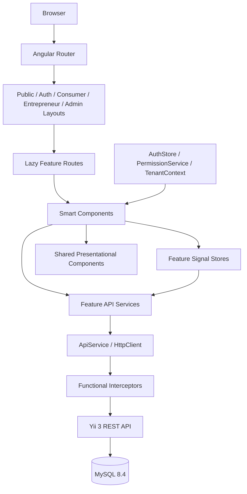
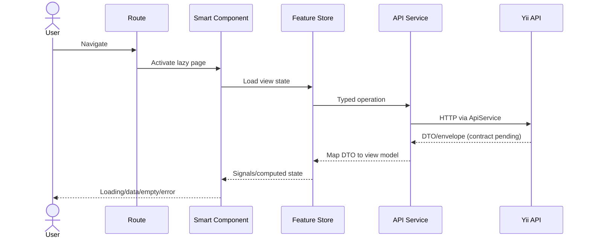

# BBG / BBC — Frontend Architecture & Requirements Specification

**Version:** 0.1 review draft · **Date:** 5 November 2026  
**Status:** Proposed; awaiting explicit approval. **Implementation:** Design only.

## 1. Scope and authority

This is Phase 1 only: Angular 22 frontend architecture and frontend requirements. It is grounded in the supplied BBG Marketplace functional list, BBC frontend/backend requirements update v1.2, components report v1.1, database design v1.2 and update v1.3, development environment reference, `.agents.zip`, and `agent-skills-kit.zip`.

The BBG functional source defines Consumer, Entrepreneur and Administrator and the marketplace journeys. BBC architecture/database documents additionally describe a tenant business-management workspace (members, catalogue, customers, sales, payments, invoices, expenses and reports). These are preserved as a scope candidate, not silently assumed to be in the BBG Phase 1 release.

Confirmed stack: Angular 22, TypeScript, Yii 3/PHP 8.4 API target, MySQL 8.4, Nginx, PHP-FPM, Docker Compose and Git. Do not use the prototype's React, Node/Express, tRPC, Wouter or Drizzle stack.

## 2. Architecture overview

**Recommendation:** standalone Angular components; feature-first lazy routes; smart route/container components; typed presentational components; Signals for synchronous state; RxJS for asynchronous composition; Reactive Forms; functional interceptors and guards; one HTTP wrapper; feature-scoped stores; strict TypeScript; server-side pagination/filtering; PWA shell with private-data cache exclusion.





Dependency direction: route/layout → feature smart component → feature service/store → core API abstraction. Shared presentational components never call HTTP, access stores, navigate or enforce permissions.

### Technology decisions

| Concern | Recommendation | Status |
|---|---|---|
| Components | Standalone | Proposed |
| Routing | Angular Router, lazy feature routes | Proposed |
| State | Signals + feature stores; RxJS for async | Proposed; no default NgRx |
| Forms | Typed Reactive Forms | Proposed |
| HTTP | `ApiService` wrapper + feature services | Architectural rule |
| Interceptors | Functional | Proposed |
| Authorization UI | Permission service + functional guards; unknown deny | Proposed |
| Styling | SCSS + CSS custom-property tokens | Proposed |
| UI primitives | Angular CDK; evaluate Angular Material | Pending approval |
| Charts | Not selected | Pending |
| Testing | Angular-compatible unit/component runner; Playwright E2E | Exact versions pending |
| PWA | Angular service worker if compatible with selected Angular 22 setup | Required capability; package decision pending |

Do not introduce libraries without checking Angular 22 compatibility and explaining the dependency.

## 3. Bootstrap and application composition

- `src/main.ts`: bootstrap.
- `src/app/app.config.ts`: router, HTTP, interceptors, providers and global error handling.
- `src/app/app.routes.ts`: top-level route tree.
- `src/app/core/config/`: typed runtime configuration; no secrets in frontend config.
- `src/app/core/initializers/session.initializer.ts`: best-effort session restore; public pages must not hang on restore.
- `src/app/core/initializers/pwa.initializer.ts`: PWA registration/update lifecycle.

## 4. Complete proposed folder structure

```text
frontend/
├── angular.json
├── package.json
├── package-lock.json
├── tsconfig.json
├── tsconfig.app.json
├── tsconfig.spec.json
├── public/
│   ├── favicon.ico
│   ├── manifest.webmanifest
│   └── icons/
└── src/
    ├── index.html
    ├── main.ts
    ├── styles.scss
    ├── environments/
    │   ├── environment.ts
    │   └── environment.production.ts
    ├── assets/{images,icons,fonts}/
    └── app/
        ├── app.component.{ts,html,scss,spec.ts}
        ├── app.config.ts
        ├── app.routes.ts
        ├── core/
        │   ├── config/{app-config.ts,app-config.token.ts}
        │   ├── auth/{auth.models.ts,auth-api.dto.ts,auth.service.ts,auth.store.ts,session.service.ts,auth.service.spec.ts}
        │   ├── permissions/{permission.models.ts,permission.service.ts,permission.guard.ts,permission.service.spec.ts}
        │   ├── tenant-context/{tenant-context.models.ts,tenant-context.service.ts,tenant-context.store.ts}
        │   ├── http/{api.service.ts,api-envelope.models.ts,api-error.models.ts,api-error.mapper.ts,api.service.spec.ts}
        │   ├── interceptors/{credentials.interceptor.ts,csrf.interceptor.ts,error.interceptor.ts,request-id.interceptor.ts}
        │   ├── guards/{authenticated.guard.ts,guest.guard.ts,role-context.guard.ts,unsaved-changes.guard.ts}
        │   ├── initializers/{session.initializer.ts,pwa.initializer.ts}
        │   ├── services/{loading.service.ts,toast.service.ts,error-handling.service.ts,notification.service.ts,title.service.ts}
        │   ├── layouts/{public-layout,auth-layout,consumer-layout,entrepreneur-layout,admin-layout}/
        │   └── utils/{date.utils.ts,currency.utils.ts,url.utils.ts}
        ├── shared/
        │   ├── components/{app-header,app-footer,app-sidebar,mobile-navigation,breadcrumb,search-input,filter-panel,pagination,data-table,confirmation-dialog,status-badge,subscription-badge,business-card,product-card,promotion-card,category-card,comment-list,like-button,enquiry-form,order-status-timeline,dashboard-stat-card,empty-state,loading-skeleton,error-state,permission-denied,toast-viewport,image-uploader}/
        │   ├── directives/{has-permission.directive.ts,autofocus.directive.ts}
        │   ├── pipes/{currency-display.pipe.ts,date-display.pipe.ts,status-label.pipe.ts}
        │   ├── validators/{file.validator.ts,matching-fields.validator.ts}
        │   ├── models/{pagination.models.ts,sort.models.ts,request-state.models.ts}
        │   └── utils/{form.utils.ts,media.utils.ts}
        ├── layouts/{public-shell,auth-shell,consumer-shell,entrepreneur-shell,admin-shell}/
        └── features/
            ├── home/{home.routes.ts,pages/home-page,components/hero-section,components/feature-highlights,services/home.service.ts}
            ├── auth/{auth.routes.ts,pages/login-page,pages/oauth-callback-page,pages/logout-page,pages/access-denied-page,services/authentication.service.ts,models/auth.models.ts,forms/login.form.ts}
            ├── profile/{profile.routes.ts,pages/profile-page,components/profile-form,services/profile.service.ts,models/profile.models.ts}
            ├── marketplace/
            │   ├── marketplace.routes.ts
            │   ├── directory/{pages/business-directory-page,components/business-search,components/business-filter,services/business-directory.service.ts,store/business-directory.store.ts,models/directory.models.ts}
            │   ├── storefront/{pages/business-storefront-page,components/storefront-header,components/storefront-product-grid,components/storefront-promotion-feed,services/storefront.service.ts,models/storefront.models.ts}
            │   ├── products/{pages/public-product-detail-page,services/public-product.service.ts,models/public-product.models.ts}
            │   └── promotions/{pages/promotion-feed-page,services/public-promotion.service.ts,models/public-promotion.models.ts}
            ├── consumer/
            │   ├── consumer.routes.ts
            │   ├── dashboard/
            │   ├── orders/{pages/order-list-page,pages/order-detail-page,pages/order-create-page,components/order-items-editor,components/payment-qr-panel,services/order.service.ts,store/order.store.ts,models/order.models.ts}
            │   ├── enquiries/{pages/my-enquiries-page,pages/enquiry-detail-page,services/consumer-enquiry.service.ts,store/consumer-enquiry.store.ts,models/enquiry.models.ts}
            │   └── engagement/{services/engagement.service.ts,models/engagement.models.ts}
            ├── entrepreneur/
            │   ├── entrepreneur.routes.ts
            │   ├── dashboard/
            │   ├── business/{pages/business-profile-page,pages/business-registration-page,pages/business-verification-page,components/business-profile-form,services/entrepreneur-business.service.ts,models/entrepreneur-business.models.ts}
            │   ├── subscriptions/{pages/subscription-plans-page,pages/subscription-detail-page,pages/subscription-request-page,components/payment-proof-uploader,services/subscription.service.ts,store/subscription.store.ts,models/subscription.models.ts}
            │   ├── products/{pages/product-list-page,pages/product-create-page,pages/product-edit-page,pages/product-detail-page,components/product-form,services/entrepreneur-product.service.ts,store/entrepreneur-product.store.ts,models/entrepreneur-product.models.ts}
            │   ├── promotions/{pages/promotion-list-page,pages/promotion-create-page,pages/promotion-edit-page,components/promotion-form,services/entrepreneur-promotion.service.ts,store/entrepreneur-promotion.store.ts,models/entrepreneur-promotion.models.ts}
            │   ├── orders/{pages/incoming-order-list-page,pages/incoming-order-detail-page,components/order-status-actions,services/incoming-order.service.ts,store/incoming-order.store.ts}
            │   └── enquiries/{pages/incoming-enquiry-list-page,pages/incoming-enquiry-detail-page,components/enquiry-response-form,services/incoming-enquiry.service.ts,store/incoming-enquiry.store.ts}
            ├── admin/
            │   ├── admin.routes.ts
            │   ├── dashboard/
            │   ├── users/
            │   ├── businesses/
            │   ├── subscriptions/
            │   ├── categories/
            │   ├── analytics/
            │   ├── moderation/
            │   └── system-health/
            ├── business-workspace/
            │   ├── workspace.routes.ts
            │   ├── tenant-switcher/
            │   ├── members/
            │   ├── catalogue/
            │   ├── customers/
            │   ├── sales/
            │   ├── payments/
            │   ├── invoices/
            │   ├── expenses/
            │   └── reports/
            └── future/
                ├── purchasing/  # reserved only; no Phase 1 routes/screens
                └── inventory/   # reserved only; no Phase 1 routes/screens
```

Core contains singleton capabilities; shared contains generic presentation; features own routes/services/models/stores. Workspace is a scope candidate. Purchasing/inventory are future placeholders only.

## 5. Layouts

| Layout | Responsibility |
|---|---|
| Public | Header, public navigation, content, footer |
| Authentication | Minimal branded login/callback/error shell |
| Consumer | Consumer navigation and dashboard shell |
| Entrepreneur | Business navigation and current business context |
| Admin | Separate platform-admin navigation/context |
| Workspace | Tenant selector and tenant-private workspace navigation, if approved |

Header, footer, sidebar, mobile navigation and breadcrumbs are reusable. Feature pages must not create duplicate navigation chrome. Role switching is not an authorization mechanism.

## 6. Route architecture

All routes are lazy-loaded by feature, kebab-case, carry title/breadcrumb metadata, and use `guestGuard`, `authenticatedGuard` and permission guards as applicable. The backend is the final authorization authority.

| Path | Component | Layout/access | Candidate permission |
|---|---|---|---|
| `/` | `HomePageComponent` | Public | Public |
| `/businesses` | `BusinessDirectoryPageComponent` | Public | Public |
| `/businesses/:businessSlug` | `BusinessStorefrontPageComponent` | Public | Public |
| `/businesses/:businessSlug/products/:productId` | `PublicProductDetailPageComponent` | Public | Public |
| `/promotions` | `PromotionFeedPageComponent` | Public | Public |
| `/login` | `LoginPageComponent` | Auth/guest | Public |
| `/auth/callback` | `OAuthCallbackPageComponent` | Auth/public callback | Provider contract pending |
| `/logout` | `LogoutPageComponent` | Authenticated | Authenticated |
| `/access-denied` | `AccessDeniedPageComponent` | Public/Auth | Public |
| `/profile` | `ProfilePageComponent` | Authenticated | `profile.view` |
| `/consumer` | `ConsumerDashboardPageComponent` | Consumer/authenticated | `consumer.dashboard.view` |
| `/consumer/orders` | `ConsumerOrderListPageComponent` | Consumer/authenticated | `order.own.view` |
| `/consumer/orders/new` | `ConsumerOrderCreatePageComponent` | Consumer/authenticated | `order.create` |
| `/consumer/orders/:orderId` | `ConsumerOrderDetailPageComponent` | Consumer/authenticated | `order.own.view` |
| `/consumer/enquiries` | `ConsumerEnquiryListPageComponent` | Consumer/authenticated | `enquiry.own.view` |
| `/consumer/enquiries/:enquiryId` | `ConsumerEnquiryDetailPageComponent` | Consumer/authenticated | `enquiry.own.view` |
| `/entrepreneur` | `EntrepreneurDashboardPageComponent` | Entrepreneur/authenticated | `dashboard.entrepreneur.view` |
| `/entrepreneur/business` | `BusinessProfilePageComponent` | Entrepreneur | `business.view` |
| `/entrepreneur/business/register` | `BusinessRegistrationPageComponent` | Entrepreneur | `business.create` |
| `/entrepreneur/business/verification` | `BusinessVerificationPageComponent` | Entrepreneur | `business.status.view` |
| `/entrepreneur/subscriptions` | `SubscriptionPlansPageComponent` | Entrepreneur | `subscription.view` |
| `/entrepreneur/subscriptions/request` | `SubscriptionRequestPageComponent` | Entrepreneur | `subscription.request` |
| `/entrepreneur/subscriptions/:subscriptionId` | `SubscriptionDetailPageComponent` | Entrepreneur | `subscription.view` |
| `/entrepreneur/products` | `ProductListPageComponent` | Entrepreneur | `product.view` |
| `/entrepreneur/products/new` | `ProductCreatePageComponent` | Entrepreneur | `product.create` |
| `/entrepreneur/products/:productId` | `ProductDetailPageComponent` | Entrepreneur | `product.view` |
| `/entrepreneur/products/:productId/edit` | `ProductEditPageComponent` | Entrepreneur | `product.update` |
| `/entrepreneur/promotions` | `PromotionListPageComponent` | Entrepreneur | `promotion.view` |
| `/entrepreneur/promotions/new` | `PromotionCreatePageComponent` | Entrepreneur | `promotion.create` |
| `/entrepreneur/promotions/:postId/edit` | `PromotionEditPageComponent` | Entrepreneur | `promotion.update` |
| `/entrepreneur/orders` | `IncomingOrderListPageComponent` | Entrepreneur | `order.business.view` |
| `/entrepreneur/orders/:orderId` | `IncomingOrderDetailPageComponent` | Entrepreneur | `order.business.view` |
| `/entrepreneur/enquiries` | `IncomingEnquiryListPageComponent` | Entrepreneur | `enquiry.business.view` |
| `/entrepreneur/enquiries/:enquiryId` | `IncomingEnquiryDetailPageComponent` | Entrepreneur | `enquiry.business.view` |
| `/admin` | `AdminDashboardPageComponent` | Platform admin | `admin.dashboard.view` |
| `/admin/users` | `AdminUserListPageComponent` | Platform admin | `user.manage` |
| `/admin/businesses` | `BusinessApprovalListPageComponent` | Platform admin | `business.approve` |
| `/admin/businesses/:businessId` | `BusinessReviewPageComponent` | Platform admin | `business.approve` |
| `/admin/subscriptions` | `SubscriptionApprovalListPageComponent` | Platform admin | `subscription.approve` |
| `/admin/subscriptions/:subscriptionId` | `SubscriptionReviewPageComponent` | Platform admin | `subscription.approve` |
| `/admin/categories` | `CategoryManagementPageComponent` | Platform admin | `category.manage` |
| `/admin/analytics` | `AdminAnalyticsPageComponent` | Platform admin | `analytics.view` |
| `/admin/moderation` | `ModerationQueuePageComponent` | Platform admin | `moderation.manage` |
| `/admin/moderation/:contentId` | `ModerationDetailPageComponent` | Platform admin | `moderation.manage` |
| `/admin/system-health` | `SystemHealthPageComponent` | Platform admin | `system.health.view` |
| `/workspace` | `WorkspaceHomePageComponent` | Tenant member; scope pending | `workspace.view` |
| `/workspace/catalogue` | `CatalogueListPageComponent` | Tenant member; scope pending | `catalogue.view` |
| `/workspace/customers` | `CustomerListPageComponent` | Tenant member; scope pending | `customer.view` |
| `/workspace/sales` | `SalesListPageComponent` | Tenant member; scope pending | `sales.view` |
| `/workspace/payments` | `PaymentListPageComponent` | Tenant member; scope pending | `payment.view` |
| `/workspace/invoices` | `InvoiceListPageComponent` | Tenant member; scope pending | `invoice.view` |
| `/workspace/expenses` | `ExpenseListPageComponent` | Tenant member; scope pending | `expense.view` |
| `/workspace/reports` | `WorkspaceReportsPageComponent` | Tenant member; scope pending | `report.view` |
| `/unauthorized` | `UnauthorizedPageComponent` | Public | Public |
| `/**` | `NotFoundPageComponent` | Public | Public |

Permission codes are candidates, not approved values. Cart is a documented placeholder; do not add a full cart route until persistence/checkout are specified. Password recovery/invitations are not in the primary BBG feature list and remain pending.

## 7. Component architecture

### 7.1 Classification

- **Smart/container:** route-level; owns route params, data loading, store/service calls, permission checks, error handling and navigation.
- **Dumb/presentational:** typed inputs and outputs only; no HTTP, store, router, permission service or business rules.
- **Shared:** reusable presentation contracts.
- **Feature-specific:** domain-specific presentation kept in its feature.
- **Layout:** app navigation and chrome.

### 7.2 Shared/layout component inventory

| Component | Type | Responsibility | Inputs | Outputs | Service/store |
|---|---|---|---|---|---|
| Public/Auth/Consumer/Entrepreneur/Admin/Workspace layouts | Layout | Page shell and navigation context | User/context/nav metadata | Navigation/context selection events | Shell may read AuthStore/TenantContext |
| Header/Footer/Sidebar/MobileNavigation/Breadcrumb | Presentational/layout | Navigation and wayfinding | Typed items, active route, labels | Selection/collapse | None |
| BusinessCard | Shared dumb | Public business summary | Business view model, tier visibility | Business selected | None |
| ProductCard | Shared dumb | Product summary/media/price | Product view model, mode | Product selected, like requested | None |
| PromotionCard | Shared dumb | Promotion content/media | Promotion, engagement summary | Post selected, like/comment requested | None |
| CategoryCard | Shared dumb | Category tile | Category | Category selected | None |
| SubscriptionBadge / StatusBadge | Shared dumb | Tier and state labels | Tier/status | None | None |
| SearchInput / FilterPanel | Shared dumb | Search and filter controls | Value/config/options | Changed/cleared/submitted | None |
| Pagination | Shared dumb | Page navigation | Page/page size/total | Page/page-size changed | None |
| DataTable | Shared dumb | Typed tabular presentation | Columns/rows/loading/empty | Row/sort/action events | None |
| ConfirmationDialog | Shared dumb | Destructive action confirmation | Title/message/labels/severity | Confirm/cancel | None |
| CommentList / LikeButton | Shared dumb | Engagement display | Comments/liked/count | Reply/delete/like events | None |
| EnquiryForm | Shared dumb | Enquiry message capture | Initial value/submitting | Submitted/cancelled | None |
| OrderStatusTimeline | Shared dumb | Order history presentation | Events/current status | Optional event selection | None |
| DashboardStatCard | Shared dumb | KPI presentation | Label/value/trend/icon | Selected | None |
| EmptyState / LoadingSkeleton / ErrorState / PermissionDenied | Shared dumb | Standard screen states | Copy/state/retry config | Retry/action/return | None |
| ToastViewport | Shared dumb | Notification rendering | Notifications | Dismissed | None |
| ImageUploader | Shared dumb | File selection/preview/progress | Files/accept/limits/disabled | Files selected/removed | None |

### 7.3 Smart/container component inventory

| Smart component | Feature | Responsibility | Services/store |
|---|---|---|---|
| HomePage | Home | Categories, promotions, hero composition | HomeService |
| BusinessDirectoryPage | Marketplace | Search/filter/paginate businesses | BusinessDirectoryService + DirectoryStore |
| BusinessStorefrontPage | Marketplace | Business profile/products/promotions | StorefrontService |
| PublicProductDetailPage | Marketplace | Product and engagement detail | PublicProductService + EngagementService |
| PromotionFeedPage | Marketplace | Public promotions list | PublicPromotionService |
| LoginPage / OAuthCallbackPage / LogoutPage | Auth | Login lifecycle and session state | AuthenticationService, SessionService, AuthStore |
| ProfilePage | Profile | Profile read/update | ProfileService, AuthStore |
| ConsumerDashboardPage | Consumer | Orders/enquiries summary | ConsumerDashboardService |
| ConsumerOrderList/Create/DetailPage | Consumer | Own order list, creation, QR, status | OrderService + OrderStore |
| ConsumerEnquiryList/DetailPage | Consumer | Own enquiry history and response | ConsumerEnquiryService + store |
| EntrepreneurDashboardPage | Entrepreneur | Business KPIs and quick actions | EntrepreneurDashboardService |
| BusinessRegistration/Profile/VerificationPage | Entrepreneur | Profile lifecycle and verification state | EntrepreneurBusinessService |
| SubscriptionPlans/Request/DetailPage | Entrepreneur | Plan, request, proof, renewal | SubscriptionService + SubscriptionStore |
| ProductList/Create/Edit/DetailPage | Entrepreneur | Product CRUD | EntrepreneurProductService + store |
| PromotionList/Create/EditPage | Entrepreneur | Promotion CRUD | EntrepreneurPromotionService + store |
| IncomingOrderList/DetailPage | Entrepreneur | Incoming orders and allowed status changes | IncomingOrderService + store |
| IncomingEnquiryList/DetailPage | Entrepreneur | Incoming enquiries and responses | IncomingEnquiryService + store |
| AdminDashboardPage | Admin | Metrics and queues | AdminAnalyticsService |
| AdminUserListPage | Admin | User list/suspension | AdminUserService |
| BusinessApprovalList/ReviewPage | Admin | Business review/decision | BusinessApprovalService |
| SubscriptionApprovalList/ReviewPage | Admin | Proof review and subscription decision | SubscriptionApprovalService |
| CategoryManagementPage | Admin | Category CRUD and usage count | CategoryService |
| AdminAnalyticsPage | Admin | Period analytics | AdminAnalyticsService |
| ModerationQueue/DetailPage | Admin | Flagged content/action/history | ModerationService |
| SystemHealthPage | Admin | Safe health summary | SystemHealthService |
| WorkspaceHome/Catalogue/Customer/Sales/Payment/Invoice/Expense/Report pages | Workspace candidate | Tenant business operations | Corresponding workspace feature services/stores |

### 7.4 Feature-specific presentational components

`HeroSection`, `FeatureHighlights`, `StorefrontHeader`, `StorefrontProductGrid`, `StorefrontPromotionFeed`, `ProductForm`, `PromotionForm`, `BusinessProfileForm`, `PaymentProofUploader`, `PaymentQrPanel`, `OrderItemsEditor`, `OrderStatusActions`, `EnquiryResponseForm`, `CategoryForm`, `BusinessReviewPanel`, `SubscriptionReviewPanel`, `ModerationActionDialog`.

All are input/output components. Smart parents own permissions, data loading, navigation and side effects. Reuse generic components before adding new shared components.

## 8. Feature-wise architecture

### Public and authentication
- Pages: home, directory, storefront, public product detail, promotions, login, callback, logout, access denied, profile.
- Services: Home, BusinessDirectory, Storefront, PublicProduct, PublicPromotion, Authentication, Session, Profile.
- State: AuthStore owns current user/session/roles/permissions. Directory filters/page live in URL; transient result state is feature-local.
- APIs required (all paths `UNKNOWN`): home summary, categories, directory search, storefront, public products/promotions, auth callback/session/logout, profile read/update.
- Permissions: public reads; profile operations require authenticated permissions.
- Tests: anonymous public access, callback/session behavior, search cancellation, no unpublished business/product leakage.

### Consumer
- Pages: dashboard, own orders, create order, order detail/payment QR, own enquiries/detail.
- Services/stores: OrderService/OrderStore, ConsumerEnquiryService/ConsumerEnquiryStore, EngagementService.
- Forms: order lines, enquiry message, comments. Cart remains a placeholder.
- APIs `UNKNOWN`: own orders/detail/create, payment instructions/QR, own enquiries/create, likes, comments.
- Candidate permissions: `order.own.view`, `order.create`, `enquiry.own.view`, `enquiry.create`, `engagement.like`, `engagement.comment`.
- Unknown rules: cart persistence, quantity precision, minimum order, delivery/pickup, tax, payment confirmation and comment limits.
- Tests: ownership isolation, duplicate submit, payment QR from server, engagement failure rollback.

### Entrepreneur
- Pages: dashboard, business registration/profile/verification, plans/request/detail/renewal, product CRUD, promotion CRUD, incoming orders, incoming enquiries.
- Services/stores: EntrepreneurBusinessService; SubscriptionService/SubscriptionStore; EntrepreneurProductService/ProductStore; EntrepreneurPromotionService/PromotionStore; IncomingOrderService/OrderStore; IncomingEnquiryService/EnquiryStore.
- Forms: business profile, subscription request/proof, product, promotion, order status, enquiry response.
- APIs `UNKNOWN`: business CRUD/status, plans/entitlements, subscription request/proof/renewal, product CRUD/media, promotion CRUD/media, incoming orders/status, incoming enquiries/respond/close.
- Entitlements: BBG says Silver profile only; Gold profile+catalogue up to 50; Platinum profile+products+promotions. Database design says entitlements should be configurable and tier names not hardcoded as system logic. UI must render server-supplied plan/entitlement data; backend enforces.
- Tests: entitlement denial, product limit, media validation, order transition, tenant/business ownership.

### Administrator
- Pages: dashboard, users, business approval, subscription approval, categories, analytics, moderation, system health.
- Services: AdminUserService, BusinessApprovalService, SubscriptionApprovalService, CategoryService, AdminAnalyticsService, ModerationService, SystemHealthService.
- Forms: approve/reject business/subscription, category create/edit, moderation action/reason, suspend user/business.
- APIs `UNKNOWN`: list/detail/suspend users, business queue/decision, subscription queue/proof/decision, category CRUD/stats, analytics, moderation queue/action/history, safe health summary.
- Candidate permissions: `user.manage`, `business.approve`, `subscription.approve`, `category.manage`, `analytics.view`, `moderation.manage`, `system.health.view`.
- Tests: platform-admin isolation, stale review conflict, audit history, unauthorized API denied.

### Business workspace candidate
The BBC report/database add tenant selector/members, catalogue, customers, sales, payments, invoices, expenses and reports. These functions lack detailed BBG workflow/form/permission requirements. They remain pending release-scope approval. Do not infer complete UX from DB columns.

### Future scope
Purchasing/suppliers/goods receiving and inventory/FIFO/reservations/transfers/adjustments remain future scope. Payment gateway integration, refunds, email/SMS/push, ratings/reviews, advanced location search, wishlist, bulk ordering and automated invoices are future enhancements. Full offline writes/background sync are not implied.

## 9. Service architecture

All HTTP passes through `ApiService`; components do not use `HttpClient`. Feature services own endpoint constants, request/response DTOs and DTO-to-view-model mapping. Endpoints, fields and response envelope are `UNKNOWN` until backend API design.

| Service | Responsibility / conceptual operations | Store interaction |
|---|---|---|
| `ApiService` | typed get/post/put/patch/delete wrapper | None |
| `AuthenticationService` | beginLogin, completeCallback, getSession | AuthStore |
| `SessionService` | restore, terminate | AuthStore reset |
| `ProfileService` | getProfile, updateProfile | AuthStore/profile state |
| `PermissionService` | has, hasAny, hasAll; unknown deny | AuthStore snapshot |
| `TenantContextService` | get/select permitted tenant | TenantContextStore |
| `HomeService` | home summary/categories/promotions | Page-local |
| `BusinessDirectoryService` | searchBusinesses(filters) | DirectoryStore |
| `StorefrontService` | getStorefront(slug) | Page-local |
| `PublicProductService` | getProduct(slug,id) | Page-local |
| `PublicPromotionService` | getPromotions(filters) | Page-local |
| `EngagementService` | like/unlike/comments/addComment | Owning feature refresh |
| `OrderService` | listOwn/getOwn/create/getPaymentInstructions | OrderStore |
| `ConsumerEnquiryService` | listOwn/getOwn/create | ConsumerEnquiryStore |
| `ConsumerDashboardService` | getSummary | Page-local |
| `EntrepreneurBusinessService` | getMine/create/update/getVerification | Feature state |
| `SubscriptionService` | listPlans/listMine/request/uploadProof/requestRenewal | SubscriptionStore |
| `EntrepreneurProductService` | list/get/create/update/softDelete/uploadMedia | ProductStore |
| `EntrepreneurPromotionService` | list/create/update/softDelete/uploadMedia | PromotionStore |
| `IncomingOrderService` | list/get/requestStatusChange | IncomingOrderStore |
| `IncomingEnquiryService` | list/get/respond/close | IncomingEnquiryStore |
| `AdminUserService` | list/get/suspend/restore | AdminStore/page state |
| `BusinessApprovalService` | listPending/get/approve/reject | AdminStore/page state |
| `SubscriptionApprovalService` | listPending/get/approve/reject | AdminStore/page state |
| `CategoryService` | list/create/update/delete | CategoryStore |
| `AdminAnalyticsService` | summary/trends | Page-local/AdminStore |
| `ModerationService` | reports/detail/action/history | AdminStore |
| `SystemHealthService` | safe health summary | Page-local |
| `WorkspaceDashboardService` | tenant summary (if approved) | Workspace state |
| `CatalogueService`, `CustomerService`, `SalesService`, `PaymentService`, `InvoiceService`, `ExpenseService`, `WorkspaceReportService` | Workspace operations (if approved) | Corresponding feature stores |
| `NotificationService` | notifications/preferences if enabled | NotificationStore |
| `LoadingService`, `ErrorHandlingService`, `ToastService` | shared UX feedback and safe error mapping | transient UI only |

Search/load streams cancel stale requests (`switchMap`); mutations block duplicate submits (`exhaustMap`/in-flight state); dependent writes run sequentially. No business rule in interceptors.

## 10. State management

Use Signals + feature-scoped stores; RxJS at async boundaries. No NgRx by default. No duplicate server data across component/service/store.

| Store | State | Actions/methods | Reset |
|---|---|---|---|
| `AuthStore` | sessionStatus, currentUser, roles, permissions, authError | restore, setSession, refreshPermissions, logout, reset | Logout/expiry |
| `TenantContextStore` | activeTenant, availableTenants, loading, error | loadMemberships, selectTenant, clear | Logout/context change |
| `BusinessDirectoryStore` | items, filters, pagination, requestStatus, error | search, setFilters, setPage, reset | Context/cache policy |
| `CategoryStore` | categories, requestStatus, error | loadPublic, loadAdmin, invalidate | Logout for private state |
| `SubscriptionStore` | plans, subscriptions, selected, status, error | loadPlans, loadMine, request, uploadProof, reset | Logout/tenant change |
| `EntrepreneurProductStore` | items, pagination, selected, status, error | load/get/create/update/softDelete/reset | Logout/business change |
| `EntrepreneurPromotionStore` | items, pagination, selected, status, error | load/create/update/softDelete/reset | Logout/business change |
| `OrderStore` | ownOrders, selected, pagination, status, error | loadMine/getMine/create/refresh/reset | Logout |
| `IncomingOrderStore` | orders, selected, pagination, status, error | load/get/changeStatus/refresh/reset | Logout/business change |
| `ConsumerEnquiryStore` | enquiries, selected, pagination, status, error | loadMine/getMine/create/refresh/reset | Logout |
| `IncomingEnquiryStore` | enquiries, selected, pagination, status, error | load/get/respond/close/reset | Logout/business change |
| `AdminStore` | queue filters, pending queues, moderation list, request states | loadUsers/loadBusinessQueue/loadSubscriptionQueue/loadModerationQueue/reset | Logout |
| `NotificationStore` | items, unreadCount, preferences, status, error | load/markRead/updatePreferences/reset | Logout |

Persistence: Auth/session is server-managed; do not persist tokens. URL stores bookmarkable filters. Component state is ephemeral. No other persisted keys without explicit approval. On tenant/business context change, clear all scoped data before loading the new context.

## 11. TypeScript models and DTO boundaries

Illustrative view-model types (wire DTOs are separate and must be agreed with backend):

```typescript
type Id = string;
type RequestStatus = 'idle' | 'loading' | 'success' | 'error';

interface PageRequest {
  page: number;
  pageSize: number;
  sortBy?: string;
  sortDirection?: 'asc' | 'desc';
}
interface PageResult<T> {
  items: T[];
  page: number;
  pageSize: number;
  totalItems?: number;
  totalPages?: number;
  hasNextPage: boolean;
  hasPreviousPage: boolean;
}
interface UserViewModel {
  id: Id; fullName: string; email: string | null;
  mobile: string | null; profileImageUrl: string | null;
}
interface RoleViewModel { code: string; name: string; scope: 'platform' | 'tenant'; }
interface PermissionViewModel { code: string; module: string; }
interface CategoryViewModel { id: Id; name: string; description: string | null; imageUrl: string | null; }
interface BusinessViewModel {
  id: Id; slug: string; name: string; description: string | null;
  category: CategoryViewModel | null; phone: string | null;
  whatsappNumber: string | null; tier: string | null;
  approvalState: string; publicStatus: string;
}
interface SubscriptionPlanViewModel {
  id: Id; name: string; description: string | null; price: number;
  currency: string; billingCycle: string; entitlements: PlanEntitlementViewModel[];
}
interface PlanEntitlementViewModel { code: string; value: string | boolean | number; }
interface SubscriptionViewModel {
  id: Id; plan: SubscriptionPlanViewModel; status: string;
  startsOn: string | null; endsOn: string | null; renewalDueOn: string | null;
  amount: number; currency: string;
}
interface ProductMediaViewModel {
  id: Id; url: string; mediaType: string; altText: string | null; sortOrder: number;
}
interface ProductViewModel {
  id: Id; businessId: Id; name: string; description: string | null;
  price: number; currency: string; images: ProductMediaViewModel[];
  publicationState: string;
}
interface PromotionPostViewModel {
  id: Id; businessId: Id; description: string; media: ProductMediaViewModel[];
  publicationState: string; createdOn: string; likeCount: number; commentCount: number;
}
interface OrderItemViewModel {
  id: Id; productId: Id; productName: string; quantity: number;
  unitPrice: number; lineTotal: number;
}
interface OrderViewModel {
  id: Id; businessId: Id; consumerId: Id; items: OrderItemViewModel[];
  totalAmount: number; currency: string; orderStatus: string;
  paymentStatus: string; createdOn: string;
}
interface PaymentViewModel {
  id: Id; amount: number; currency: string; paymentStatus: string;
  paymentReference: string | null; paymentInstructions: string | null;
  qrImageUrl: string | null;
}
interface EnquiryMessageViewModel {
  id: Id; senderId: Id; message: string; createdOn: string;
}
interface EnquiryViewModel {
  id: Id; businessId: Id; consumerId: Id; message: string;
  status: string; createdOn: string; responses: EnquiryMessageViewModel[];
}
interface LikeViewModel { targetType: 'PRODUCT' | 'POST'; targetId: Id; liked: boolean; count: number; }
interface CommentViewModel {
  id: Id; targetType: 'PRODUCT' | 'POST'; targetId: Id;
  authorName: string; message: string; createdOn: string;
}
interface NotificationPreferenceViewModel { channel: string; enabled: boolean; }
interface DashboardStatisticsViewModel {
  key: string; label: string; value: number | string; change?: number | null; periodLabel?: string;
}
```

Relationships: users have role assignments/memberships; business belongs to category; business owns subscriptions/products/posts/orders/enquiries; subscription references plan/entitlements; product has media; order has items and payments; enquiry has messages; users create likes/comments on products/posts. Notification preferences belong to users (tenant context pending).

DTO mapping rules: preserve meaningful nulls; normalize wire casing in service; date values remain ISO strings until display; no arbitrary entity fields from forms; financial totals remain server-authoritative; no client floating-point calculation as source of truth.

## 12. Forms and validation

Client validation is for usability; backend validation is authoritative. Unknown rules must remain unknown.

| Form | Source-supported fields | Client validation | Pending |
|---|---|---|---|
| Login/callback | Provider/callback state | Callback state/safe error | Provider and payload |
| Profile | Name, email, mobile, profile image | Format only after constraints confirmed | Requiredness, verification, uniqueness |
| Business registration/edit | Name, description, category, phone, WhatsApp | Confirmed requiredness only | Legal/address fields, docs, post-approval edit rules |
| Subscription request | Plan, payment reference, proof | Required plan/proof if confirmed; file type/size | Price, cycle, expiry, proof policy |
| Payment proof | File/reference | File selection/type/size | Accepted formats/limits/retention |
| Product create/edit | Name, description, price, images | Required/name/price only when confirmed | Currency, SKU, quantity, variants, tax, media limits |
| Promotion create/edit | Description, images | Content/file checks when rules approved | Text/media limits, scheduling/expiry |
| Enquiry | Message | Non-empty if confirmed | Length, attachments, rate limit |
| Enquiry response | Message | Non-empty if confirmed | Length/edit/close rules |
| Comment | Message | Non-empty | Length/edit/delete/moderation policy |
| Order create | Business, product, quantity | Positive quantity as basic guard; line rules pending | Cart, quantity precision, delivery, tax, payment |
| Order status | Target status/note | Only show server-provided allowed actions | Transition graph |
| Category | Name, description | Requiredness/uniqueness pending | Slug/hierarchy/image |
| Business/subscription decision | Decision, notes/reason | Decision required; reason policy pending | Rejection reason mandatory? |
| Moderation/suspension | Action, reason | Confirm destructive action | Action types, duration, appeals |

Submission behavior: block duplicate submit; preserve values on recoverable errors; map server field errors; display safe general errors; success only after API success; destructive actions name the entity.

## 13. UI/UX and design system

Brand colors from BBG: primary green `#10B981`, accent yellow `#FBBF24`. Use semantic status tokens and text/icons, not color alone. Font family and full neutral/success/warning/danger palette require design approval.

Proposed breakpoints: small 360–639 px; medium 640–767 px; large 768–1023 px; extra large 1024–1279 px; wide 1280 px+. Test 375, 768 and 1280 px. Primary action must be reachable without horizontal scrolling; touch targets ≥40 px; no hover-only actions.

Light/dark theme is referenced in BBG source. Use semantic CSS tokens and dark equivalents for every custom surface/text. Persisting theme preference is pending.

Every screen must handle:
- Loading with stable skeleton.
- Empty with reason and next action.
- Safe error and retry where useful.
- Permission denied.
- Field validation.
- Success feedback naming entity/action.
- Partial failure for any approved batch operation.
- Destructive confirmation.
- Offline/connection-lost state.

Accessibility: semantic landmarks/headings, labeled inputs, keyboard operation, visible focus, focus trap/restore for dialogs, Escape handling, screen-reader announcements, meaningful alt text, contrast checks, chart text/table equivalent, reduced motion.

## 14. Frontend security

- Never store access/refresh tokens in localStorage/sessionStorage.
- If cookie auth is selected: secure, HttpOnly, SameSite cookie plus approved CSRF defense.
- If bearer auth is selected: token storage/refresh policy must be approved; memory-only access token preferred.
- CORS is server configured.
- Guards/directives are UX only; Yii 3 authorizes every protected request.
- Never trust client-supplied tenant ID.
- Render user-generated content as text or through an explicit sanitization policy.
- Validate uploads client-side for UX and server-side for security.
- Exclude tenant-private, profile, payment and privileged responses from public/service-worker caches.
- Clear user-specific stores on logout/expiry and tenant-scoped stores on context change.
- Never log tokens, secrets, payment proof contents or unnecessary PII.

## 15. Performance and PWA

- Server-side filtering, sorting and pagination; no full-table downloads.
- Apply tenant scope and active-record filter on backend before pagination/counts.
- Configurable backend maximum page size; exact values pending.
- Debounced search; cancel stale requests.
- Virtual scrolling only for genuinely large visible collections.
- Stable track keys; lazy media and thumbnails.
- Cursor/keyset pagination only if needed and approved.
- Batch/stream large exports; do not hold huge datasets in browser memory.
- PWA manifest/icons, service worker, application-shell cache, offline fallback, connectivity status and safe update prompt.
- Full offline order/payment/inventory writes and background sync are not implied.

## 16. Testing strategy

| Level | Tests |
|---|---|
| Unit | DTO mapping, validators, formatting, permission evaluation |
| Component | Inputs/outputs, UI states, keyboard/accessibility basics |
| Service | Endpoint/payload, DTO mapping, envelope/transport errors |
| Store | Initial/load success/failure/cancel/mutation/reset |
| Guard/interceptor | Anonymous/protected, permission default deny, session/error |
| Integration | Feature screen + service + store with mocked API |
| E2E | Consumer, entrepreneur and admin workflows |
| Responsive | 375/768/1280 px |
| Accessibility | Keyboard, focus, labels, semantics, contrast, reduced motion |

**Consumer E2E:** public home → category/directory → search → storefront → product/promotions → like/comment → enquiry → order → QR → status tracking; verify another consumer's order is inaccessible.

**Entrepreneur E2E:** login → dashboard → register business → pending/approved status → plans/request/proof → product entitlement checks → promotion entitlement check → incoming order/status → enquiry response → consumer context switch without privilege escalation.

**Admin E2E:** login → dashboard → business queue/review/decision → subscription proof/decision → category CRUD → analytics → moderation action/history → safe health summary; verify non-admin cannot access admin APIs by changing route/browser state.

Negative tests: unknown permission denies; cross-tenant access blocked; stale search does not overwrite latest; duplicate submit blocked; failed mutation never shows success; logout clears state; private data never enters public PWA cache.

## 17. Frontend requirements register

Priorities: Must / Should / Could. Permission keys and endpoints below are candidates/UNKNOWN until approved.

### Authentication and shared

| ID | Requirement | Preconditions / flow | Validation/API | Components/store | Acceptance criteria | Priority |
|---|---|---|---|---|---|---|
| FE-AUTH-001 | Initiate approved login | Guest opens login → provider flow → callback | Provider/callback UNKNOWN | Login, AuthService, AuthStore | Successful callback restores session; failure leaves guest state | Must |
| FE-AUTH-002 | Restore session | App starts → restore → authenticated or guest | Session endpoint UNKNOWN | SessionService/AuthStore | Valid session opens protected routes; expired session is guest | Must |
| FE-AUTH-003 | Logout | Authenticated user → server logout → reset | Revocation contract UNKNOWN | Logout, SessionService/AuthStore | Session ends and user stores clear | Must |
| FE-AUTH-004 | View/update profile | Load → edit → save | Field rules/API UNKNOWN | ProfilePage/ProfileService | Server-returned profile shown; field errors mapped | Should |
| FE-AUTH-005 | Permission-aware navigation | Load server permission snapshot | Permission contract UNKNOWN | PermissionService/guards/directive | Unknown permission denies; backend remains authority | Must |
| FE-AUTH-006 | Safe role/context switching | User selects allowed context | Context API UNKNOWN | Layout/AuthStore/TenantContextStore | Switching UI never adds backend privileges | Must |
| FE-SHARED-001 | Central API wrapper | Feature service uses ApiService | Envelope UNKNOWN | ApiService/interceptors | No HTTP in feature components; safe errors normalized | Must |
| FE-SHARED-002 | Consistent UI states | Each request transitions state | Per operation | Shared state components | Loading/empty/error/denied/success handled | Must |
| FE-SHARED-003 | Responsive layout | Use all role screens on mobile/tablet/desktop | N/A | Layout/shared components | 375/768/1280 layouts usable | Must |
| FE-SHARED-004 | Server pagination | List loads page/filter | Pagination API UNKNOWN | DataTable/Pagination/store | Full table is not downloaded; backend limit obeyed | Must |
| FE-SHARED-005 | Debounced search | Search text changes | Search fields/API UNKNOWN | SearchInput/store | Stale response cannot overwrite newest result | Must |
| FE-SEC-001 | Secure auth state | Session restored | Auth policy pending | AuthStore | No auth token in local/session storage | Must |
| FE-SEC-002 | Tenant isolation UX | Tenant member changes context | Tenant API UNKNOWN | TenantContextStore | Old tenant data cleared; backend expected to verify membership | Must |
| FE-UX-001 | Accessibility | Keyboard/screen-reader use | N/A | All components | All actions keyboard reachable/labeled/focused | Must |
| FE-UX-002 | Theme support | User views light/dark | Persistence pending | Theme service/layout | Custom surfaces readable in both themes | Should |
| FE-PWA-001 | Installable offline shell | Install/open offline | PWA config pending | Manifest/service worker | Shell/fallback works offline; private APIs not cached | Must |

### Consumer

| ID | Requirement | Flow / validation | API | Components/store | Acceptance criteria | Priority |
|---|---|---|---|---|---|---|
| FE-CONS-001 | Home hero and CTA | Open home → Explore Businesses | Home API UNKNOWN | HomePage/Hero | Visitor can reach directory | Must |
| FE-CONS-002 | Category browse | Load categories → select | Category API UNKNOWN | CategoryCard | Selected category filters directory | Must |
| FE-CONS-003 | Latest promotions | Load public feed | Promotion API UNKNOWN | PromotionFeed/PromotionCard | Only eligible published promotions appear | Must |
| FE-CONS-004 | Business directory | List active businesses | Directory API UNKNOWN | Directory/BusinessCard/Store | Active approved businesses shown | Must |
| FE-CONS-005 | Business search | Debounced name search/clear | Search API UNKNOWN | SearchInput/Store | Search and clear work against server results | Must |
| FE-CONS-006 | Category filter | Apply/clear category | Filter API UNKNOWN | FilterPanel/Store | Clear restores unfiltered result | Must |
| FE-CONS-007 | Storefront | Open slug → profile/products/promotions | Storefront API UNKNOWN | Storefront components | Correct business data and eligibility displayed | Must |
| FE-CONS-008 | WhatsApp contact | Click chat CTA | API supplies number/link | StorefrontHeader | Safe deep link opens correct business contact | Should |
| FE-CONS-009 | Public product detail | Select product | Product API UNKNOWN | ProductDetail | Details/media match server response | Must |
| FE-CONS-010 | Like product/post | Toggle like | Like API/idempotency UNKNOWN | LikeButton/EngagementService | UI reflects server result; failure rolls back | Must |
| FE-CONS-011 | Comments | Load/add comments | Comment API/length UNKNOWN | CommentList | Comment appears after success with timestamp | Must |
| FE-CONS-012 | Send enquiry | Submit message | Enquiry API UNKNOWN | EnquiryForm | Successful enquiry is recorded and confirmed | Must |
| FE-CONS-013 | Enquiry history | List own/status/response | Enquiry API UNKNOWN | ConsumerEnquiry pages/store | User sees only own enquiry history | Must |
| FE-CONS-014 | Cart placeholder | Show placeholder only | No committed cart API | Placeholder | No false claim of persisted cart/checkout | Could |
| FE-CONS-015 | Create order | Select products → submit | Order API/quantity rules UNKNOWN | OrderCreate/OrderStore | Server confirms order; duplicate submit blocked | Must |
| FE-CONS-016 | Display UPI QR | Load server payment instruction | Payment QR contract UNKNOWN | PaymentQrPanel | QR/instructions are backend supplied, never fabricated | Must |
| FE-CONS-017 | Order history/detail | List/detail/status timeline | Order API UNKNOWN | Order pages/store | Only own orders accessible | Must |
| FE-CONS-018 | Consumer dashboard | Show orders/enquiries/quick actions | Summary API UNKNOWN | Dashboard | Summary and empty states work | Should |

### Entrepreneur

| ID | Requirement | Flow / validation | API | Components/store | Acceptance criteria | Priority |
|---|---|---|---|---|---|---|
| FE-ENT-001 | Register business | Submit profile | Business fields/API UNKNOWN | Registration/Form | Server review state shown after submit | Must |
| FE-ENT-002 | Manage business profile | Load/edit/save | Editable fields UNKNOWN | Profile/Form | Only permitted fields can be changed | Must |
| FE-ENT-003 | View verification | Show status/notes | Status API UNKNOWN | Verification page | Status matches server | Must |
| FE-ENT-004 | View plans | Show tiers/benefits/prices | Plan API; price/cycle UNKNOWN | Plans/Badge | Plan details server-driven | Must |
| FE-ENT-005 | Request subscription | Select plan/upload proof | Subscription/proof API UNKNOWN | Request/ProofUploader/Store | Pending state shown; upload failure recoverable | Must |
| FE-ENT-006 | Renewal/status | View current/renew if eligible | Renewal rules/API UNKNOWN | Detail/Store | Renewal only when server says eligible | Must |
| FE-ENT-007 | Product CRUD | List/create/edit/soft-delete | Product API UNKNOWN | Product pages/Form/Store | Entitlement and limits enforced by backend | Must |
| FE-ENT-008 | Product media | Upload/link images | Media API/file rules UNKNOWN | ImageUploader/ProductForm | Invalid file explained; server media displayed | Must |
| FE-ENT-009 | Promotion CRUD | Create/edit/delete | Promotion API UNKNOWN | Promotion pages/Form/Store | Only entitled Platinum account can create | Must |
| FE-ENT-010 | Promotion engagement | View likes/comments | Engagement API UNKNOWN | PromotionCard/CommentList | Counts reflect server data | Should |
| FE-ENT-011 | Incoming orders | List/detail owned-business orders | Order API UNKNOWN | Incoming order pages/store | Only authorized business orders shown | Must |
| FE-ENT-012 | Order status update | Request allowed transition | Transition API UNKNOWN | StatusActions | Only server-approved transitions offered | Must |
| FE-ENT-013 | Incoming enquiries | List/detail | Enquiry API UNKNOWN | Enquiry pages/store | Only authorized business enquiries shown | Must |
| FE-ENT-014 | Respond/close enquiry | Submit response/status | Enquiry API/state UNKNOWN | ResponseForm | New response/status shown after server success | Must |
| FE-ENT-015 | Entrepreneur dashboard | Show products/orders/enquiries/subscription | Summary API UNKNOWN | Dashboard | Summary/quick actions render | Should |
| FE-ENT-016 | Consumer-mode access | Switch allowed UI context | Context contract UNKNOWN | Layout/AuthStore | No privilege escalation | Should |

### Administrator

| ID | Requirement | Flow / validation | API | Components/store | Acceptance criteria | Priority |
|---|---|---|---|---|---|---|
| FE-ADMIN-001 | Admin dashboard | Metrics and queues | Analytics API UNKNOWN | Dashboard | Permitted metrics and safe errors shown | Must |
| FE-ADMIN-002 | User management | Search/list/detail | User API UNKNOWN | UserList/DataTable | Paginated and permission protected | Must |
| FE-ADMIN-003 | Suspend user | Confirm action | Suspension policy/API UNKNOWN | UserService/Dialog | Status refresh only after success | Must |
| FE-ADMIN-004 | Business approval queue | List pending businesses | Approval API UNKNOWN | ApprovalList | Pending queue displayed with pagination | Must |
| FE-ADMIN-005 | Approve/reject business | Review → decision/notes | Decision API/reason policy UNKNOWN | ReviewPage/Form | Decision reflects server; stale conflict shown | Must |
| FE-ADMIN-006 | Subscription queue | List pending requests/proof | Subscription API UNKNOWN | SubscriptionQueue | Authorized admin can inspect proof | Must |
| FE-ADMIN-007 | Verify payment/decide subscription | Review proof → approve/reject | Payment contract UNKNOWN | ReviewPage | Upload alone never implies payment approval | Must |
| FE-ADMIN-008 | Active subscriptions | List/filter | Subscription API UNKNOWN | Subscription screen | Active list is server-filtered/paginated | Should |
| FE-ADMIN-009 | Category CRUD | Add/edit/delete | Category API/dependencies UNKNOWN | CategoryManagement/Form | Dependency conflict blocks unsafe delete | Must |
| FE-ADMIN-010 | Category statistics | Show business count/category | Analytics API UNKNOWN | Category table | Counts come from backend | Should |
| FE-ADMIN-011 | Analytics | User/business/subscription/order metrics | Metric definitions/API UNKNOWN | AnalyticsPage | Values/periods come from API | Must |
| FE-ADMIN-012 | Moderation queue | List flagged posts/comments | Moderation API UNKNOWN | ModerationQueue | Only eligible reports shown | Must |
| FE-ADMIN-013 | Moderation action | Remove content/suspend account | Action policy/API UNKNOWN | ModerationDetail/Dialog | Action/audit history shown after success | Must |
| FE-ADMIN-014 | Moderation history | Filter past actions | History API UNKNOWN | ModerationHistory | Authorized actor can inspect history | Should |
| FE-ADMIN-015 | System health | Show safe DB/server status | Health API/metrics UNKNOWN | HealthPage | No secrets/stack traces exposed | Should |
| FE-ADMIN-016 | Admin role switch | Test permitted dashboards | Context contract UNKNOWN | AdminLayout/AuthStore | Cannot bypass backend permissions | Should |

### Workspace scope candidates

| ID | Requirement | Missing contract | Status |
|---|---|---|---|
| FE-WORK-001 | Tenant workspace/context | Tenant API and Phase 1 scope | Pending |
| FE-WORK-002 | Tenant members/roles | Membership and permission workflows | Pending |
| FE-WORK-003 | Catalogue | Catalogue DTO/API and business rules | Pending |
| FE-WORK-004 | Customers | Customer identity model and API | Pending |
| FE-WORK-005 | Sales | Sales/order workflow and API | Pending |
| FE-WORK-006 | Payments | Payment lifecycle/API | Pending |
| FE-WORK-007 | Invoices | Invoice/document policy/API | Pending |
| FE-WORK-008 | Expenses | Expense/tax/currency rules/API | Pending |
| FE-WORK-009 | Reports | Metric definitions/export/API | Pending |

Future IDs: `FE-FUT-001` payment gateway/refunds; `FE-FUT-002` email/SMS/push; `FE-FUT-003` ratings/reviews/location/wishlist/bulk order; `FE-FUT-004` expanded subscription portal; `FE-FUT-005` automated invoice generation; `FE-FUT-006` offline writes/background sync; `FE-FUT-007` purchasing; `FE-FUT-008` inventory. All future.

## 18. Traceability and completeness

| BBG source feature | Frontend location | Requirement IDs | Coverage |
|---|---|---|---|
| OAuth/session/logout/profile/roles | Auth/Profile | FE-AUTH-001–006 | Covered; contract pending |
| Home/category/promotions | Home | FE-CONS-001–003 | Covered |
| Directory/search/filter/cards | Marketplace | FE-CONS-004–006 | Covered |
| Storefront/products/WhatsApp/tier | Storefront | FE-CONS-007–009 | Covered |
| Likes/comments | Engagement | FE-CONS-010–011 | Covered |
| Enquiry/history/status/deep-link | Enquiries | FE-CONS-012–013 | Covered; deep-link contract pending |
| Cart/order/UPI/status/history | Consumer orders | FE-CONS-014–017 | Covered; cart placeholder retained |
| Consumer dashboard | Consumer | FE-CONS-018 | Covered |
| Business/verification | Entrepreneur | FE-ENT-001–003 | Covered |
| Plans/request/proof/renewal | Subscription | FE-ENT-004–006 | Covered; commercial rules pending |
| Product CRUD/limits | Products | FE-ENT-007–008 | Covered; entitlement enforcement server-side |
| Platinum posts | Promotions | FE-ENT-009–010 | Covered |
| Incoming orders/enquiries | Entrepreneur | FE-ENT-011–016 | Covered |
| Approvals/categories/analytics/moderation/users/health | Admin | FE-ADMIN-001–016 | Covered; policies/contracts pending |
| Responsive/accessibility/performance/security/PWA | Shared/core | FE-SHARED/SEC/UX/PWA | Covered |

**Completeness verdict:** The functional areas in the BBG source have frontend routes, component ownership, services/stores and draft acceptance criteria. However, exact API endpoint schemas, approved permissions, authentication contract, subscription/order rules and expanded workspace scope remain open. Therefore the frontend is ready for review with gaps, not implementation-ready.

## 19. Open questions

1. Is Phase 1 marketplace-only, or does it include the expanded tenant workspace?
2. Is Manus OAuth mandatory? Which provider(s) are approved?
3. Is the global user + tenant membership model approved for consumers and entrepreneurs?
4. What does role switching mean: UI persona, tenant role selection, or controlled impersonation?
5. What is the complete action-level permission matrix?
6. What is the API envelope and pagination contract?
7. What are all business registration fields and post-approval edit rules?
8. What are subscription prices, cycles, expiry/renewal rules and proof verification policy?
9. Are Silver/Gold/Platinum configurable plans? Is Gold's 50-product limit configurable?
10. What are product fields, currency, units, variants, SKU and tax rules?
11. What are cart persistence, order quantity, delivery, cancellation, returns and payment confirmation rules?
12. What are allowed order transitions and who can execute them?
13. Is enquiry response threaded? Can messages be edited or enquiries reopened?
14. What are comment/like moderation, edit/delete and rate-limit policies?
15. What upload types/limits/storage/retention are approved?
16. Which notification channels are in initial release?
17. What are analytics metric definitions and reporting periods?
18. Which system health fields may be exposed?
19. Is dark mode required in first release?
20. Which UI library and chart library are approved?
21. Which Angular 22 unit/E2E test versions are approved?
22. What browser support matrix applies?
23. What are public URL/SEO requirements?
24. Which workspace modules are Phase 1?
25. Is offline shell sufficient for release 1?

## 20. Approval gate

**Frontend review status: Pending.** Approval should confirm product scope, roles, auth/session model, role switching, permission matrix, styling/UI library, routes/components, plan/order rules and requirement acceptance criteria.

Per the master prompt, Yii 3 backend architecture must not begin until the frontend architecture is explicitly reviewed and approved. Implementation requires a separate explicit approval.
